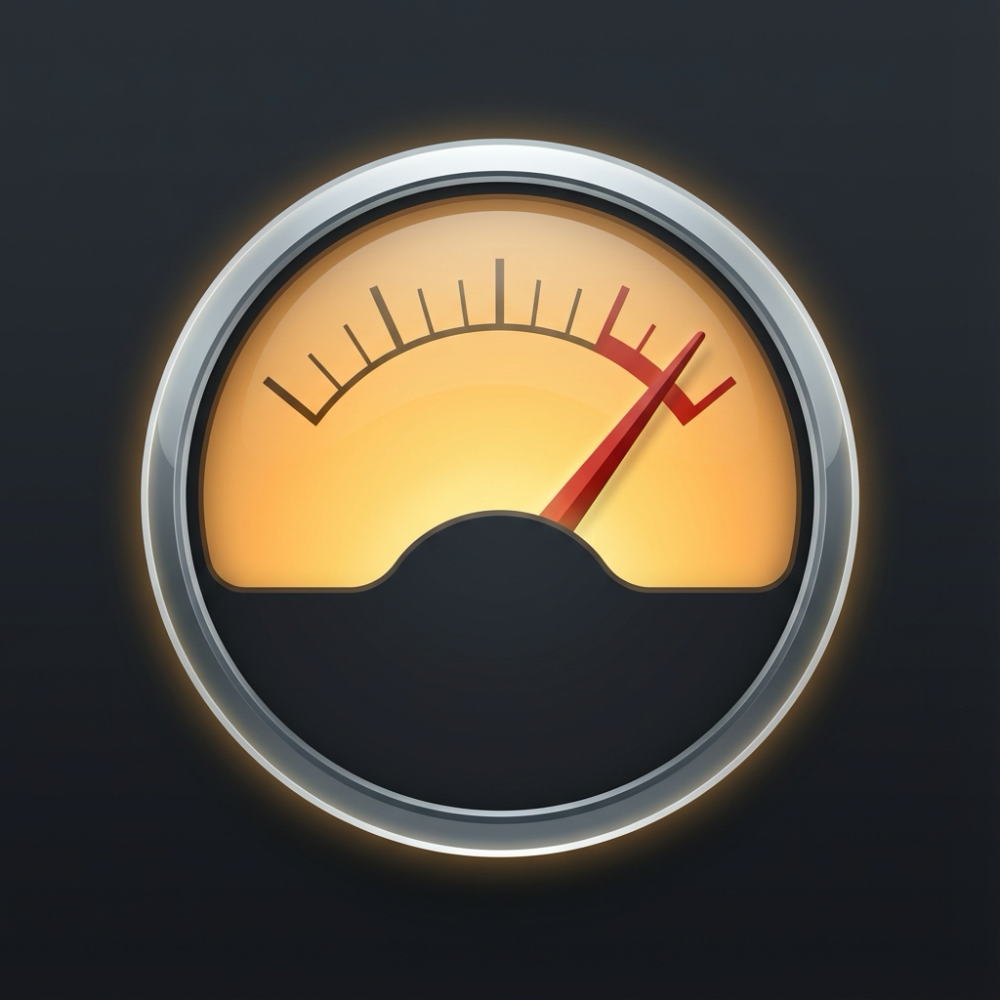

# Fluttery

Fluttery is a desktop application for servicing tape machines, calibrating turntables, and performing basic signal analysis without dedicated test equipment. It uses your computer's sound card or an external audio interface, and allows you to calibrate speed, measure wow & flutter, calibrate azimuth and measure crosstalk, measure distortion, and much more.

[Read the Fluttery User Manual](fluttery/manual/README.md). It is also available offline from **Help > Fluttery Help** in the app.

## Downloads

[Latest Fluttery release](https://github.com/ashleycox/Fluttery/releases/latest)

| System | x64 | ARM64 |
| --- | --- | --- |
| macOS | [Intel ZIP](https://github.com/ashleycox/Fluttery/releases/latest/download/fluttery-macos-x64.zip) | [Apple silicon ZIP](https://github.com/ashleycox/Fluttery/releases/latest/download/fluttery-macos-arm64.zip) |
| Windows | [x64 installer](https://github.com/ashleycox/Fluttery/releases/latest/download/fluttery-windows-x64.exe) | [ARM64 installer](https://github.com/ashleycox/Fluttery/releases/latest/download/fluttery-windows-arm64.exe) |
| Linux | [x64 AppImage](https://github.com/ashleycox/Fluttery/releases/latest/download/fluttery-linux-x64.AppImage) | [ARM64 AppImage](https://github.com/ashleycox/Fluttery/releases/latest/download/fluttery-linux-arm64.AppImage) |
| Linux (optional Debian package) | [x64 `.deb`](https://github.com/ashleycox/Fluttery/releases/latest/download/fluttery-linux-x64.deb) | [ARM64 `.deb`](https://github.com/ashleycox/Fluttery/releases/latest/download/fluttery-linux-arm64.deb) |

### Platform support

These minimums are based on the runtimes, native libraries and operating-system APIs required by the packaged app. Fluttery may run on older platforms, but this has not been verified.

| System | Minimum requirement |
| --- | --- |
| macOS, Intel | macOS 10.15 Catalina |
| macOS, Apple silicon | macOS 12.3 Monterey |
| Windows, x64 | Windows 8.1 with the Universal CRT update and a compatible x64 Visual C++ v14 runtime |
| Windows, ARM64 | Windows 10 on Arm with the ARM64 Visual C++ v14 runtime |
| Linux, x64 and ARM64 | Ubuntu 24.04 LTS or a compatible GTK 3 desktop with glibc 2.39 or newer and PortAudio |

Additionally, you will require an audio interface or sound card, ideally with a line-level audio input. A microphone input cannot be used with a line-level source such as a tape deck without attenuation. Inexpensive interfaces such as the Behringer UCA202 work well, but the better your interface, the more accurate your results will be. The quality of your interface is especially important if you intend to use the signal analysis features, such as the scope or distortion measurements.

Fluttery can check for new releases automatically. Signed macOS bundles can install updates through Sparkle. A writable Linux AppImage can download and verify its replacement. Windows and Debian package installs open the release page so you can download the new installer or package.

## Features

### Wow, flutter and speed

- Play a reference tone and read the measured frequency, speed error, input level, clipping and signal lock as you adjust the machine. Fluttery can recognise 3,000 and 3,150 Hz test tones automatically, or you can enter the desired frequency based on your test tape or record.
- Read overall peak and RMS or split rotational wow and flutter into separate bands at 6 Hz or a frequency of your choice. Choose IEC/DIN-style peak, AES6 weighted peak, JIS RMS or unweighted measurement. The separate scrape flutter mode measures 200–5,000 Hz of variation using a 12,500 Hz carrier and an input rate of at least 44.1 kHz.
- Set the analogue meters to Auto, 0.1%, 0.4%, 1% or 4% and adjust the needle damping. Use the detector and weighting presets, or set the attack, release, RMS averaging and weighting filter yourself. You can remove steady speed error from the variation reading and let the lock threshold follow the input level.
- Switch between the run history and live flutter spectrum. Check one-second RMS, rolling ten-second maxima, very slow drift from 0.05 to 0.5 Hz, and the estimated frequency and period of repeating speed variation.
- Measure for 10, 30 or 60 seconds, or run continuously. Set a pass/fail limit for repeated checks. Use a built-in measurement profile or save your own. A tape run can end automatically after sustained loss of the reference tone. The tape counter tracks total run time and resets independently of the readings.
- Analyse a test tone recorded in an uncompressed WAV file. Choose the audio channel, and set a start time and duration if you only need part of the recording. Review peak, RMS, speed error and the modulation spectrum, then bring the readings into Results. You can also save live unweighted speed variation as a 32-bit PCM WAV with the steady offset and a record of invalid intervals.

### Tape Decks

- Check playback response from an alignment tape with swept or stepped tones, live or from a WAV recording. Choose the reference frequency and how to combine repeat readings. Both channels share a reference level, so a mismatch stays visible. Automatic stop can leave the silent tail out of a live capture.
- Check the recording path with a sweep, white noise or pink noise. Measure off tape on a three-head deck, or save the test signal, record it, rewind and measure playback on a two-head deck. You can reopen the original test WAV and a recorded return. Sweep analysis can follow changes in tape speed, and pinned traces let you compare settings such as record level.
- Adjust head azimuth against a test tone. Read phase, stability and channel delay in microseconds alongside your chosen tolerance. Use a live history or XY trace, listen to left minus right, and measure or enter the interface offset. A second test frequency helps resolve ambiguous phase readings.
- Measure or enter each channel’s bias peak, then adjust for the overbias drop specified for the tape. Match record level against a source reference and compare sensitivity, third-harmonic distortion and broadband response.

### Turntables and phono stages

- Check platter speed from a test record. Set the speed the record was cut for and the speed you’re playing it at independently. Both offer 16⅔, 33⅓, 45, 78 or a custom RPM, with a choice of 78.26 or 78.00 RPM for the 78 setting. Follow the last 30 seconds against the nominal speed and record a run to keep its minimum, maximum and average RPM.
- Read live left and right levels, then capture stereo separation in both directions. Read leakage, phase and the noise floor. If leakage is too quiet for an exact reading, Fluttery gives a minimum separation. Other tests cover centre-zero channel balance, stereo tracking distortion, rumble and mains hum, and low-frequency tonearm and cartridge resonance.
- Use the test-record assistants to compare anti-skate, tracking force, vertical tracking angle and stylus rake settings. Keep labelled trials for each groove or test level, and compare channel distortion or two-tone intermodulation as you make adjustments.
- To compare phono loading, play the same reference tone from your test record at each resistance or capacitance setting. Then play the other test tones. Fluttery compares their levels with the reference measured at that setting, so you can see how loading changes the frequency response. For phono gain, compare level, balance, noise and headroom. The assistants keep test settings with the readings, show live and captured plots, and save test results to the session for later recall.

### Oscilloscope, spectrum and distortion

- View raw audio, demodulated speed variation or stereo XY phase. Set the timebase and vertical scale. For raw audio, choose either input or both and read the scale in calibrated volts or digital full scale. Freeze a trace to inspect it. Live readings include RMS, peak and stereo correlation.
- Trigger on a rising or falling edge, with a choice of input, threshold, hysteresis and how much of the waveform to keep before the crossing. Auto, Normal and armed Single modes cover free-running, repeated and one-off captures.
- The Distortion Analyzer finds the fundamental and reads THD, THD+N and the third harmonic. View an FFT or individual fitted harmonics, pause to examine a reading, and resume recording into the session.
- For noise and other spectra, choose the FFT length and window. Average successive blocks or hold the peak in every bin. Measure stereo two-tone intermodulation with SMPTE, DIN or CCIF settings or frequencies of your own. Use an external test signal or let Fluttery generate one and measure the return.
- Run stepped stereo THD and THD+N tests across frequency or level, with your own settling time and observation time per step. Save the distortion curves and IMD products for review.

### Levels, frequency response and interface calibration

- Measure AC RMS and sample peak with a live level plot. Choose a preset or custom bandwidth and observation window. Calibrate each channel from a known voltage or enter its factor by hand to read volts, millivolts, dBV and dBu. The calibration follows the input device and sample rate.
- Capture the reference signal and noise separately to measure A-weighted and unweighted signal-to-noise ratios per channel. View the noise spectrum alongside its A-weighted trace to see where hum or other noise sits.
- Measure a device’s response with a logarithmic sweep, white noise or pink noise. View measured and corrected gain, stereo balance, phase, group delay and noise coherence where available. Pin earlier traces for comparison and export the underlying readings to CSV.
- An interface loopback assistant measures gain, phase, delay and the interface’s own noise and distortion where the capture supports it. Watch the return live with input monitoring muted until you confirm you’ve unplugged the loopback cable. Save a named calibration profile for the input device, output device and sample rates used in the test. Apply it with the same setup to correct for the interface’s gain, phase and group delay. You can also adjust the profile’s gain trim.
- Choose the input and output devices independently and record in mono or stereo. Use the device’s default sample rate or select a preset up to 192 kHz. Calibrate the sample clock with an independent reference tone, and match the input channels automatically or by entering trims. Monitor stereo, either channel, the mono average, the channel sum or left minus right.

### Test tones, noise and sweeps

- Generate sine, square, triangle or sawtooth waves, plus white and pink noise. Use a common reference or a frequency of your own. Preview the signal silently, set the output level and pan, and set a modulation rate and depth to simulate wow and flutter. Internal loopback can feed the analysis tools directly to assess accuracy or for comparison results.
- Design a linear or logarithmic sweep in either direction. Start with the audible range, bass, midrange, treble or turntable resonance, or enter your own range, duration and amplitude. The preview plots frequency or level over time.
- For a more involved sweep, set rules at specific frequencies. Switch waveform, change the frequency curve, or take the amplitude to a new level in a step or along a linear or logarithmic ramp.
- Play a sweep through the selected output and use internal loopback to send it to the analysis tools. Export it as a mono or stereo WAV at your chosen sample rate in 16-, 24- or 32-bit PCM. Named presets keep the sweep, its rules and the WAV settings together. Edit, rename or delete your presets as needed.

### Plots and image export

- Hover or click to inspect a reading, drag to pan, and Shift-drag to zoom into an area. Use the keyboard to move between values and traces. In a spectrogram, move through time and frequency to read the level in decibels. Set exact axis limits, undo a view change, hide or isolate traces, and set A and B markers to read the difference.
- Set the plot canvas independently of the app appearance. Pick the trace colours and weight, and decide when to show sample dots, grid lines and the legend. Spectrograms have their own colour palette and level range.
- Copy a plot as a PNG or save it to disk. Export the current view or the full range as PNG, SVG or PDF, with your choice of size, resolution and background, including transparency. Set the title and choose whether to include the grid, legend or markers. Save those options as defaults if you use them often.

### Sessions and reports

- Start a quick measurement straight from the instrument. Keep it in a Fluttery session, or export JSON you can reopen later. Results shows wow and flutter over time, an FFT and spectrogram, speed drift, sample tables and statistics. It also holds individual instrument captures and a distortion timeline that includes turntable tracking. Overlay a second session to compare wow and flutter or speed drift, and read the numerical differences.
- Keep a compact history for quick checks, or opt in to complete readings, earlier runs, detailed signal-loss intervals and lossless original input audio. Select an earlier run to view or report on it. Export the retained audio as WAV or as a ZIP of segments, or remove it while keeping the readings.
- When a saved run used different settings, review the recorded and current values side by side. Fluttery checks the recorded devices and audio format before offering related calibrations. Apply compatible differences individually or together, for this session or as your new defaults.
- Export CSV or JSON, save or print a PDF, or make a standalone HTML report with zoom and keyboard access to chart values. A ZIP collects those formats and the available graph images. Choose the sections, tables and chart descriptions, and set the paper size, PDF scale and filename pattern. Reports can include a logo, equipment details, a technician’s name and session notes.
- Check device and signal status, analysis timing and dropouts in Diagnostics. Turn on logging when you need it, especially useful for diagnostics, and copy, save or clear the log.

### Desktop, keyboard and help

- Use separate instrument windows or one tabbed workspace. Both have native menus, toolbars and commands for the current tool. Open the relevant Settings pane from an instrument or choose your startup tool and the default Turntable and Results views in the separate Settings window.
- Read a textual, screen-reader-friendly copy of the current measurements or use the keyboard to explore the underlying plot values. Turn on expanded chart descriptions, tooltips and help tags, and spoken status announcements where supported for clear descriptions of measured results.
- Open **Keyboard Commands** with `Command+Shift+K` on macOS or `Control+Shift+K` on Windows and Linux. Search for an action or control, or use the two-letter shortcuts for the current window. Use `Command+Shift+H` or `Control+Shift+H` to describe the focused control.
- Follow the system’s colour mode or choose light or dark, and adjust text size from the View menu. Modern, Retro hi-fi, Soft contours and High contrast each have their own styling and synthesised switch and transport sounds. Turn sounds off altogether or control the focus cue and tape-counter sounds separately.
- A first-launch Setup Wizard introduces the app and walks through update preferences and every settings page. Reopen it from **Help**. The searchable offline manual has illustrated workflows and separate references for settings and platform shortcuts.

## Contributing

Fluttery is developed by [Ashley Cox](https://ashleycox.co.uk) and is open-source software licensed under the [GNU General Public License, version 3](LICENSE). I welcome code contributions, see [contributing.md](contributing.md)

Fluttery is provided without gaurantee as to its accuracy or suitiblity. Measurement accuracy depends on your computer's harddware, sound card or audio interface, and analogue test media.

## Support Fluttery

If you like Fluttery and you’d like to support my work, you can [make a donation](https://www.paypal.com/donate/?hosted_button_id=WMLX4PLED9PRE). There’s no pressure or hard sell. Fluttery is and always will be free.
