# Getting started

## Install or update Fluttery

Download the version for your operating system and processor. For the oldest supported versions, see the platform support table. [Fluttery releases](https://github.com/ashleycox/Fluttery/releases/latest) · [Platform support](https://github.com/ashleycox/Fluttery#platform-support)

<!-- platform: macos -->
### macOS

1. Unzip the macOS download.
2. Move **Fluttery.app** to **Applications** or your personal Applications folder and open it from Finder.
3. When you first start the audio input, macOS may ask for microphone access. Choose **Allow** so Fluttery can use your interface. You can change this later under **Privacy & Security > Microphone** in System Settings. On older versions of macOS, look under **Security & Privacy** in System Preferences.
4. To check for a new version, choose **Help > Check for Updates…**. Follow the prompts if Fluttery offers to install it. If the release page opens, download the matching Mac version and replace the app in Applications.
<!-- endplatform -->

<!-- platform: windows -->
### Windows

1. Open the installer. Review the GPL licence, choose installation for your account or all users, then choose the location and Start menu folder.
2. Select **Desktop shortcut** if you want an icon on the desktop.
3. If the installer asks for the Visual C++ runtime, open the Microsoft page it offers. Choose the redistributable for your processor and version of Windows.
4. On the final page, you can choose **Launch Fluttery** or **Read the Fluttery user manual**. You can also find **Fluttery Help** in the Start menu folder you chose.
5. Check for a new version under **Help > Check for Updates…**. If an update is available, open the release page and download the matching installer. Close Fluttery before running it. To update your existing copy, choose the same folder and install for the same users.
<!-- endplatform -->

<!-- platform: linux -->
### Linux

1. If you downloaded an AppImage, use your file manager’s permissions dialog to allow it to run as a program. Move it to the folder where you plan to keep it before opening it. Fluttery can download and verify an update if it can write to the AppImage file.
2. If using a Debian package, install it with your package manager and start Fluttery from the desktop menu. **Help > Check for Updates…** opens the release page when you choose to get an update.
<!-- endplatform -->

## Use the Setup Wizard

1. Choose **Next** on the welcome page. You can also open **User Manual…** or use the links to Fluttery on GitHub and Ashley Cox’s website.
2. Choose whether to turn on **Automatically check for updates**, then choose **Next**.
3. Work through **General**, **Audio I/O**, **Measurement**, **Calibration**, **Graphs**, **Reports** and **Diagnostics**. The number of pages depends on your window and text size. **Next** saves your choices for that page. Use **Back** to return to the previous page. You can also press `Return` to continue, unless the focused control uses that key.
4. Choose **Finish** when you’re done. **User Manual…** is also available on the last page. If you need to close the wizard earlier, **Set Up Later** keeps anything you’ve already saved.

You can reopen setup from **Help > Setup Wizard…** or change any individual setting in the Settings window.

<!-- figures -->
<!-- platform: macos -->
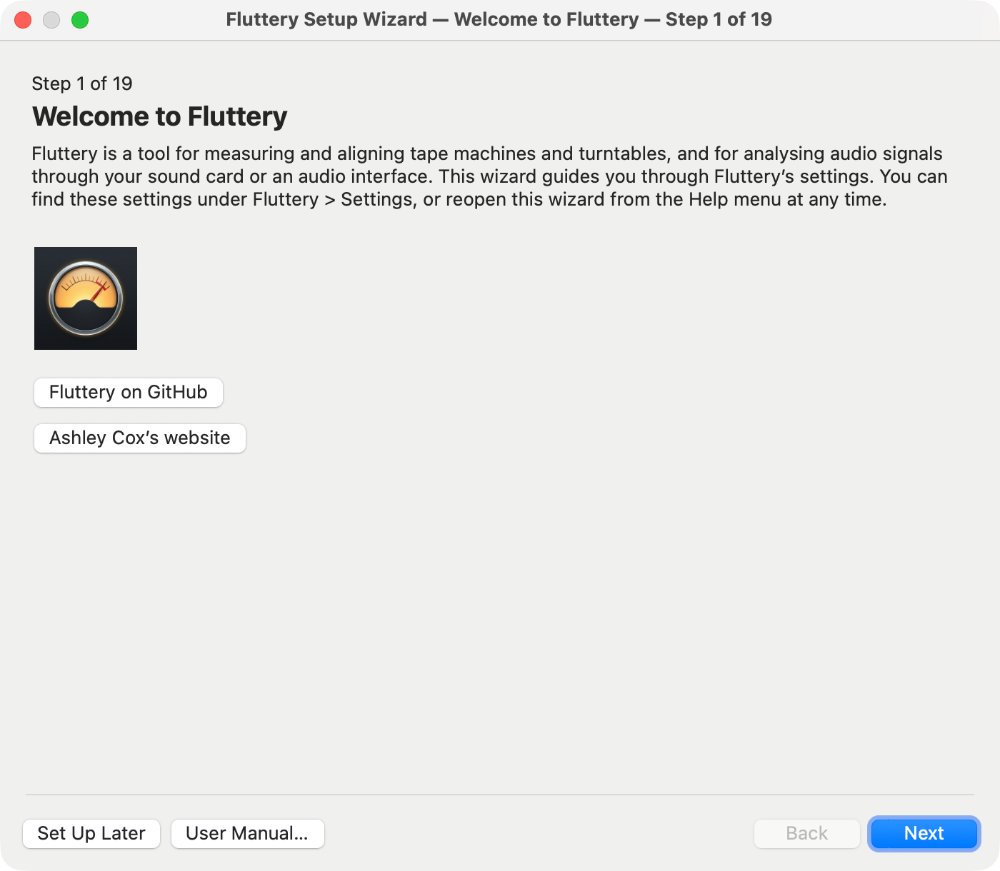
<!-- endplatform -->

<!-- platform: windows -->

Windows illustration

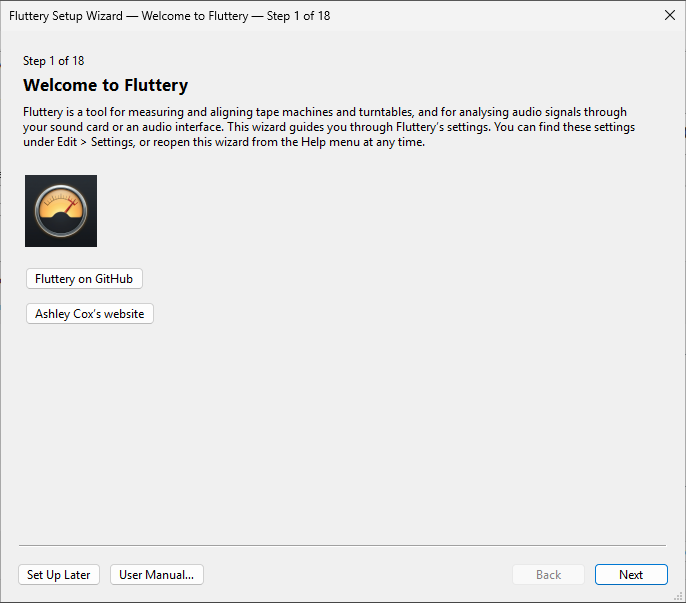

<!-- endplatform -->

<!-- platform: linux -->

Linux illustration

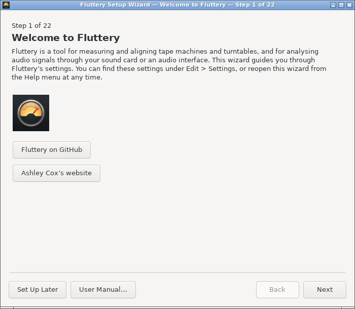

<!-- endplatform -->

<!-- platform: macos -->
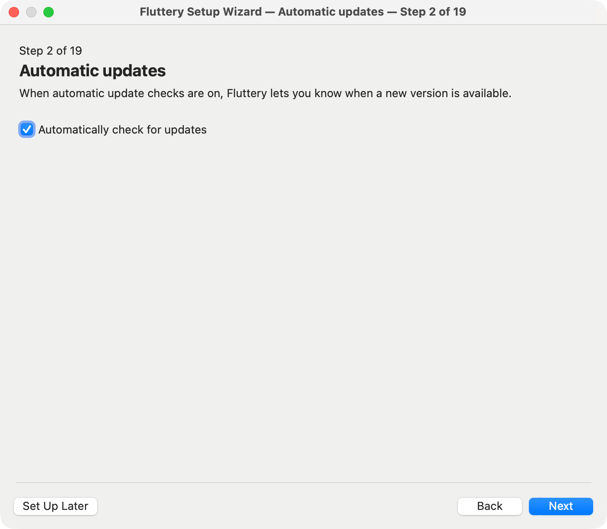
<!-- endplatform -->

<!-- platform: windows -->

Windows illustration

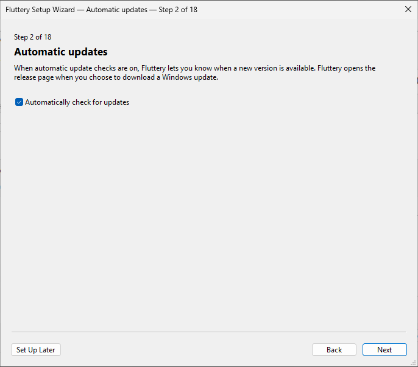

<!-- endplatform -->

<!-- platform: linux -->

Linux illustration

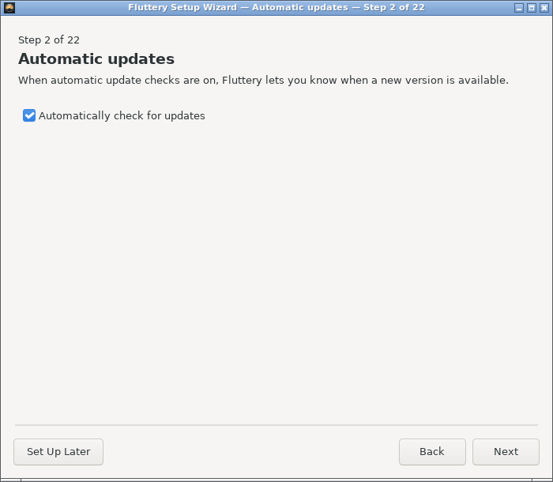

<!-- endplatform -->

<!-- platform: macos -->
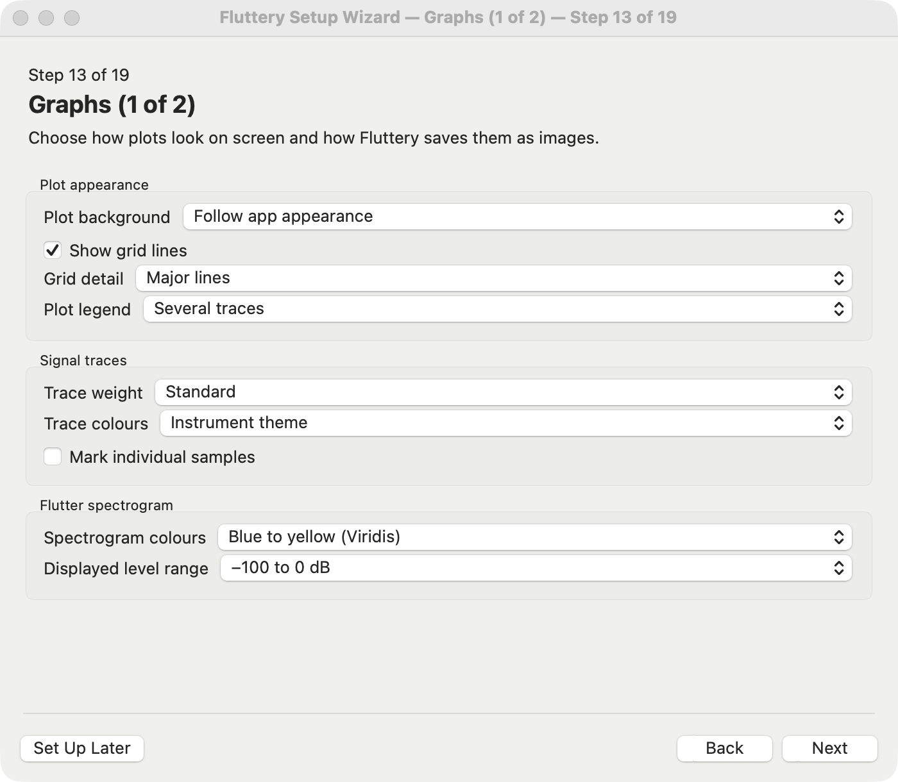
<!-- endplatform -->

<!-- platform: windows -->

Windows illustration

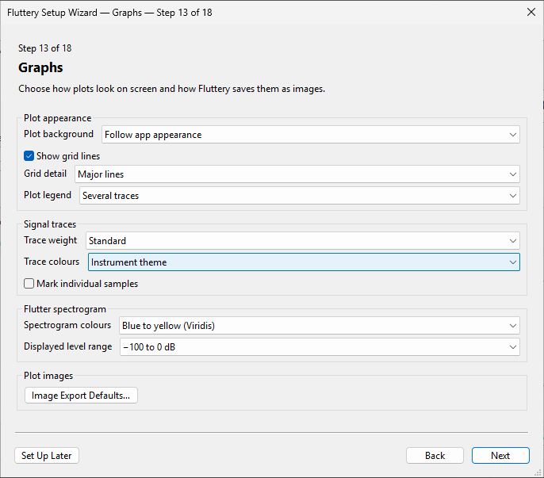

<!-- endplatform -->

<!-- platform: linux -->

Linux illustration

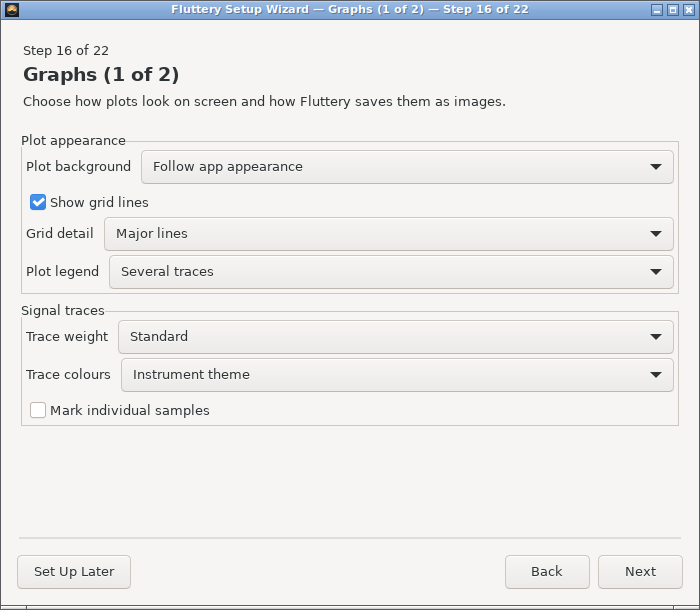

<!-- endplatform -->

<!-- platform: macos -->
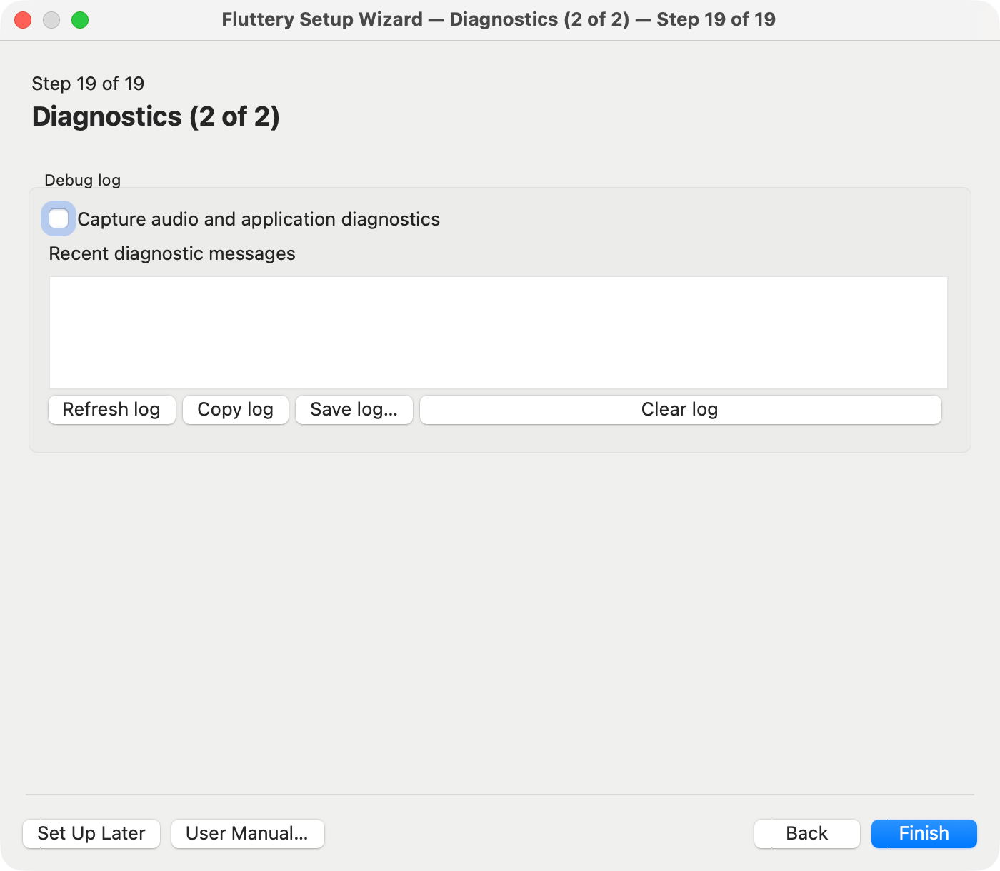
<!-- endplatform -->

<!-- platform: windows -->

Windows illustration

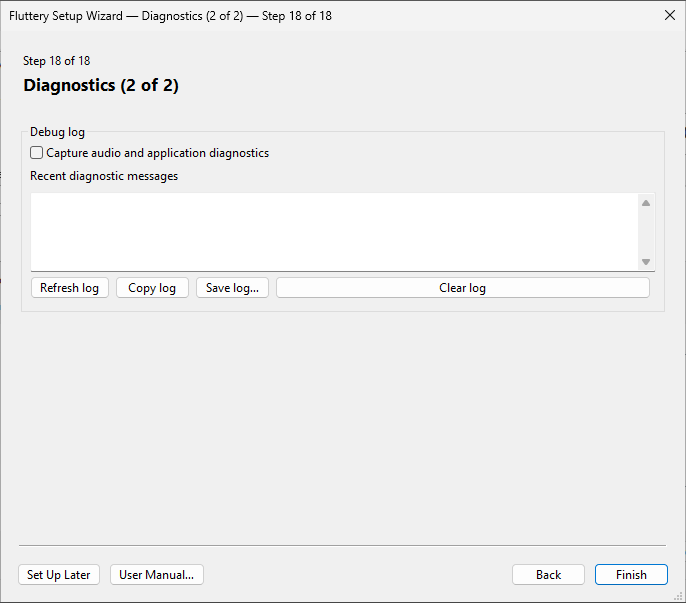

<!-- endplatform -->

<!-- platform: linux -->

Linux illustration

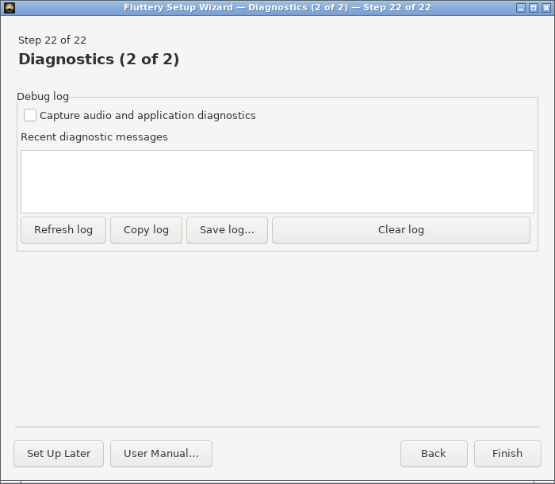

<!-- endplatform -->
<!-- endfigures -->

## Connect an audio interface

1. Connect the equipment’s line output to the interface’s line input. If the equipment has an output level control, start with it set low. Use both inputs for stereo work. A microphone input may overload on a line signal.
2. Choose **Tools > Audio > Audio Settings…**. Select **Audio input**, **Audio output**, **Input channels** and **Sample rate**. **Device default** uses the capture device's default sample rate. **Refresh device list** rescans attached interfaces.
3. Choose **Apply Settings**, then **Start live input**. Play the test tone. Adjust the equipment’s output level, if it has a control, or raise the gain at the interface until the signal is clear and below clipping.
4. To hear the hardware input, enable **Play the input through the selected output**. Use headphones or an isolated output, start with a low **Monitor volume (0 to 1)** and choose the routing under **Monitor channels**.
5. When you’ve finished, choose **Tools > Audio > Stop Live Input**. You can start and stop the input by hand even if **Start live input when opening measurement tools** is on.

<!-- figures -->
<!-- platform: macos -->
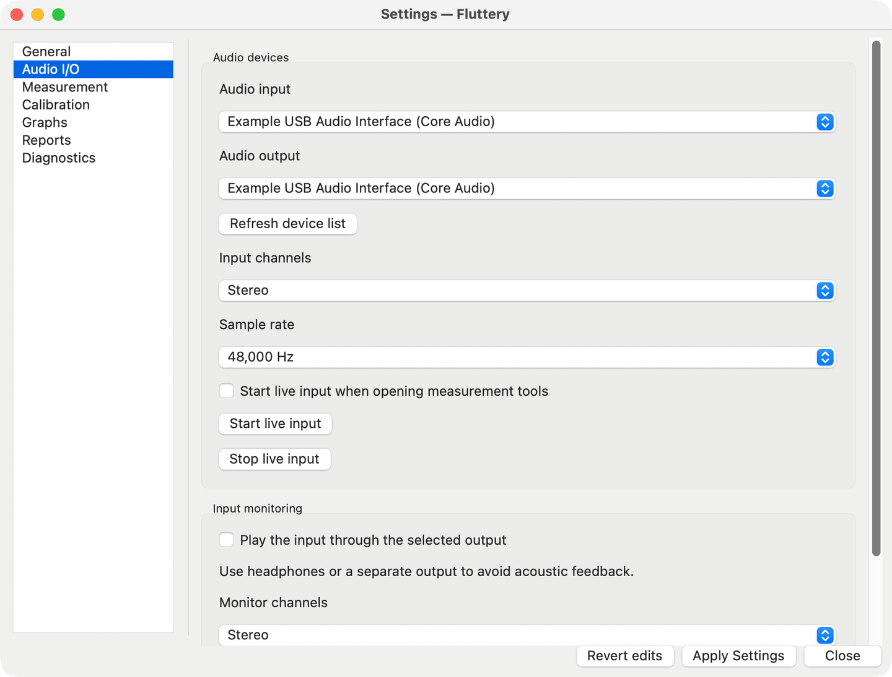
<!-- endplatform -->

<!-- platform: windows -->

Windows illustration

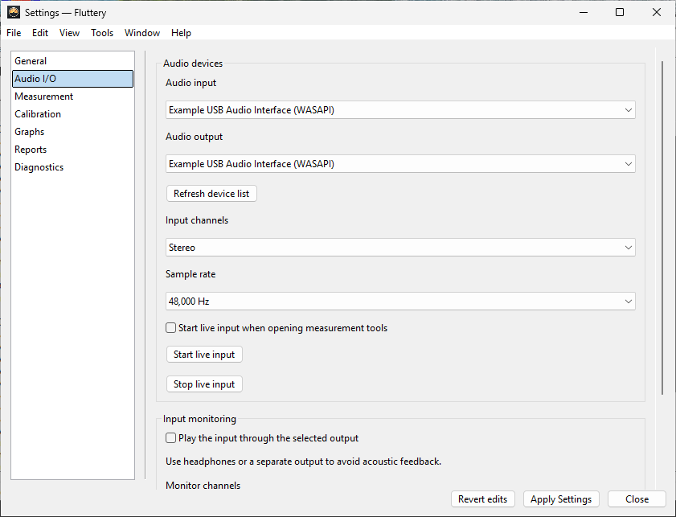

<!-- endplatform -->

<!-- platform: linux -->

Linux illustration

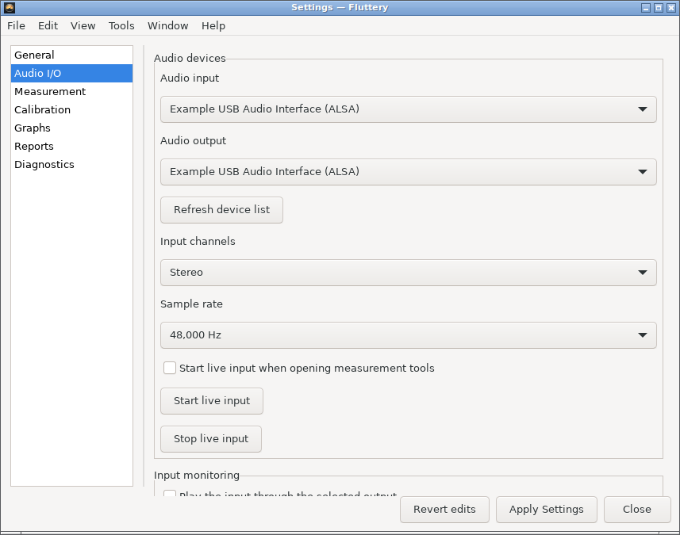

<!-- endplatform -->
<!-- endfigures -->

## Try a measurement without equipment

1. Open **Window > Signal Generator**. Set **Frequency standard** to **3150 Hz** and **Waveform** to **Sine**.
2. Choose **Options**, select **Enable Internal Loopback**, set **Output volume (%)** and choose **Start Generator**. Loopback sends the signal straight to Fluttery. You may also hear the tone if you’ve selected an available audio output.
3. Choose **Window > Wow & Flutter**. It uses the reference set by the generator. Choose **Start Measurement**, wait for a locked reading, then choose **Stop Measurement**.
4. Return to **Window > Signal Generator** and select **Enable Frequency Modulation**. Set **Modulation frequency (Hz)** to 4 and **Modulation depth (%)** to 0.25. Start another measurement in **Wow & Flutter**. The meter and history graph will show the variation.
5. Stop the measurement. Open **Window > Session Results** and choose **Spectrum (FFT)** under **Show** to find the peak at the modulation frequency. Stop the generator when you’re done. To keep the run, choose **File > Save Session**. For the steps to measure a tape deck or turntable, see [Wow and flutter](03-measure.md).

To keep the generator controls and the meter visible at the same time, use **File > New Window** before starting a measurement and display a different tool in each window.

<!-- figures -->
<!-- platform: macos -->
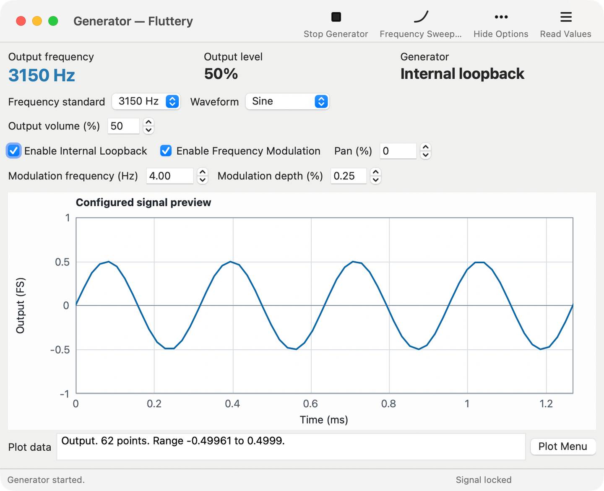
<!-- endplatform -->

<!-- platform: windows -->

Windows illustration

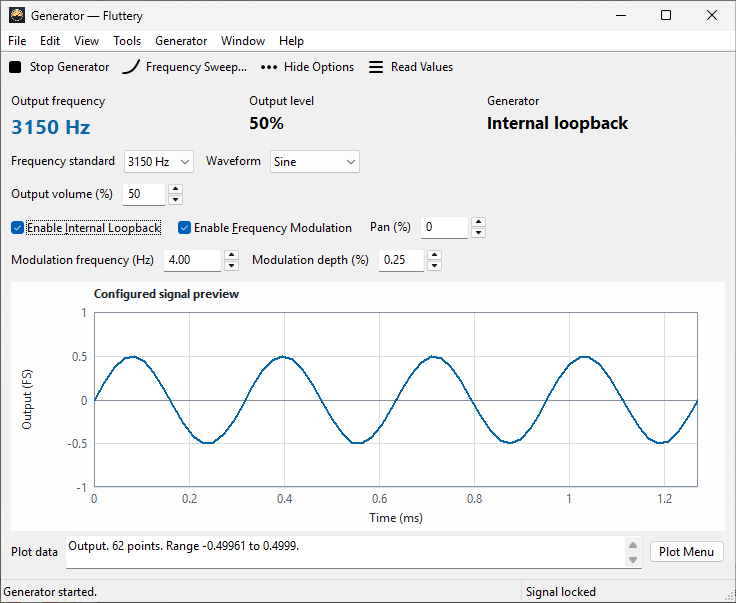

<!-- endplatform -->

<!-- platform: linux -->

Linux illustration

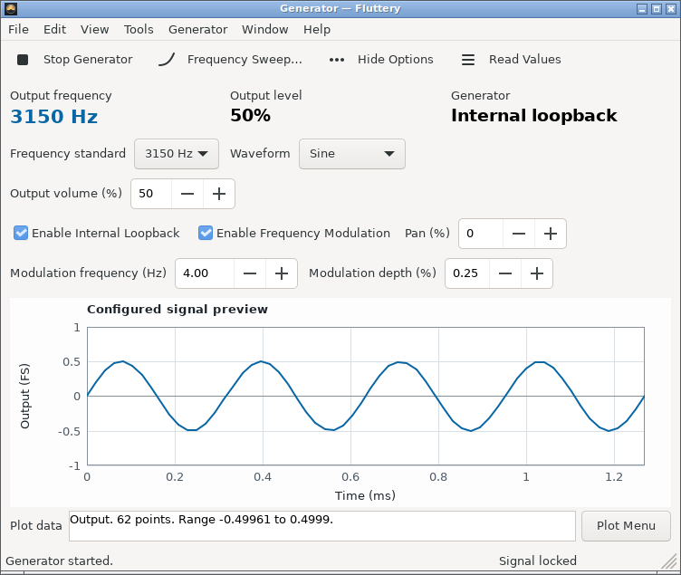

<!-- endplatform -->
<!-- endfigures -->

## Keyboard shortcuts

| Command | macOS | Windows and Linux |
| --- | --- | --- |
| Open Fluttery Help | `F1` | `F1` |
| Move forward or back through installer or wizard controls | `Tab` or `Shift+Tab` | `Tab` or `Shift+Tab` |
| Use the focused button or checkbox | `Space` | `Space` |
| Close the wizard | `Escape` | `Escape` |
| Open Settings | `Command+,` | `Control+,` |
| Open Wow & Flutter | `Command+1` | `Control+1` |
| Open Signal Generator | `Command+5` | `Control+5` |
| Open Session Results | `Command+6` | `Control+6` |
| Start or stop the measurement | `Command+Shift+Space` | `Control+Space` |
| Read Current Values | `Command+Shift+R` | `Control+Shift+R` |
| Open Keyboard Commands | `Command+Shift+K` | `Control+Shift+K` |
| Save Session | `Command+S` | `Control+S` |

In **Keyboard Commands**, search for **Audio Settings**, **Start Live Input** or **Stop Live Input**.

## Support Fluttery

If you like Fluttery and you’d like to support my work, you can [make a donation](https://www.paypal.com/donate/?hosted_button_id=WMLX4PLED9PRE). There’s no pressure or hard sell. Fluttery is and always will be free.
