# Workspace and accessibility

## Open and arrange tools

1. Choose a tool from the **Window** menu. **Wow & Flutter**, **Oscilloscope**, **Turntable**, **Distortion Analyzer**, **Signal Generator** and **Session Results** open in the current window. **Settings** opens in its own window.
2. To keep two tools open side by side, use **File > New Window**. Both windows share the same session. If you choose a tool that’s already open in the other window, Fluttery swaps the tools between the two windows.
3. Choose **View > Workspace Layout** to switch between **Single Tool per Window** and **Tabbed Workspace**. In the tabbed layout, the **Window** menu also lets you switch tabs. You can still open a tool in its own window.
4. If you try to change tools during a measurement, **Stop and Switch** ends the measurement and opens the other tool. **Keep Current Tool** leaves the measurement running.
5. Use the toolbar or the instrument’s menu for controls such as **Waveform** and **XY Phase** in **Scope**. The **Turntable** menu lists its six tests. When you switch tabs, the menu changes to match the instrument.
6. Use **Tools** for cartridge, tape deck and calibration assistants, signal tests and audio input commands. **Quit Fluttery** is in the **Fluttery** menu on macOS and the **File** menu on Windows and Linux. On Windows and Linux, closing the last window also quits the app.

Choose **File > New Session** when you want a separate set of measurements in a new session window. Choose the startup tool and default Turntable and Results views in **Settings > General**.

<!-- figures -->
<!-- platform: macos -->
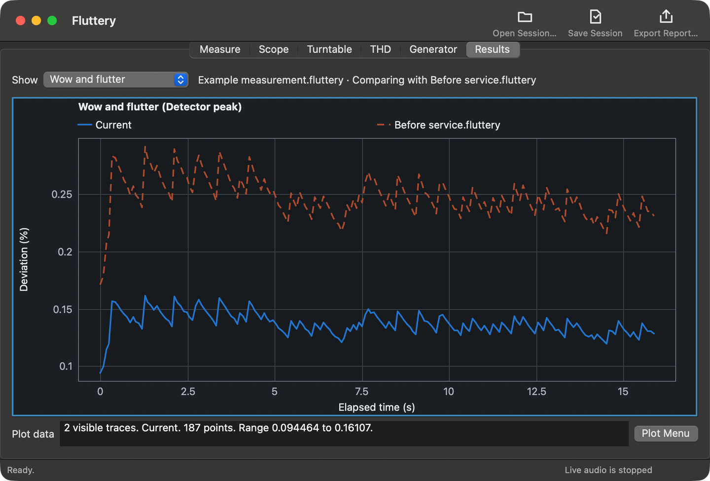
<!-- endplatform -->

<!-- platform: windows -->

Windows illustration

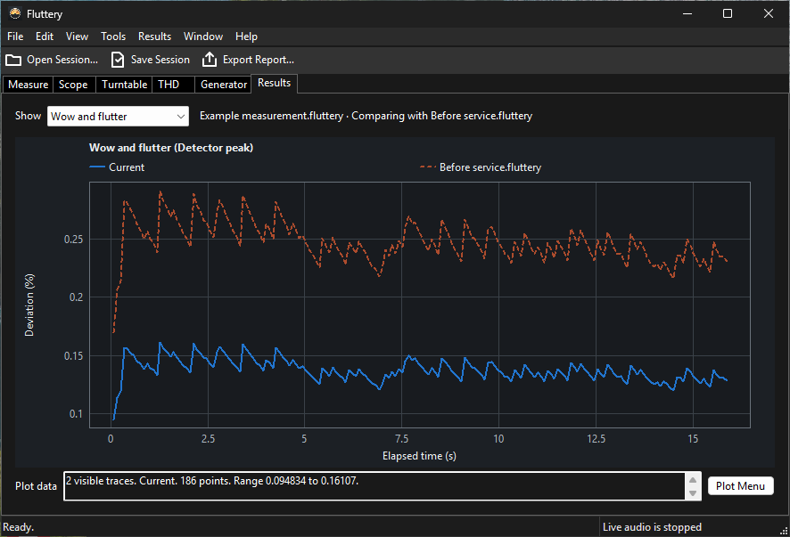

<!-- endplatform -->

<!-- platform: linux -->

Linux illustration

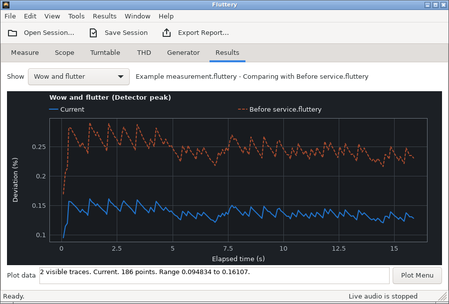

<!-- endplatform -->
<!-- endfigures -->

## Find any command or control by keyboard

1. Open **Help > Keyboard Commands…**. You’ll find the commands and controls for the current window.
2. Search for what you want to use. Try `Compare`, `Refresh` or `Default technician`.
3. Use `F6` to move between search and the choices, `Up Arrow` or `Down Arrow` to select a command and `F7` to read its description.
4. Press `Return` to use the selected command, or type its two-letter code while the list has focus. The codes depend on which commands and controls are available, so check the list in the window you’re using.
5. Use **Help > Describe Focused Control…** to read the help tag for the current control. **View > Read Current Values…** opens a copy of the active tool’s readings that stays still while you read it.

In **Settings**, use the arrow keys to choose a category, then press `Tab` to move to its settings. Use **Apply Settings** to save your changes. **Revert edits** takes you back to the last settings you applied. **Close** returns you to the previous tool.

## Set appearance, sounds and spoken feedback

1. Open **Settings > General**. Choose **Colour mode** and **Instrument appearance**. The instrument theme also controls the switch, transport and counter reset sounds.
2. Change **Interface text size (%)** here or use the **View** menu to change or reset the size from a tool window.
3. Turn on **Play interface sounds** to hear the controls. You can turn the focus sound on or off separately with **Play a quiet cue when a control receives focus**.
4. Use **Show tooltips and help tags** for help with individual controls. For more detail when reading graphs, turn on **Show expanded text descriptions for graphs**. On supported platforms, **Announce important status changes** reads out changes to devices and measurements.
5. Choose **Apply Settings**.

## Explore a graph

1. Move the pointer over the graph, or focus it with `Tab` and use the arrow keys. Left and Right step between points. Up and Down change the trace or spectrogram frequency. `Page Up` and `Page Down` take larger steps. Press `Return` to focus **Plot data** and read the exact values.
2. Click a point to select it. To compare two readings, choose the first point and press `A`, then choose the second and press `B`. The plot marks both readings and **Plot data** gives their difference. Press `Escape` to clear the markers. Pause or freeze a changing instrument when you need to inspect one capture at your own pace.
3. Drag to pan or hold `Shift` while dragging to zoom to a rectangle. Scroll over the plot to zoom around the pointer. Hold `Shift` while scrolling to zoom the horizontal axis only. Press `V` to enter exact axis limits, `Backspace` to return to the previous view, or `Home` to restore the default view.
4. Click a legend entry to show or hide that trace. Shift-click to isolate it. To edit visibility by keyboard, choose **Choose Visible Traces…** from the **Plot Menu**. Use **Settings > Graphs** to change the background, line weight, colours, grid, sample markers or legend. The graph background can follow the app or stay light or dark independently. The spectrogram has its own colour and level range.

<!-- platform: macos -->
Hold `Command` while scrolling to zoom the vertical axis only. Shift-click a point to set marker A. Command-click to set B.
<!-- endplatform -->
<!-- platform: windows, linux -->
Hold `Control` while scrolling to zoom the vertical axis only. Shift-click a point to set marker A. Control-click to set B.
<!-- endplatform -->

<!-- figures -->
<!-- platform: macos -->
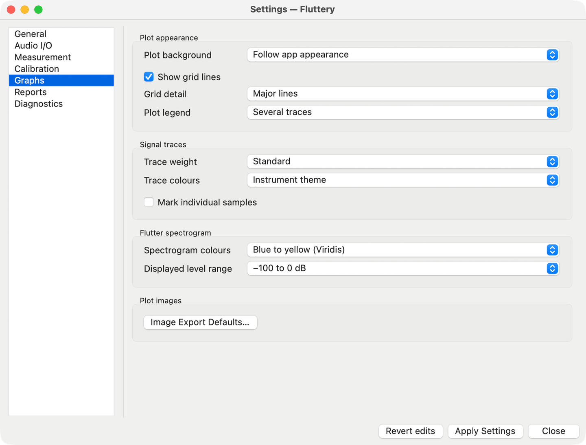
<!-- endplatform -->

<!-- platform: windows -->

Windows illustration

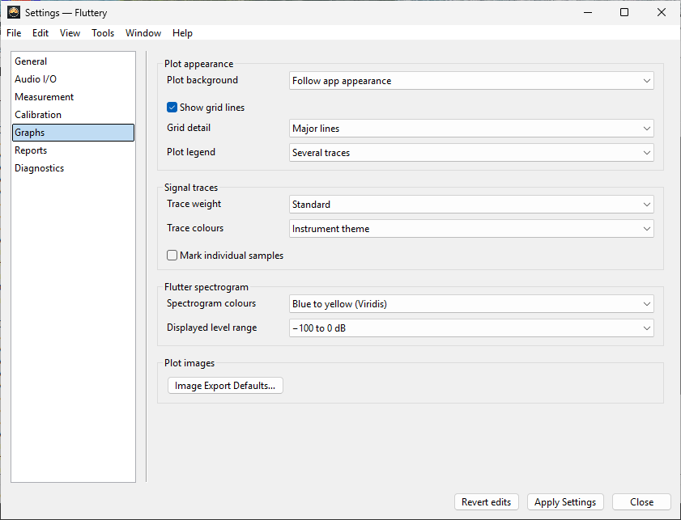

<!-- endplatform -->

<!-- platform: linux -->

Linux illustration

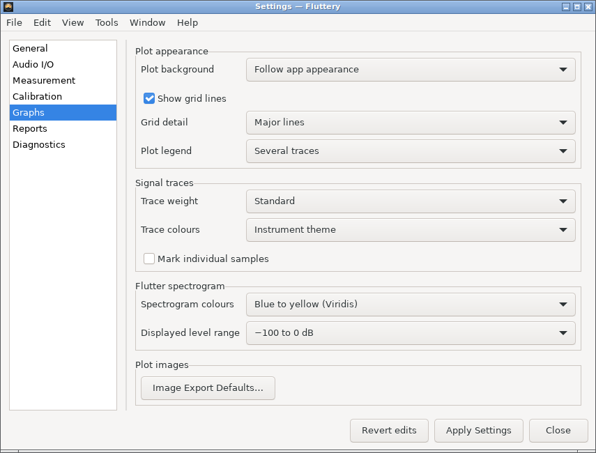

<!-- endplatform -->
<!-- endfigures -->

<!-- figures -->
<!-- platform: macos -->
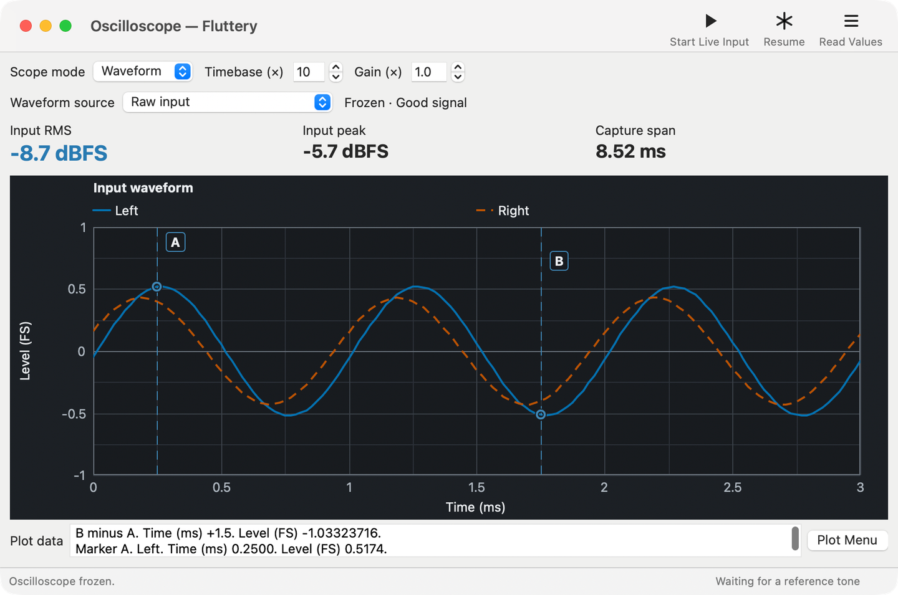
<!-- endplatform -->

<!-- platform: windows -->

Windows illustration

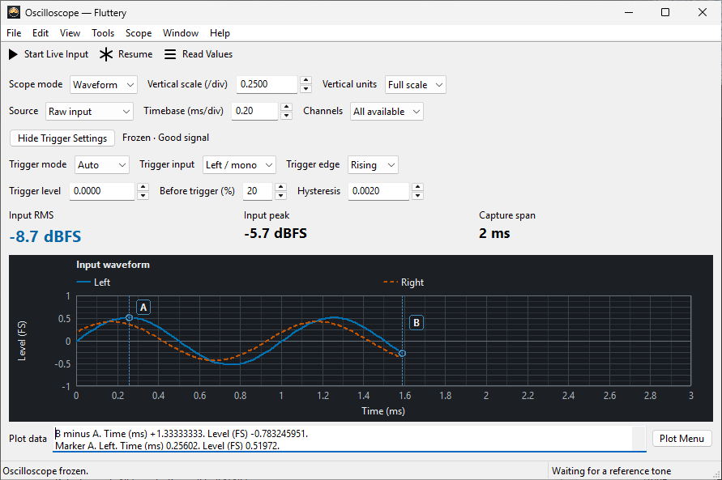

<!-- endplatform -->

<!-- platform: linux -->
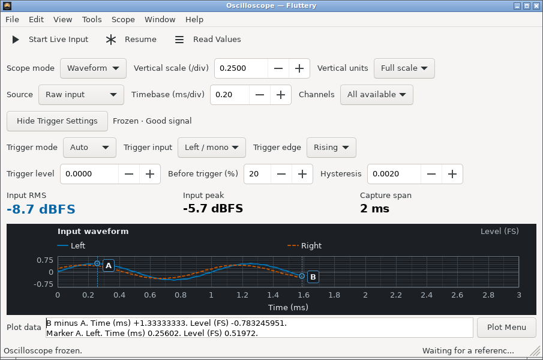
<!-- endplatform -->
<!-- endfigures -->

## Save or copy a plot image

1. Set up the plot as you want it in the image. Zoom in, choose the traces and set any comparison markers. Fluttery takes a copy of that view when you open the export command, so live readings won’t change the image while you choose a filename.
2. Use **Plot Menu > Copy Plot Image** to copy a PNG to the clipboard, or **Quick Save PNG…** to save one to a file. Both use the defaults in **Settings > Graphs > Image Export Defaults…**.
3. Open **Save Plot Image…** to choose the format, size or print resolution. PNG saves the plot as pixels. SVG and PDF keep the lines sharp when you resize them. The coloured part of a spectrogram stays a pixel image in either format.
4. Choose **Current view** or **Full data range**. Set the background to light, dark, transparent or **Match plot**. Include or hide the title, legend, grid and comparison markers. A transparent image uses dark lettering suitable for a light page.
5. To use these options for future images, select **Use these options as defaults**. Choose **Choose File…** and confirm the destination.

<!-- figures -->
<!-- platform: macos -->
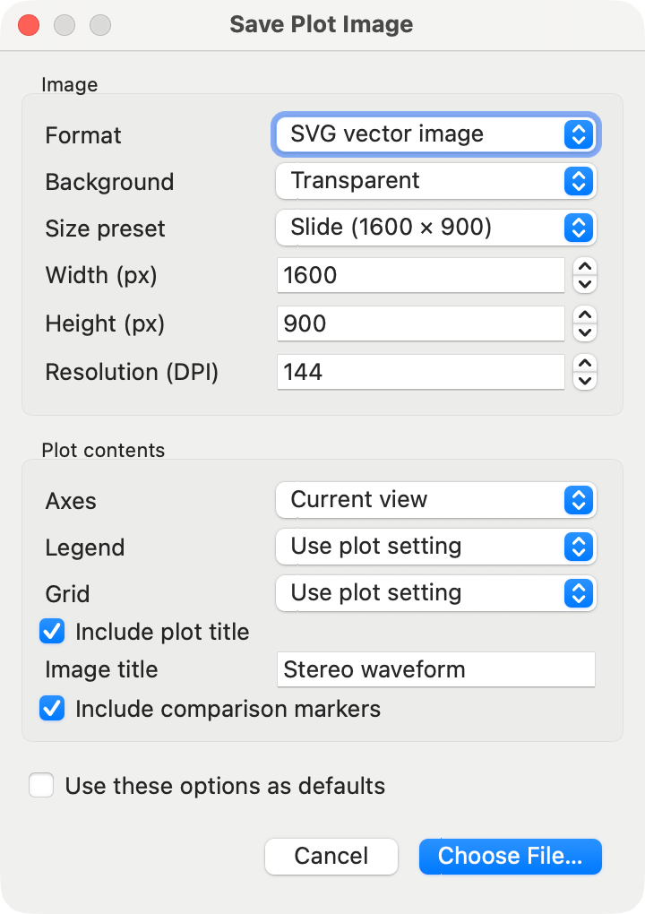
<!-- endplatform -->

<!-- platform: windows -->

Windows illustration

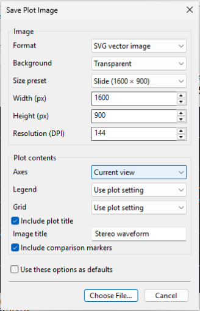

<!-- endplatform -->

<!-- platform: linux -->
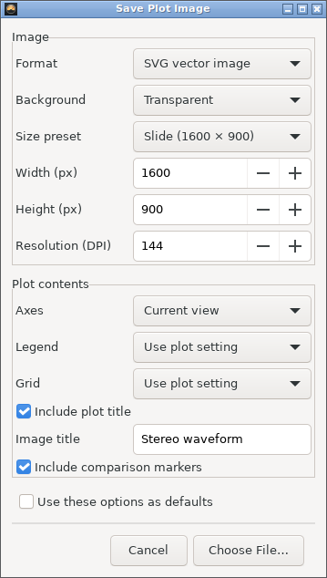
<!-- endplatform -->
<!-- endfigures -->

## Find version information and contact the developer

Choose **About Fluttery** for the version number and project details. On macOS this item is in the **Fluttery** menu. On Windows and Linux it is in **Help**.

Choose **Help > Project Repository** to open Fluttery on GitHub, or **Help > Send Feedback** to start an email. If you’re reporting an audio problem, you can include a diagnostic log. [Collect audio diagnostics](09-troubleshooting.md#collect-audio-diagnostics)

Choose **Help > Donate…** to open the optional donation page in your browser.

## Keyboard shortcuts

| Command | macOS | Windows and Linux |
| --- | --- | --- |
| Switch tools or open Settings from Window | `Command+1` through `Command+7` | `Control+1` through `Control+7` |
| Open Settings directly | `Command+,` | `Control+,` |
| New Window in the same session | `Command+Shift+N` | `Control+Shift+N` |
| New Session in its own window | `Command+N` | `Control+N` |
| Close the current window | `Command+W` | `Control+W` |
| Quit Fluttery | `Command+Q` | `Control+Q` |
| Open Keyboard Commands | `Command+Shift+K` | `Control+Shift+K` |
| Describe the focused control | `Command+Shift+H` | `Control+Shift+H` |
| Read Current Values | `Command+Shift+R` | `Control+Shift+R` |
| Move between controls | `Tab` or `Shift+Tab` | `Tab` or `Shift+Tab` |
| Move between search and the list in Keyboard Commands | `F6` | `F6` |
| Read the selected command description | `F7` | `F7` |
| Run the selected command | `Return` | `Return` |
| Toggle a focused checkbox | `Space` | `Space` |
| Larger Text | `Command+=` | `Control+=` |
| Smaller Text | `Command+-` | `Control+-` |
| Reset Text Size | `Command+0` | `Control+0` |
| Toggle full screen | `F11` | `F11` |
| Move to the previous or next plot point | `Left Arrow` or `Right Arrow` | `Left Arrow` or `Right Arrow` |
| Take larger steps through plot points | `Page Up` or `Page Down` | `Page Up` or `Page Down` |
| Select the first or last plot point | `Shift+Home` or `Shift+End` | `Shift+Home` or `Shift+End` |
| Change trace or spectrogram frequency | `Up Arrow` or `Down Arrow` | `Up Arrow` or `Down Arrow` |
| Read a plot point and any marker differences | `Return` with the plot focused | `Return` with the plot focused |
| Set or clear comparison markers | `A` or `B` to set a marker, `Escape` to clear both | `A` or `B` to set a marker, `Escape` to clear both |
| Pan the plot | `Shift+Arrow` | `Shift+Arrow` |
| Zoom in or out | `+` or `-` | `+` or `-` |
| Enter exact axis limits | `V` | `V` |
| Return to the previous zoom or pan | `Backspace` | `Backspace` |
| Restore the default plot view | `Home` | `Home` |
| Open the Plot Menu | `Shift+F10` with the plot or its data field focused | `Shift+F10` with the plot or its data field focused |

Search for **Copy Plot Image**, **Quick Save PNG** or **Save Plot Image** in **Keyboard Commands**. You can also find **About Fluttery**, **Project Repository**, **Send Feedback** and **Donate** there.

## Support Fluttery

If you like Fluttery and you’d like to support my work, you can [make a donation](https://www.paypal.com/donate/?hosted_button_id=WMLX4PLED9PRE). There’s no pressure or hard sell. Fluttery is and always will be free.
