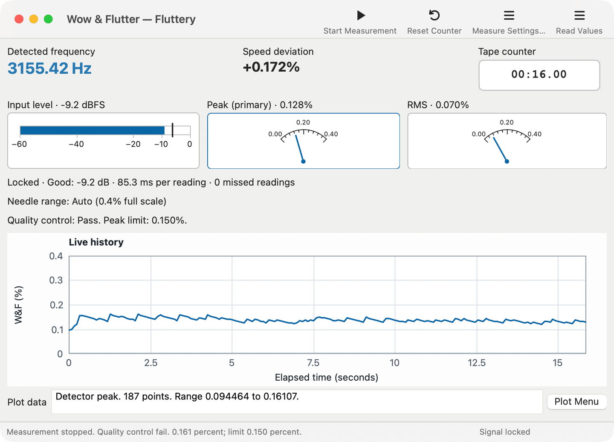
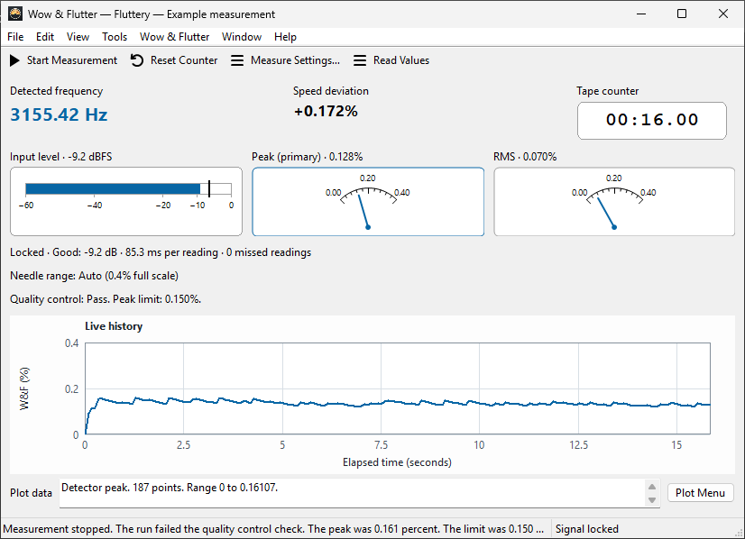
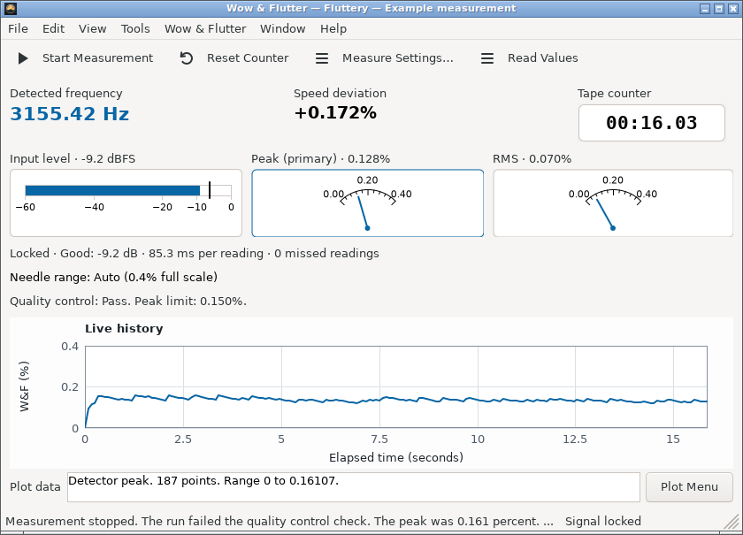
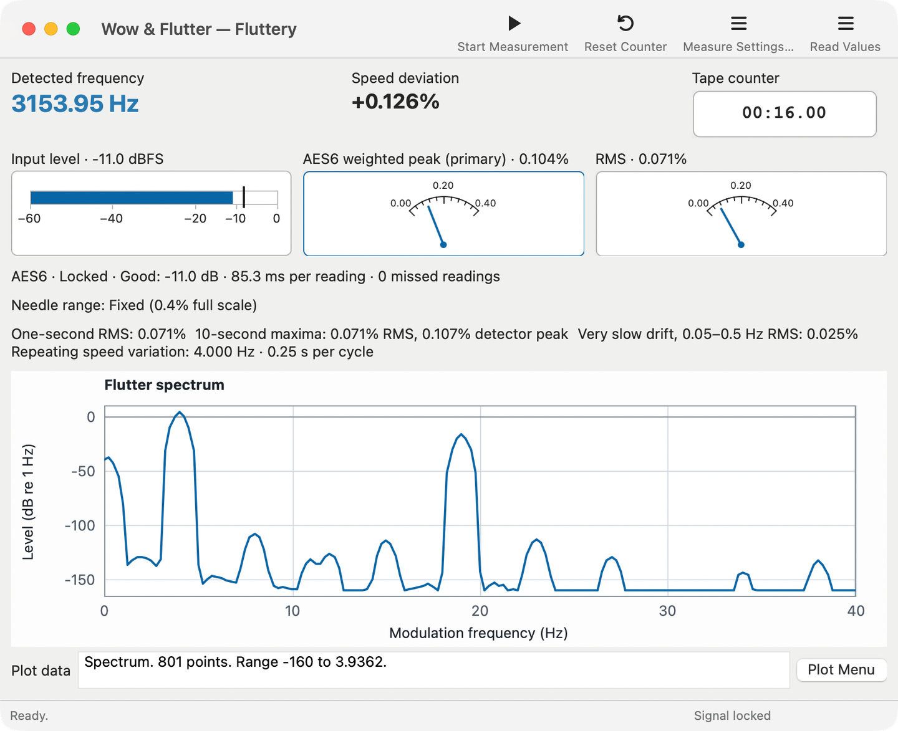
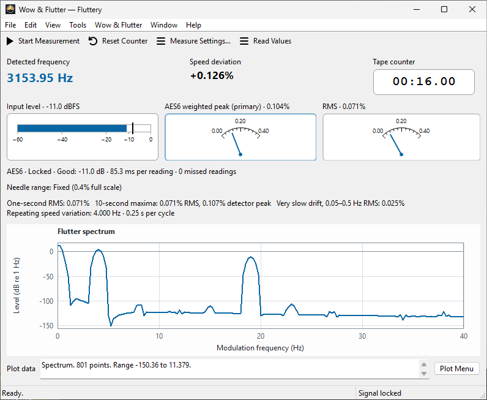
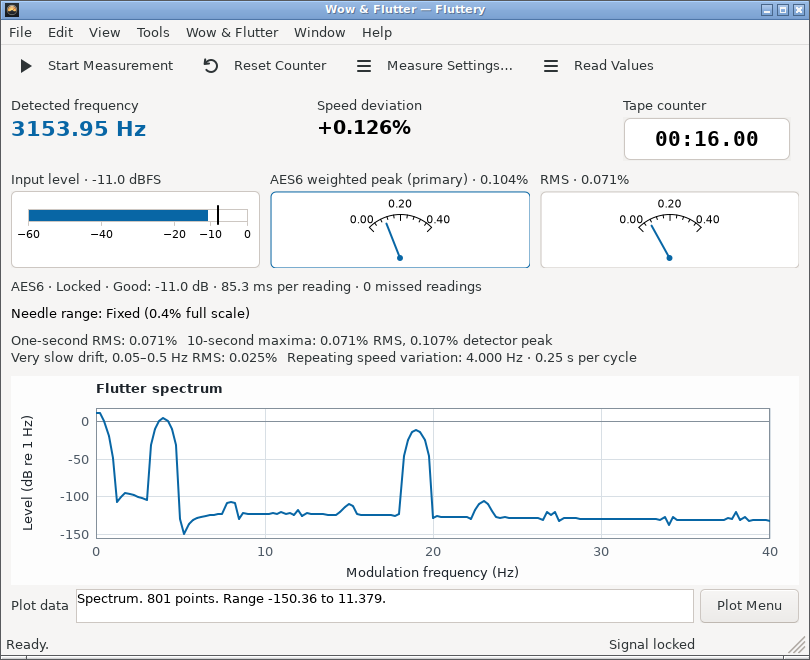
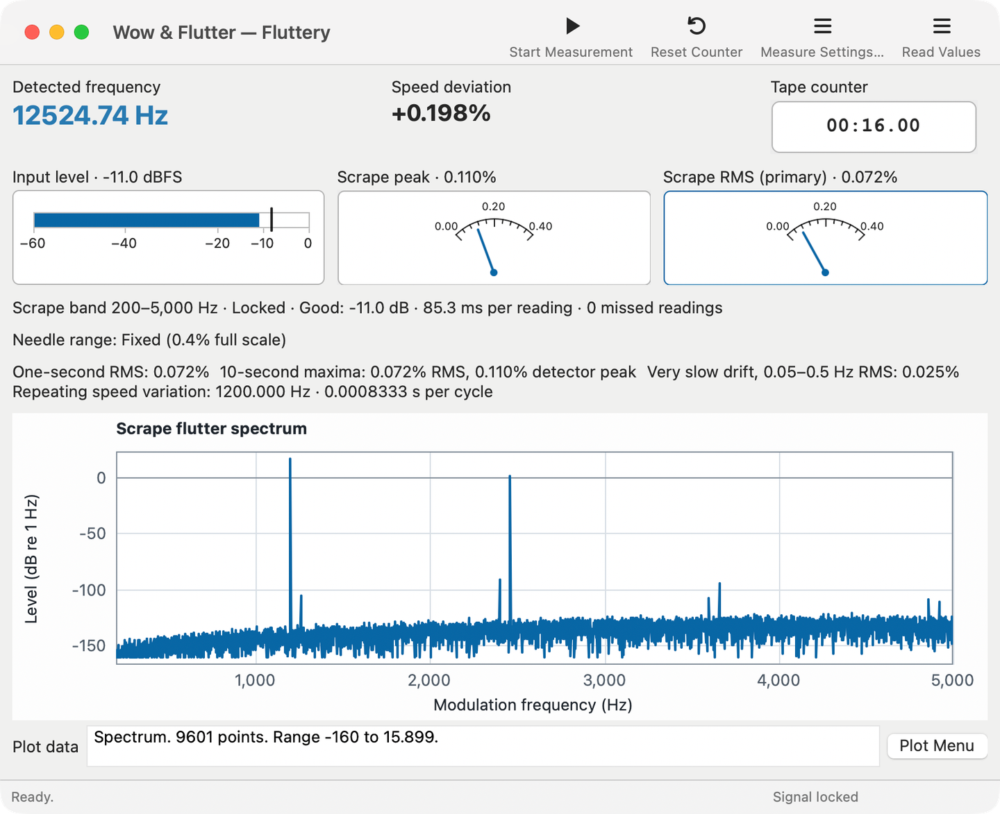
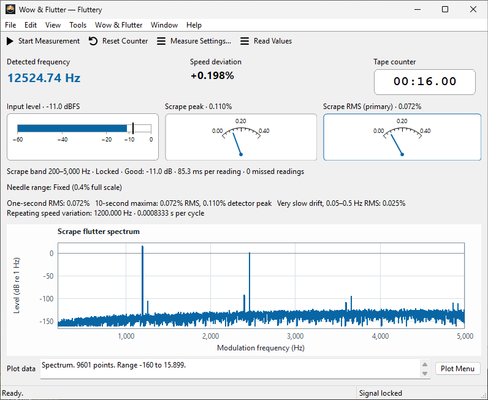
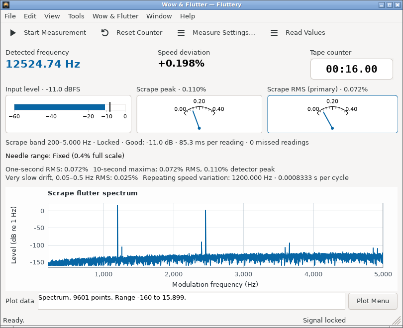

# Measure wow and flutter

Fluttery measures wow and flutter from a steady tone played by your equipment. Wow is the slower change in speed and flutter is the faster change. If the equipment runs consistently fast or slow, you’ll see that separately under **Speed deviation**.

## Connect a test source

1. Use a test tape or record with a known reference tone, usually 3,000 Hz or 3,150 Hz. Use the specified playback speed and play the reference track.
2. Feed the playback equipment's line output to the audio interface. Use a phono preamp for a turntable that provides phono-level output.
3. Open **Tools > Audio > Audio Settings…**. Choose the interface under **Audio input**. Choose **Mono** for one input or **Stereo** for two. In a stereo capture, the wow and flutter instrument analyses the left input.
4. In **Settings > Measurement**, set **Reference frequency (Hz)** to the frequency given on the tape or record. **Automatically recognise 3,000 and 3,150 Hz references** lets Fluttery work out which of those two reference tones you’re playing. Turn it off if you want Fluttery to keep using the frequency you entered.
5. Choose **Apply Settings**. Open **Window > Wow & Flutter**. If input is stopped, choose **Tools > Audio > Start Live Input**.
6. Play the tone and check **Detected frequency** and the confidence line. Set the interface’s input gain high enough for Fluttery to lock on to the tone, with room for peaks. If you see **Input clipping** or **Input near clipping**, turn down the interface gain. A peak can clip even when the average level looks fine.

Turn on **Show frequency before the reading settles** in **Settings > Measurement** if you’d like to see a frequency before Fluttery locks on to the tone. Fluttery marks it **(estimate)** on the Measure screen and in **Read Values**. The lock indicator and recorded readings still use their usual checks.

### If the reference will not lock

1. Check that **Audio input** is set to your interface and that the operating system has given Fluttery access to it.
2. If the signal is low or absent, check that the track is playing, the source reaches the first input channel, and the input gain is high enough. Choose **Refresh device list** in Audio I/O after connecting an interface.
3. If Fluttery finds a frequency and still shows **Unstable**, check the test tone and playback speed. If the speed is a long way off, Fluttery may be able to read the frequency before it can measure wow and flutter.
4. Choose **Read Values** to check the input level, the time between readings and the number of missed readings. A reading is missed when there’s a signal but Fluttery can’t measure the tone in that interval. The separate count of lost references and capture gaps helps you spot a tone dropping out or a problem with the audio connection.

## Record a run and review the readings

1. In **Settings > Measurement**, set **Run duration** to **Continuous**, **10 seconds**, **30 seconds**, or **60 seconds**. Choose **Apply Settings**.
2. If you want to keep the current run, choose **File > Save Session** or **Save Session As** before starting another. Fluttery asks before replacing the current wow and flutter history. The session keeps its turntable captures, distortion readings and other details.
3. Play the reference tone and wait for a stable reading. Choose **Start Measurement** on the toolbar. Fluttery starts adding points to the history graph and the tape counter starts counting.
4. Choose **Stop Measurement** to end the run early. A timed run stops when the time is up. If live input drops out and there’s no signal from internal loopback, Fluttery stops the run and tells you what happened.
5. Choose **Read Values** for a copy of the current readings that stays still while you read it. **Detected frequency** is the frequency Fluttery measures. **Speed deviation** is how far it is from the reference, as a percentage. For example, 3,156.3 Hz against 3,150 Hz is 0.20% fast.
6. Choose **Wow & Flutter > View Results** to open the **Wow and flutter** graph in Results. Use **Session samples** to read individual values, **Session statistics** for a summary, and **File > Save Session** to keep the run.

If you switch tools during a run, choose **Stop and Switch** to stop measuring and open the other tool. Choose **Keep Current Tool** to carry on measuring. You can also open **File > New Window** to use another tool in the same session while the run continues.

**Wow & Flutter > Reset Counter** sets the tape counter back to zero and keeps the recorded samples. The counter adds up the time spent measuring across runs. In the Retro theme, each counter unit is a tenth of a second. Other themes show elapsed time. Choose **Wow & Flutter > Clear Wow and Flutter History** to clear the wow and flutter samples. **File > Clear Session…** asks before clearing the other captures and session details as well.

The history graph leaves a gap where Fluttery lost the tone, so the time axis still lines up with the run. The input level scale shows RMS in dBFS and holds its recent peak for about 1.5 seconds. When the live meter is waiting for the tone to lock, you can still see the scale. The needle appears once Fluttery locks on.

<!-- figures -->
<!-- platform: macos -->

<!-- endplatform -->

<!-- platform: windows -->

Windows illustration

<!-- endplatform -->

<!-- platform: linux -->

Linux illustration

<!-- endplatform -->
<!-- endfigures -->

## Choose the measurement and graph settings

1. Choose **Measure Settings…** on the instrument toolbar. In **Measurement standard**, choose **IEC/DIN peak** for the moving weighted peak, **AES6 weighted peak (two-sigma)** for a statistical reading, **JIS RMS** to make RMS the primary reading, or **Unweighted** to bypass the weighting filter.
2. Use **Wow & Flutter > Show Split Wow and Flutter** to show peak and RMS for each frequency band. The default **Wow / flutter split (Hz)** is 6 Hz. Choose **Show Combined Readings** to return to overall peak and RMS.
3. Set **Analogue meter full scale** to **Auto**, **0.1%**, **0.4%**, **1%** or **4%**. Auto starts at 0.1% and uses the larger reading to set the range for both needles. It waits three seconds before switching to a narrower range. **Needle range** shows the scale in use and flags readings above it. The number beside each needle is just as precise at every scale. Set **Analogue needle damping (seconds)** to change how quickly the needles move. Use **Detector timing** to change how quickly the readings respond.
4. In **Detector timing**, choose **Exponential averaging** or **One-second window** under **RMS detector**. The exponential detector and moving peak use the **NAK T-100**, **Fast setup**, **Slow / steady** or **Custom** timings. Reduce **RMS averaging (seconds)** to make RMS react faster. Reduce **Peak attack (seconds)** to follow sudden rises more closely. Increase **Peak release (seconds)** if you want peaks to stay visible for longer.
5. In **Weighting profile**, choose **IEC/DIN 45507**, **Broad service**, **Narrow diagnostic**, or **Custom**. For a custom profile, **Centre frequency (Hz)** sets the centre of the weighting band, **Q** sets its width, and **Gain** sets its level. A higher Q gives a narrower band.
6. Use **Remove steady speed error from wow and flutter** to separate steady speed offset from the variation reading with unweighted and alternate weighting profiles. The standard weighting and scrape band already reject steady speed error. **Adapt signal lock to the input level** lets the detector adjust its threshold as the tone level changes.
7. Under **History graph source**, choose **Detector peak** to plot the peak after applying the detector timing. **Raw block peak** plots the highest measured variation in each block before applying that timing. Choose **Apply Settings**. Save the settings with the run so you can use the same settings next time.

**Wow & Flutter > Show Plot Controls** displays buttons for changing points, traces and zoom. **Read Plot Data** focuses the plot's text. Use **View > Graph Settings** to adjust visual contrast, grid and trace weight. The plot description and saved values are available in either workspace layout.

## Measure AES6 weighted peak

1. Use a calibrated 3,150 Hz reference track. In **Measure Settings…**, leave **Flutter analysis band** on **Rotational wow and flutter** and select **AES6 weighted peak (two-sigma)**. This mode uses 3,150 Hz and the reference weighting curve regardless of the saved reference frequency or weighting profile.
2. Start capture and wait for the instrument to show a stable lock. Choose **Start Measurement** to record a fresh run. The **AES6 weighted peak** readout shows how much of the five-second lock window has elapsed. A dropout restarts the window.
3. The value is a percentage of the mean speed over the last five seconds. The weighted variation exceeds that value for about 5% of the window. The standard weighting curve gives most weight to modulation near 4 Hz.
4. To compare your results with a service manual, use the reference, playback speed and detector it specifies. Choose **IEC/DIN peak** for a moving peak with adjustable attack and release, or **JIS RMS** for an RMS reading. **Read Values** gives you a text copy of the reading and tells you which detector is active.

The measurement method and weighting are described in [AES6-2008](https://aes.org/publications/standards-store/?id=15), [IEC 60386](https://webstore.iec.ch/en/publication/2015) and the earlier [DIN 45507](https://www.dinmedia.de/de/norm/din-45507/1520543). The [CCIR Recommendation 409 weighting table](https://search.itu.int/history/HistoryDigitalCollectionDocLibrary/4.276.43.en.1005.pdf#page=43) gives nominal points and tolerances. Use a reference tape or record suitable for the device you are measuring.

<!-- platform: macos -->

<!-- endplatform -->

<!-- platform: windows -->

Windows illustration

<!-- endplatform -->

<!-- platform: linux -->

Linux illustration

<!-- endplatform -->

## Inspect short peaks, slow drift and repeating variation

1. Choose **Wow & Flutter > Show Detector Statistics** to show extra readings in the instrument. **Read Values** includes these readings even while the extra display is closed.
2. **One-second RMS** measures speed variation over the last full second of a locked signal. **10-second maxima** shows the highest one-second RMS and highest smoothed detector peak in the last ten seconds. For a summary of the whole recorded run, use the session statistics.
3. **Very slow drift** measures unweighted changes between 0.05 and 0.5 Hz. Allow at least twenty seconds of continuous lock. The drift and one-second RMS readouts show how long the tone has been locked while you wait. **Speed deviation** above the meters gives the percentage difference between the measured frequency and the reference. Equipment that runs steadily fast or slow can show little or no drift.
4. **Repeating speed variation** gives the frequency of a repeated change and the time it takes to complete one cycle. At 4 Hz, a cycle takes a quarter of a second. Fluttery can find the fundamental even if its harmonics are stronger. Give slow changes several cycles to repeat. A one-off jump or a frequency that keeps changing may leave Fluttery without a period to report.
5. Use **Wow & Flutter > Show Live Flutter Spectrum** to inspect components while the signal plays. Use **Read Plot Data** and the arrow keys to explore individual points. Choose **Show Run History** to return to the time graph.

See the [Virtins wow and flutter measurement guide](https://www.virtins.com/doc/Wow-and-Flutter-Measurement-using-Multi-Instrument.pdf) for examples of drift and modulation analysis.

## Measure high-band scrape flutter

1. Connect the recorder to an interface that can capture at 44.1 kHz or higher, and play a suitable 12,500 Hz test tone. The recorder must pass frequencies far enough above the carrier for the interface to receive the upper modulation sideband.
2. Open **Measure Settings…** and select **Scrape flutter (12,500 Hz reference)** under **Flutter analysis band**. Choose **Apply Settings**. Fluttery measures a 200–5,000 Hz band after demodulating the carrier. The usual wow and flutter weighting and split apply only in rotational mode.
3. Wait for the carrier to lock. Compare **Scrape RMS** and **Scrape peak**, or select **Show Live Flutter Spectrum** to look for high-frequency components. Record a run if you need session results. For the standard low-frequency measurements, select **Rotational wow and flutter** when finished.

The [Audio Precision System Two user manual](https://www.audioprecision.com/fileadmin-ap/technical-library/APWINforSystemTwoUserManual20.pdf?force=) describes the 12.5 kHz carrier and high-band measurement.

<!-- platform: macos -->

<!-- endplatform -->

<!-- platform: windows -->

Windows illustration

<!-- endplatform -->

<!-- platform: linux -->

Linux illustration

<!-- endplatform -->

## Stop at the end of a test tape

1. Open **Wow & Flutter > Tape End Settings…**. Enable **Stop at the end of a test tape** and choose **Apply Settings** before starting the run.
2. Start the measurement and play the reference tape. Fluttery starts listening for the end after two seconds of stable lock, so you can play through a quiet leader at the start.
3. Once the tone drops out, Fluttery stops the run when the input stays below **Tape-end threshold (dBFS)** for the time set under **Tape-end silence (seconds)**. The defaults are −45 dBFS and six seconds. Allow more time for tapes with longer quiet gaps, or raise the threshold if tape hiss keeps the run going.
4. Use **Results** to inspect the run. The same setting works for [tape playback response](10-frequency-response.md#measure-tape-playback-response) and [unweighted speed WAV capture](11-bench-levels.md#save-raw-speed-as-wav).

## Run a pass/fail check or reuse a profile

1. In **Settings > Measurement**, choose a built-in **Profile** or set up the measurement yourself. **IEC service check**, **JIS RMS check**, **Quick QC**, and **Turntable stereo setup** provide common combinations. Use **Apply selected profile** to load the selected setup.
2. Enable **Enable pass/fail quality control** and enter the **Quality control limit (%)** specified by your test procedure. Choose **Apply Settings**.
3. Record a run. **Quality control** compares the live peak with the limit. To report a pass, Fluttery needs a steady reference and complete readings without clipping. Clipping, an uncertain reference or missing data can make the result inconclusive. If Fluttery can’t tell which reference to use, enter the frequency given on your test tape or record.
4. To reuse the setup, choose **Save current settings as a profile**, give it a name, and save it. The next time you need it, select that name under **Profile** and choose **Apply selected profile**.
5. Choose **Delete selected custom profile** to remove a custom setup you no longer need. The built-in profiles are always available.

## Keyboard shortcuts

| Command | macOS | Windows and Linux |
| --- | --- | --- |
| Open Wow & Flutter | `Command+1` | `Control+1` |
| Open Settings | `Command+,` | `Control+,` |
| Start or stop a wow and flutter run | `Command+Shift+Space` | `Control+Space` |
| Read Current Values | `Command+Shift+R` | `Control+Shift+R` |
| Reset Counter in Wow & Flutter | `Command+Shift+T` | `Control+Shift+T` |
| Clear Wow and Flutter History | `Command+R` | `Control+R` |
| Clear Session… | `Command+Shift+E` | `Control+Shift+E` |
| Save Session | `Command+S` | `Control+S` |
| Open Keyboard Commands | `Command+Shift+K` | `Control+Shift+K` |
| Move between search and the list in Keyboard Commands | `F6` | `F6` |
| Read the selected command description | `F7` | `F7` |
| Move between points with the plot focused | `Left Arrow` or `Right Arrow` | `Left Arrow` or `Right Arrow` |
| Switch traces with the plot focused | `Up Arrow` or `Down Arrow` | `Up Arrow` or `Down Arrow` |
| Pan or zoom with the plot focused | `Shift+Arrow` to pan, `+` or `-` to zoom | `Shift+Arrow` to pan, `+` or `-` to zoom |
| Restore the default plot axes | `Home` | `Home` |
| Open the Plot Menu from the plot or plot data | `Shift+F10` | `Shift+F10` |
| Close the Read Values window | `Escape` | `Escape` |

You can start or stop a run or clear the wow and flutter history from another instrument window.

In **Keyboard Commands**, look for **Start Live Input** or **Audio Settings** to get the signal in. In Wow & Flutter, search for **Measure Settings**, **Show Split Wow and Flutter**, **Show Detector Statistics**, **Show Live Flutter Spectrum**, **Show Run History**, **Read Plot Data** or **View Results**.

With Settings open, search for **Measurement standard**, **Flutter analysis band**, **Tape End Settings**, **Profile**, **Apply selected profile** or **Quality control limit**. A command for an editable field takes you to the field. For help using the list and its two-letter codes, see [Find any command or control by keyboard](02-workspace.md#find-any-command-or-control-by-keyboard).

## Support Fluttery

If you like Fluttery and you’d like to support my work, you can [make a donation](https://www.paypal.com/donate/?hosted_button_id=WMLX4PLED9PRE). There’s no pressure or hard sell. Fluttery is and always will be free.
