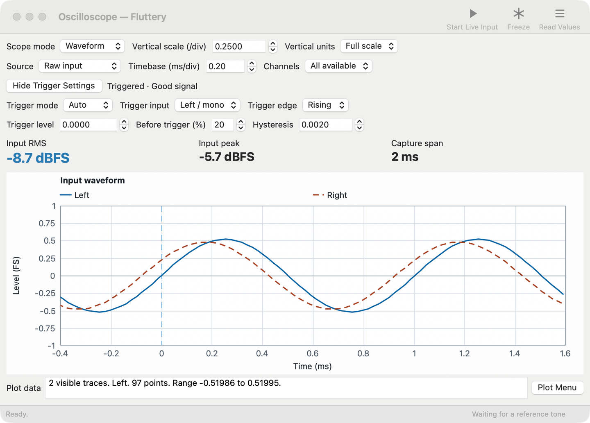
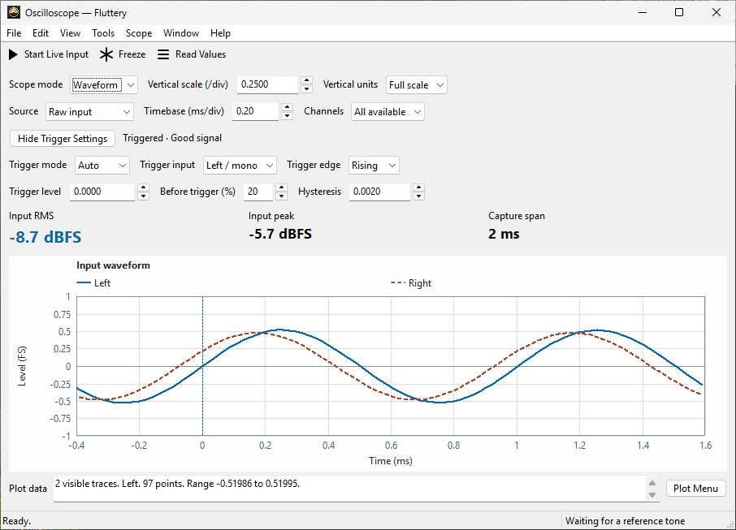
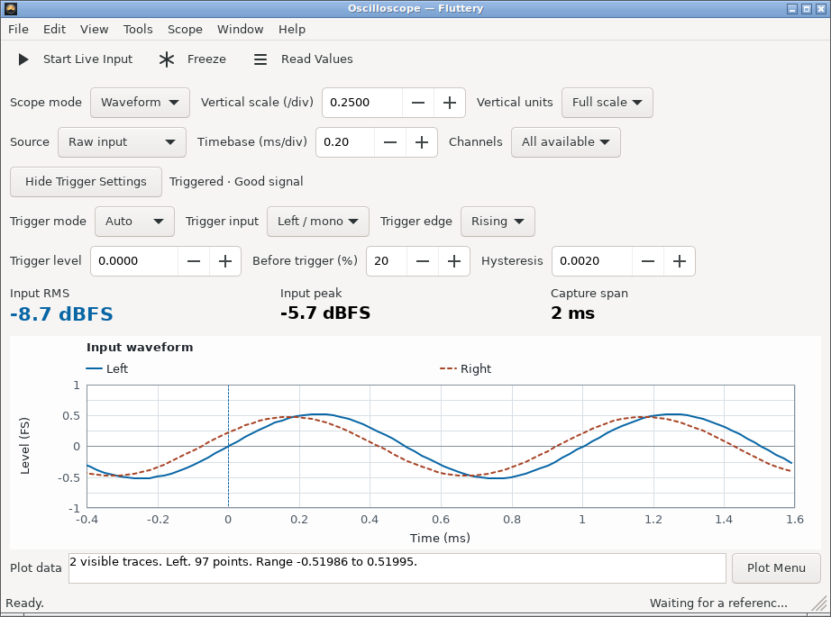
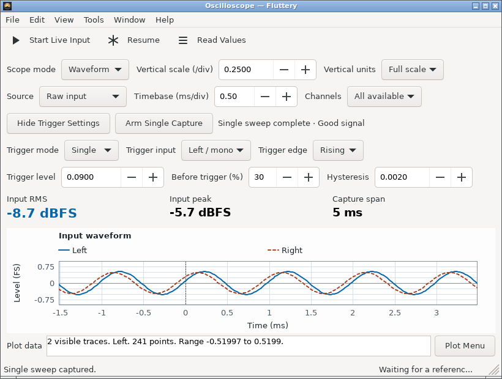
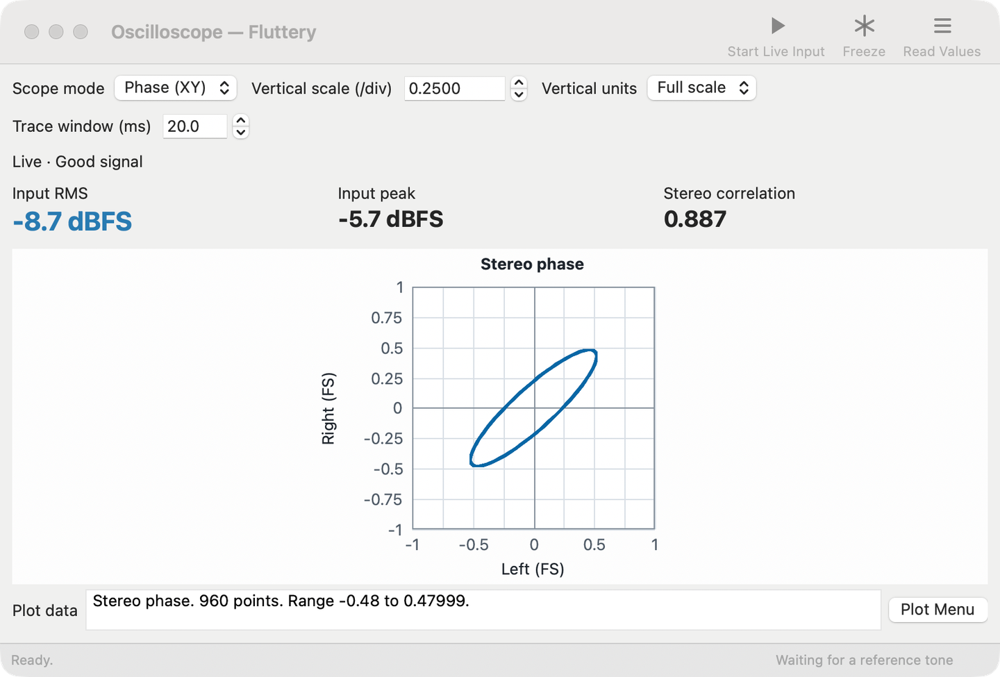
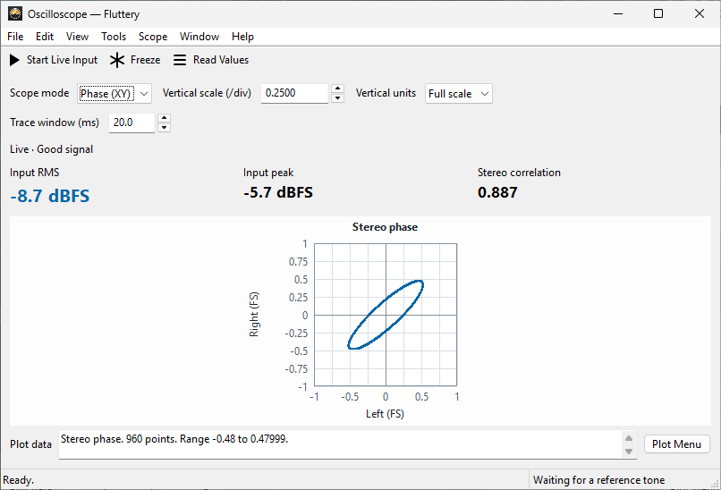
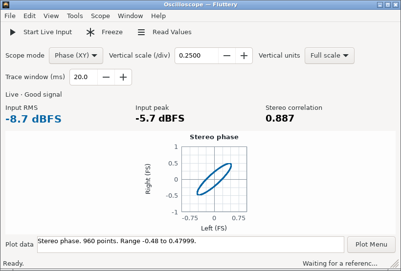

# Use the oscilloscope

Open the oscilloscope to check the signal coming into Fluttery. You can also use it to see how playback speed varies while a reference tone is playing or to compare the two channels on an XY plot.

## Open the scope and start capture

1. Open **Window > Oscilloscope**, then choose **Scope > Waveform**. If input is stopped, choose **Start Live Input** in the scope toolbar.
2. Choose the connected interface under **Tools > Audio > Audio Settings…**. For stereo comparisons, set **Input channels** to **Stereo** and choose **Apply Settings**.
3. Play the source and check the line showing the signal status. It tells you whether the scope is live or frozen and shows the condition of the signal and its RMS level. Choose **Read Values** for the current scope settings and the RMS and peak levels.
4. If the plot is empty, check that the source is reaching the selected input and that the operating system has given Fluttery access to the device. Also check whether the scope is frozen or waiting for a trigger. If the signal clips, turn down the interface gain or the level at the source.

## Inspect the raw input waveform

1. Set **Scope mode** to **Waveform** and **Source** to **Raw input**. If you’re using stereo input, choose one or both traces under **Channels**.
2. Set **Timebase (ms/div)**. Use a smaller value to spread out fast cycles or a larger one to see more time at once. On a triggered trace, the crossing is at zero. Samples from before the trigger have negative times.
3. Adjust **Vertical scale (/div)** until the signal fits. Use full scale for uncalibrated readings. To show volts under **Vertical units**, use a calibration that matches the input and gain. [Calibrate the input](11-bench-levels.md#calibrate-voltage)
4. Once the trace is steady, check for flat tops, uneven waveforms, gaps or changes in level. Read the values at individual points to see how close either channel comes to full scale.
5. The channel fields show RMS and peak levels in dBFS. With stereo input, **Stereo correlation** shows how closely the channels follow each other. Choose **Read Values** for a copy of the current readings or **Read Plot Data** to read the selected point.

<!-- figures -->
<!-- platform: macos -->

<!-- endplatform -->

<!-- platform: windows -->

Windows illustration

<!-- endplatform -->

<!-- platform: linux -->

Linux illustration

<!-- endplatform -->
<!-- endfigures -->

## Trigger on an edge

1. Choose **Show Trigger Settings**. Pick the input and choose whether the scope should trigger when the signal rises past a set level or falls below it.
2. Enter the **Trigger level** in the units shown on the vertical axis. Increase **Hysteresis** if small fluctuations around the trigger level cause extra crossings. Set **Before trigger (%)** to choose how much of the trace you see before the crossing.
3. Choose **Auto** to keep the waveform moving and line it up with an edge when one appears. Choose **Normal** to hold the last triggered waveform until there’s another crossing.
4. Choose **Single**, then **Arm Single Capture**. The scope waits for the next crossing and the samples it needs after that point. It holds the waveform until you resume or arm another capture. If the input drops out, the scope starts looking again for a complete trace.

<!-- platform: linux -->

Linux illustration

<!-- endplatform -->

## Inspect demodulated wow and flutter

1. Set the measurement reference to the test tape or record's tone in **Settings > Measurement** and apply the settings. Play the tone and check that the **Wow and Flutter** instrument locks.
2. Open the scope, set **Scope mode** to **Waveform**, and choose **Speed variation** under **Source**. You can also choose **Scope > Show Wow and Flutter Waveform** when the raw waveform is displayed.
3. Read the vertical axis as percentage speed variation. The trace reflects the measurement weighting and the steady-speed-error setting. Choose **Unweighted** under **Measurement standard** if you want to examine the underlying variation without the weighting filter.
4. Set a larger **Timebase (ms/div)** to see slower cycles. Use a smaller vertical scale to make small changes easier to see. If you see a regular pattern, compare it before and after you adjust the equipment.
5. Choose **Read Values** for an estimate of RMS speed variation over the part of the trace you can see. The input level still refers to the incoming audio. Use **Wow and Flutter** for the detector readings from the whole run.

## Compare stereo channels in Phase (XY) mode

1. Select **Stereo** under **Input channels** in **Settings > Audio I/O** and connect both inputs.
2. Play a signal that should be the same on both channels. Choose **Scope > XY Phase** or set **Scope mode** to **Phase (XY)**. The scope puts the left input on the horizontal axis and the right input on the vertical axis.
3. Adjust **Vertical scale** so the trace fits. Use **Trace window (ms)** to choose how much of the signal to draw. Both axes use the same scale. A diagonal that slopes up to the right shows the same polarity. A diagonal that slopes down to the right shows opposite polarity. If both channels carry the same steady frequency, an ellipse shows a phase difference. The relative levels of the channels also affect its shape.
4. Choose **Read Values** for stereo correlation. Values near +1 mean the channels move together. Values near −1 mean they move in opposite directions. A value near zero can come from a phase offset or from different signals. Check the trace shape and the signal you’re playing to tell those cases apart.
5. If only one input is configured, the scope shows a **Mono XY waveform** with the same input on both axes. Select stereo for a channel-to-channel comparison.

For a turntable crosstalk or balance test, open **Turntable > Measure Phase in Scope** from the turntable window. This opens the same XY view.

<!-- figures -->
<!-- platform: macos -->

<!-- endplatform -->

<!-- platform: windows -->

Windows illustration

<!-- endplatform -->

<!-- platform: linux -->

Linux illustration

<!-- endplatform -->
<!-- endfigures -->

## Freeze and inspect a capture

1. When the signal you want is on screen, choose **Freeze** in the scope toolbar. The trace and readings stay in place while the audio input keeps running.
2. You can still change scope mode, vertical scale, timebase or waveform source to look at the same capture.
3. To check one sample at a time, choose **Scope > Show Plot Controls**, or focus the plot and use the keyboard shortcuts at the end of this chapter. The **Plot data** field shows the selected trace and the values at that point. Choose **Read Plot Data** to move focus there.
4. Drag the plot to pan or use the mouse wheel over it to zoom. Double-click the plot or choose **Fit Plot** to restore the normal axes.
5. Choose **Resume** to see the live signal again. To stop audio capture, choose **Tools > Audio > Stop Live Input**.

## Keyboard shortcuts

| Command | macOS | Windows and Linux |
| --- | --- | --- |
| Open Oscilloscope | `Command+2` | `Control+2` |
| Open Wow & Flutter | `Command+1` | `Control+1` |
| Read Current Values | `Command+Shift+R` | `Control+Shift+R` |
| Open Keyboard Commands | `Command+Shift+K` | `Control+Shift+K` |
| Move between search and the list in Keyboard Commands | `F6` | `F6` |
| Move between points with the plot focused | `Left Arrow` or `Right Arrow` | `Left Arrow` or `Right Arrow` |
| Switch traces with the plot focused | `Up Arrow` or `Down Arrow` | `Up Arrow` or `Down Arrow` |
| Pan or zoom with the plot focused | `Shift+Arrow` to pan, `+` or `-` to zoom | `Shift+Arrow` to pan, `+` or `-` to zoom |
| Restore the default plot axes | `Home` | `Home` |
| Open the Plot Menu from the plot or plot data | `Shift+F10` | `Shift+F10` |
| Close the Read Values window | `Escape` | `Escape` |

Search in **Keyboard Commands** for **Start Live Input**, **Audio Settings**, **XY Phase**, **Select Scope Mode**, **Show Wow and Flutter Waveform** or **Show Raw Input Waveform**. From a crosstalk or balance test, search for **Measure Phase in Scope**.

To change the display or trigger, look for **Edit Scope Timebase**, **Edit Scope Vertical Scale**, **Show Trigger Settings**, **Edit Trigger Level** or **Arm Single Capture**. A command for a setting takes you to the control, where you can use the arrow keys or type a number and press `Return`.

Use **Freeze** or **Resume**, depending on which action is available. You can also search for plot commands such as **Read Plot Data**, **Next Point** or **Zoom In**.

## Support Fluttery

If you like Fluttery and you’d like to support my work, you can [make a donation](https://www.paypal.com/donate/?hosted_button_id=WMLX4PLED9PRE). There’s no pressure or hard sell. Fluttery is and always will be free.
