# Test a turntable

Fluttery has six turntable tests. Pick the track that matches the test you want to run. Use the speed track to check RPM, the left-only or right-only track to measure crosstalk, the tracking track to measure distortion, and a silent groove to measure noise.

## Prepare a stereo setup

1. Connect the turntable's line output, or the output of its phono preamplifier, to a stereo audio interface. Connect the left and right outputs to the corresponding inputs.
2. Open **Tools > Audio > Audio Settings…**. Select the interface under **Audio input**, set **Input channels** to **Stereo**, and choose **Apply Settings**. You can also reach the stereo setting directly from the turntable window with **Enable Stereo Input**. If the device can’t open both channels, choose an interface or driver that supports stereo.
3. In **Settings > Measurement**, set **Reference frequency (Hz)** and **Test record speed** to the values specified for your test track. **Turntable stereo setup** is a built-in profile for a 3,150 Hz stereo test. Apply the profile first if you plan to customise it.
4. Open **Window > Turntable**. Choose one of the six tests from the **Turntable** menu or the **Test** control in the instrument. If input is stopped, choose **Tools > Audio > Start Live Input**.
5. Play the track you plan to test and set the input gain. Choose **Read Values** to check the detected frequency, level and confidence. If the signal is weak, check the preamp, cables, input selection and gain. Turn the gain down if the interface clips.

If your interface gives the channels unequal gain, use **Settings > Calibration > Channel calibration** before testing crosstalk or balance. Feed the same reference signal into both inputs. That lets Fluttery measure the gain difference in the interface and its input path before you measure the turntable.

## Speed stability (RPM)

1. In **Turntable**, choose **Speed (RPM)**. In the turntable window this test is **Speed stability (RPM)**.
2. Set **Test record speed** to the speed the track was cut for, and **Playback speed** to the speed you want to check. Both offer 16⅔, 33⅓, 45, 78 and a custom value. Fluttery uses the exact fractions for 16⅔ and 33⅓. To use 78.26 or 78.00 RPM, set **78 RPM reference** under **Settings > Measurement**. Choose **Custom** if the record calls for a different speed. [IASA guide to analogue disc speeds](https://www.iasa-web.org/book/export/html/176)
3. Play the speed track and read **Measured speed** and **Speed deviation**. A positive number means the turntable is running fast. A negative number means it is running slow. For example, if a 3,150 Hz track cut for 45 RPM reads 3,156.3 Hz, the turntable is running at 45.09 RPM, or 0.20% fast.
4. Follow the turntable’s instructions and let the speed settle after each adjustment. The speed chart shows the last 30 seconds, with a dashed line at the target speed. **Read Values** gives the reference, the playback speed you selected and the frequency Fluttery detected. You can still get an RPM estimate if the wow and flutter detector can’t lock, for example when you play a track at a different speed from the one it was cut for.
5. Choose **Start Recording**, then **Stop Recording**, to save a series of RPM readings. **View Results** opens the latest speed recording. The summary gives the average, minimum and maximum RPM.

Speed checks work with mono or stereo input. With **Reference tone** set to **Detect 3,000 / 3,150 Hz**, Fluttery recognises common speed tracks. If the tone is ambiguous or the track was cut at a different frequency, choose **Enter frequency** and enter the nominal tone. For wow and flutter percentages, record a separate run in the **Wow and Flutter** instrument.

<!-- figures -->
<!-- platform: macos -->
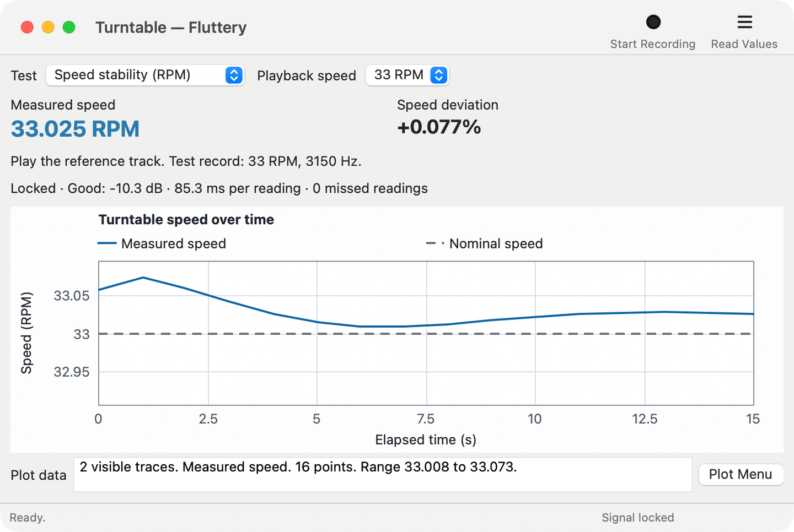
<!-- endplatform -->

<!-- platform: windows -->

Windows illustration

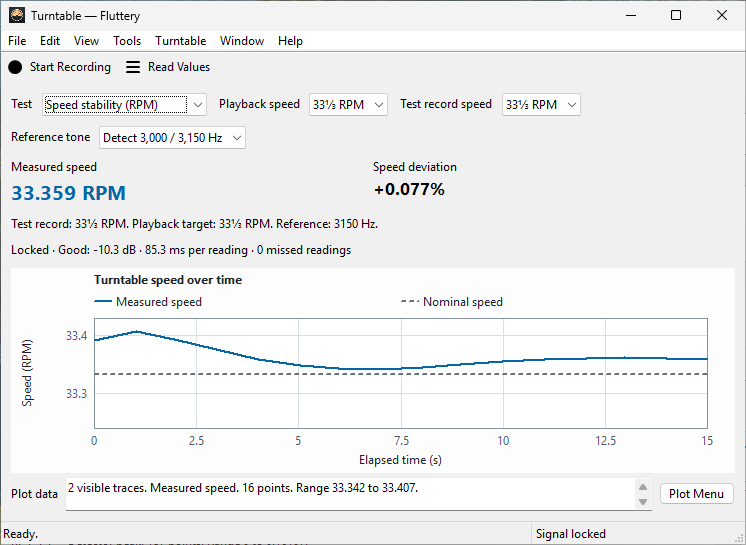

<!-- endplatform -->

<!-- platform: linux -->

Linux illustration

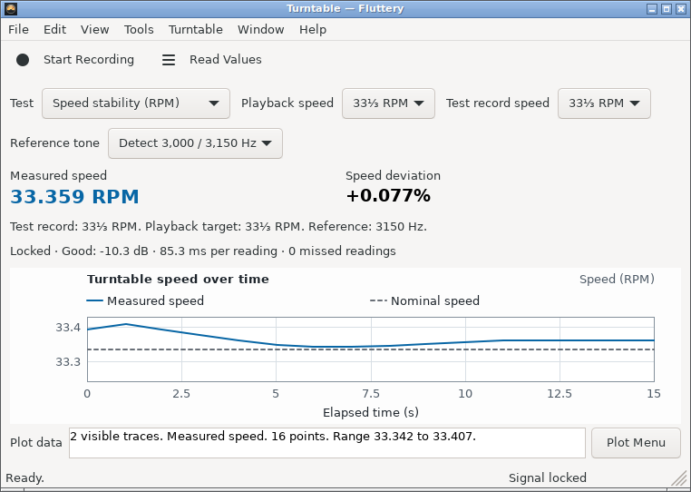

<!-- endplatform -->
<!-- endfigures -->

## Crosstalk and azimuth

1. In **Turntable**, choose **Crosstalk**. In the window the test is **Crosstalk and azimuth**.
2. Enter the frequency given on the record under **Expected tone (Hz)**. Set it to zero if you want Fluttery to find the tone on the channel the test track drives. Play the left-only track and check the levels of both channels under **Live test tone**. They’re shown in dBFS. Let the level settle, then choose **Capture Left**. Fluttery measures the tone on the left and estimates how much leaks into the right channel.
3. Play the right-only track and choose **Capture Right**. The two readings are independent. For example, a driven channel at −15 dBFS and a corresponding tone at −45 dBFS on the other channel give 30 dB of separation.
4. Compare left-to-right and right-to-left separation. Keep gains and trims fixed and follow the cartridge or tonearm instructions if you adjust azimuth. If Fluttery shows a lower bound, the leakage is so close to the measured noise floor that it can only say how much separation you have at a minimum. The phase reading is unreliable at that level. Choose **Save Readings** to keep either or both readings, or **Clear Readings** to start again.
5. Use **Turntable > Measure Phase in Scope** to inspect stereo phase when you have the relevant test signal. Return to Crosstalk to check channel separation again.

If the two readings are unexpectedly similar, first check that you’re playing a left-only or right-only track. Check that the preamp and interface are keeping the channels separate. If Fluttery can’t find the tone, check the expected frequency, playback speed and the cable to the input you’re testing.

<!-- figures -->
<!-- platform: macos -->
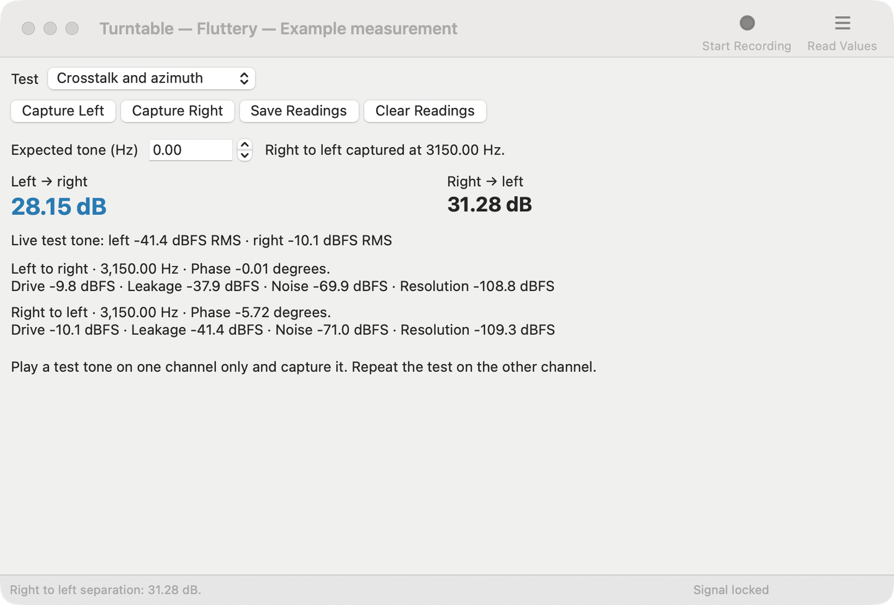
<!-- endplatform -->

<!-- platform: windows -->

Windows illustration

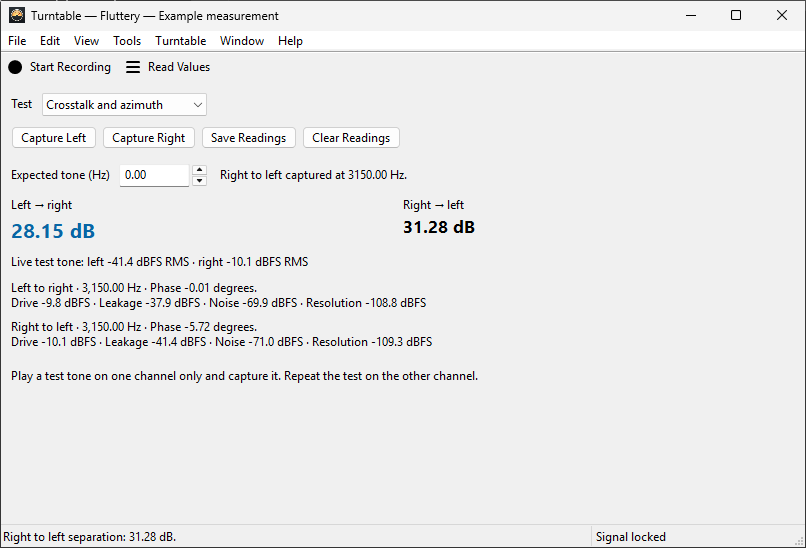

<!-- endplatform -->

<!-- platform: linux -->

Linux illustration

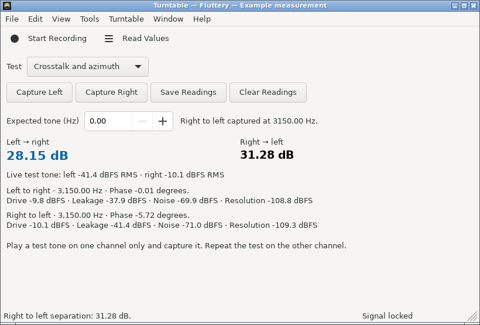

<!-- endplatform -->
<!-- endfigures -->

## Channel balance

1. Choose **Turntable > Channel balance** and play the equal-level stereo test tone. Set the reference frequency to match.
2. Read **Channel balance** and **Louder channel**. The scale moves towards the louder side and sits in the centre when the levels are equal. **Read Values** gives you the level of each channel and the difference between them. Fluttery highlights differences greater than 1 dB.
3. Feed the same reference straight into both inputs. If you see the same imbalance, check **Channel calibration** before adjusting the turntable. Choose **Read Values** in either tool to see the detected stereo tone and the reference you set.
4. Use **Start Recording** and **Stop Recording** to keep a before-and-after series. Use **View Results** for the latest balance measurement and its summary. Use **Measure Phase in Scope** if you also need to compare phase.

<!-- figures -->
<!-- platform: macos -->
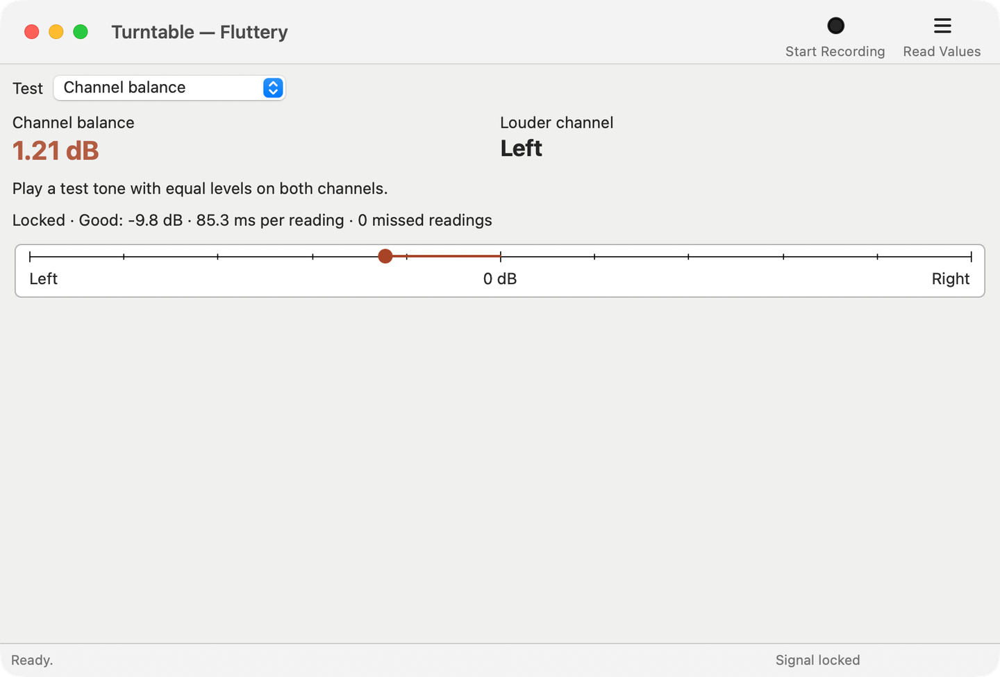
<!-- endplatform -->

<!-- platform: windows -->

Windows illustration

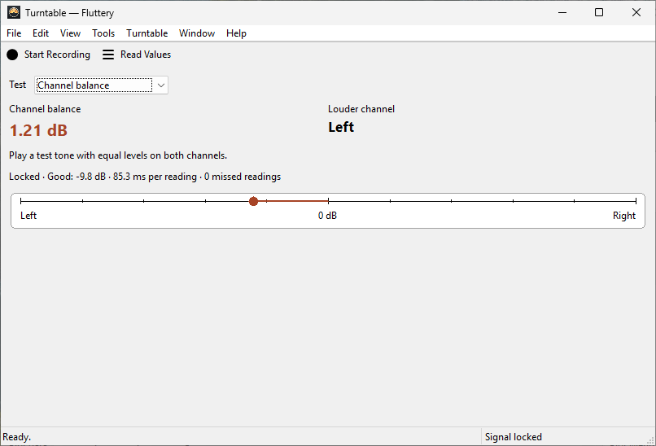

<!-- endplatform -->

<!-- platform: linux -->

Linux illustration

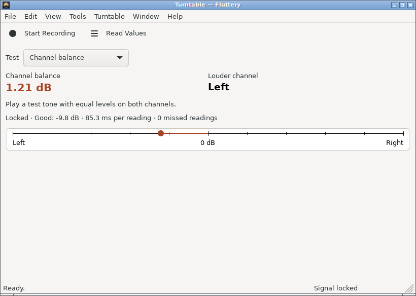

<!-- endplatform -->
<!-- endfigures -->

## Tracking distortion

1. Choose **Turntable > Tracking distortion** and play the tracking track. Keep the interface gain at the same setting for each pass.
2. Compare **Left THD plus noise** and **Right THD plus noise**. Use **Read Values** to check the fundamental and signal confidence. The graph shows a spectrum for each channel. High distortion can come from the playback equipment, the interface input or the test signal itself. Check the tone and make sure there is enough headroom before you adjust the turntable.
3. Make one change at a time when comparing tracking force or anti-skate. Stay within your equipment's specified adjustment ranges and repeat the same test track after each adjustment.
4. Record each pass with **Start Recording** and **Stop Recording**. **View Results** opens the series under **THD+N results**. When Fluttery can save the left-channel spectrum and can’t measure THD, it opens the spectrum under **Recorded measurements**. You can read the frequency and level of each saved bin there.

<!-- figures -->
<!-- platform: macos -->
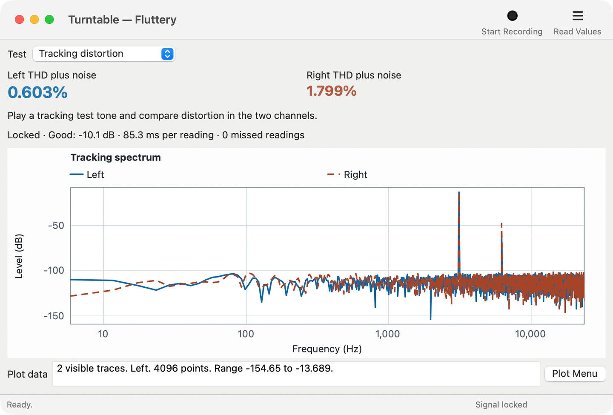
<!-- endplatform -->

<!-- platform: windows -->

Windows illustration

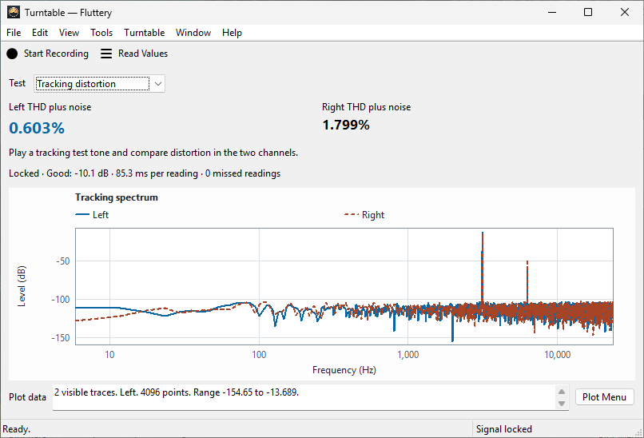

<!-- endplatform -->

<!-- platform: linux -->

Linux illustration

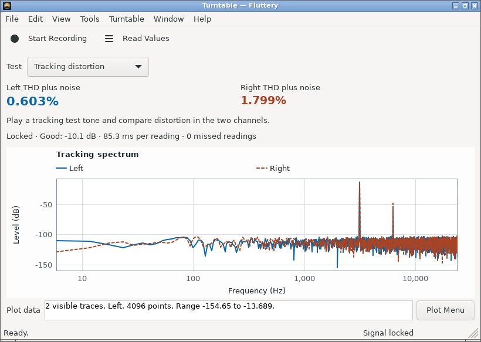

<!-- endplatform -->
<!-- endfigures -->

## Noise floor

1. Choose **Turntable > Noise floor** and play a silent or unmodulated groove appropriate for your test record. Leave input gains and signal routing the same between measurements.
2. Read **RMS noise level** for the overall level on the left input and **Low-frequency rumble** for the low-frequency band. **Read Values** gives the frequency of the strongest peak. Check the graph for other peaks. A peak at the mains frequency or a multiple of it can help point to hum.
3. To see how much noise the interface contributes, capture its input noise separately with the equipment set up as specified in your test procedure. Keep the same input gain so you can compare the spectra and levels.
4. Choose **Start Recording** and **Stop Recording** to keep the latest spectrum with its noise and rumble readings. Open **View Results** to compare separate captures.

<!-- figures -->
<!-- platform: macos -->
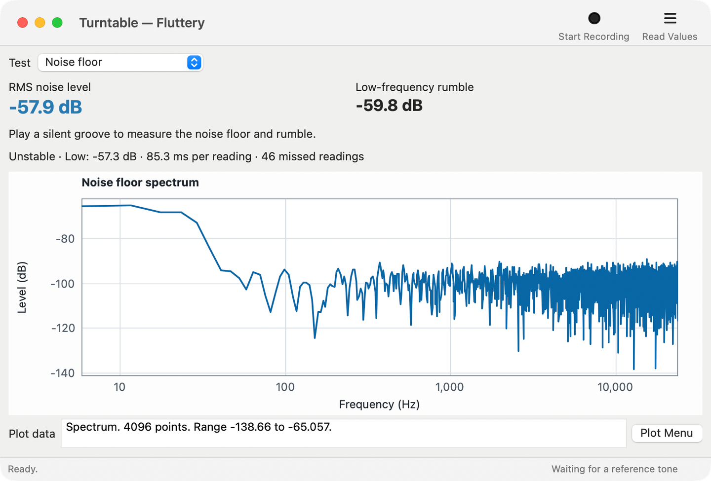
<!-- endplatform -->

<!-- platform: windows -->

Windows illustration

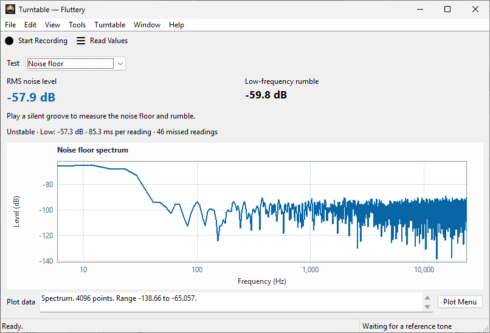

<!-- endplatform -->

<!-- platform: linux -->

Linux illustration

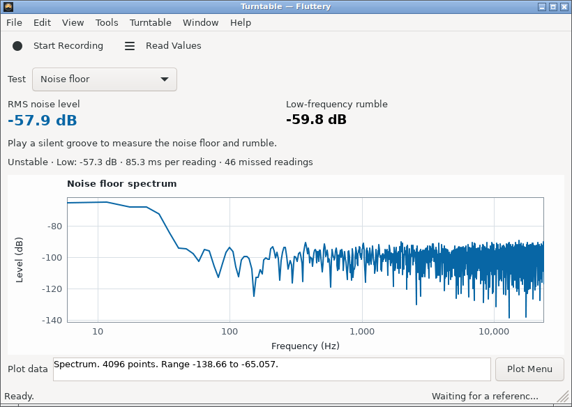

<!-- endplatform -->
<!-- endfigures -->

## Low-frequency resonance

1. Choose **Turntable > Resonance**. In the turntable window the test is **Low-frequency resonance**.
2. Play a resonance test track or the low-frequency sweep recommended for the tonearm and cartridge. Check **Peak resonance** and **Resonance level**. The graph goes up to 30 Hz. Fluttery looks for the strongest peak between 2 and 30 Hz and shows the typical target range of 8 to 12 Hz in the readout.
3. Use **Read Values** or **Read Plot Data** to inspect the peak. Repeat the same test track or sweep after each change. Check the test record and turntable instructions when interpreting the result.
4. Choose **Start Recording** and **Stop Recording** when the graph displays the region you want to keep. This saves the latest spectrum with its resonance reading. **View Results** opens the recorded measurement.

If no meaningful peak appears, verify that the track is the resonance test and that the preamplifier and interface can pass the low frequencies you are trying to measure. A low-frequency or subsonic filter in the signal path can reduce the peak.

<!-- figures -->
<!-- platform: macos -->
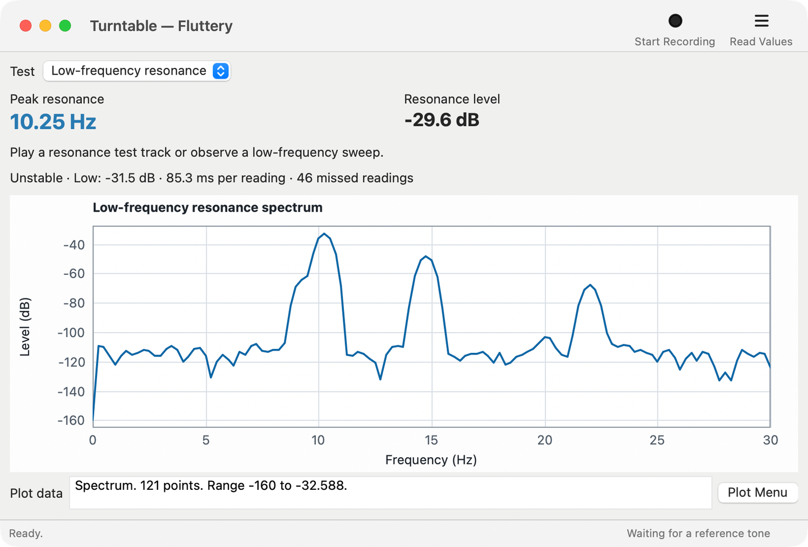
<!-- endplatform -->

<!-- platform: windows -->

Windows illustration

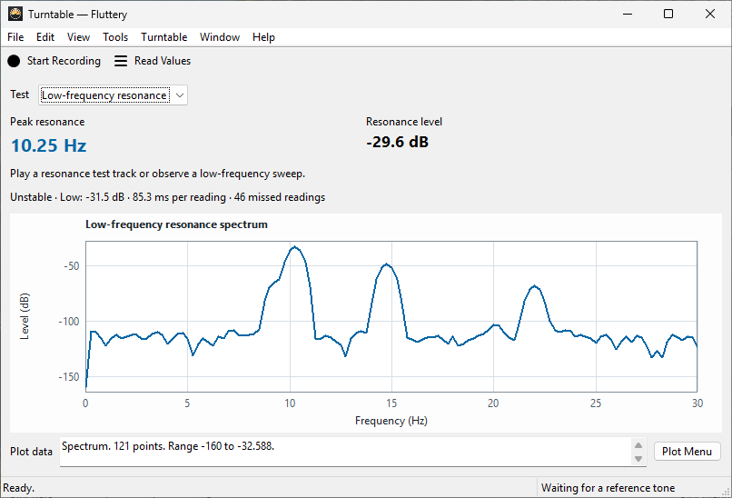

<!-- endplatform -->

<!-- platform: linux -->

Linux illustration

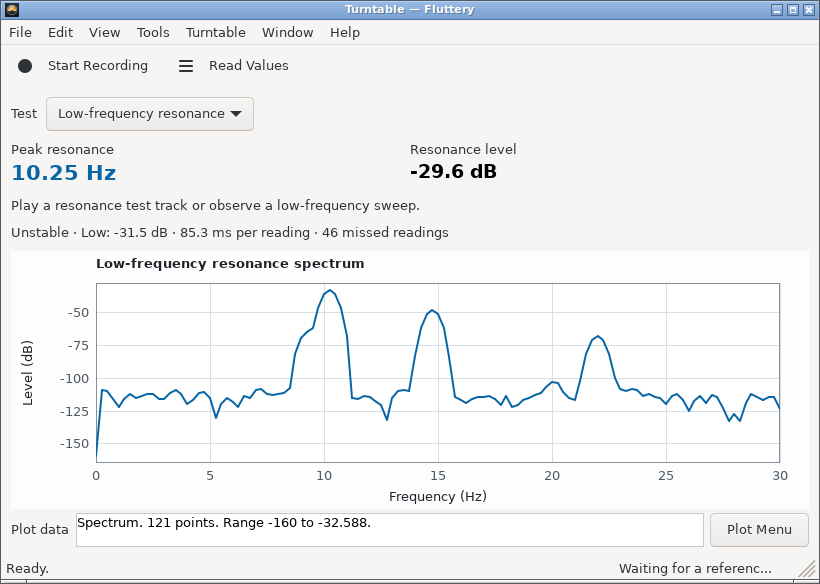

<!-- endplatform -->
<!-- endfigures -->

## Review and save a turntable test

1. Choose **Stop Recording** before changing **Test** or **Playback speed**. **Run duration** applies to the Wow and Flutter instrument.
2. Choose **Turntable > View Results**. In **Recorded measurements**, Fluttery opens the latest recording of the same test. Use the **Type** filter to see other tests. A tracking series also appears beside the standalone distortion readings in **THD+N results**.
3. In **Recorded measurements**, set **Display** to **Details** for a summary, **Graph** to compare the data visually, or **Sample table** to read individual values. Fluttery can draw the graph when the recording contains values for that measurement.
4. Use **File > Save Session** to save the measurements. In Settings, use **Maximum samples kept in a session** to control retention. Use **File > Export** to create the report or data format you need.

If Fluttery reports **No usable signal was captured**, verify the active input and wait until the relevant readings or spectrum are available before repeating the capture. Confirm that you are viewing the intended measurement type in Results.

## Keyboard shortcuts

| Command | macOS | Windows and Linux |
| --- | --- | --- |
| Open Turntable | `Command+3` | `Control+3` |
| Open Settings | `Command+,` | `Control+,` |
| Open Session Results | `Command+6` | `Control+6` |
| Read Current Values | `Command+Shift+R` | `Control+Shift+R` |
| Open Keyboard Commands | `Command+Shift+K` | `Control+Shift+K` |
| Move between search and the list in Keyboard Commands | `F6` | `F6` |
| Save Session | `Command+S` | `Control+S` |
| Move between points with the plot focused | `Left Arrow` or `Right Arrow` | `Left Arrow` or `Right Arrow` |
| Switch traces with the plot focused | `Up Arrow` or `Down Arrow` | `Up Arrow` or `Down Arrow` |
| Pan or zoom with the plot focused | `Shift+Arrow` to pan, `+` or `-` to zoom | `Shift+Arrow` to pan, `+` or `-` to zoom |
| Restore the default plot axes | `Home` | `Home` |
| Open the Plot Menu from the plot or plot data | `Shift+F10` | `Shift+F10` |

In **Keyboard Commands**, search for **Audio Settings**, **Enable Stereo Input** or **Select Turntable Test**. You can also search for a test by name, such as **Speed (RPM)**, **Crosstalk**, **Channel balance**, **Tracking distortion**, **Noise floor** or **Resonance**.

In the speed test, look for **Select Playback Speed**. For crosstalk, use **Capture Left**, **Capture Right** and **Save Readings**. **Measure Phase in Scope** is available from crosstalk and balance. Other useful searches are **Start Recording**, **Stop Recording**, **Read Plot Data** and **View Results**. In Results, search for **Measurement type filter** or **Selected measurement view**.

## Support Fluttery

If you like Fluttery and you’d like to support my work, you can [make a donation](https://www.paypal.com/donate/?hosted_button_id=WMLX4PLED9PRE). There’s no pressure or hard sell. Fluttery is and always will be free.
