# Analyse distortion and generate test signals

Use the **Distortion Analyzer** to measure what the equipment adds to a test tone. The **Signal Generator** can supply the tone. Both tools use the devices you choose in **Settings > Audio I/O**.

## Start a distortion measurement

1. Send a steady sine wave to the selected audio input. The **Distortion Analyzer** uses the left channel when you have stereo input. Use **Tracking distortion** in Turntable to read both channels.
2. Choose **Window > Distortion Analyzer** and select **Start Analysis** on the toolbar. Allow input access if your operating system asks.
3. Check that **Fundamental frequency** matches your test tone. Fluttery uses the strongest frequency in the measurement band, so a louder tone can take its place. Use the test source on its own and check the connection and gain before you record a run for comparison.
4. **THD** shows the harmonics together, **Third harmonic** shows HD3, and **THD plus noise** includes the other energy in the measurement band. Each reading is a percentage of the fundamental. Check the spectrum to find the strongest components, or choose **Read Values** to read the current values without the display changing. [Audio Precision’s distortion measurements](https://aes.org/publications/par/t/)
5. If Fluttery shows low confidence or no reading, check that the test signal is reaching the selected input. Raise the level of the clean test signal if needed. If distortion rises sharply as you increase the input gain, turn the gain down and try again. The reading includes any distortion from the test source and audio interface.

<!-- figures -->
<!-- platform: macos -->
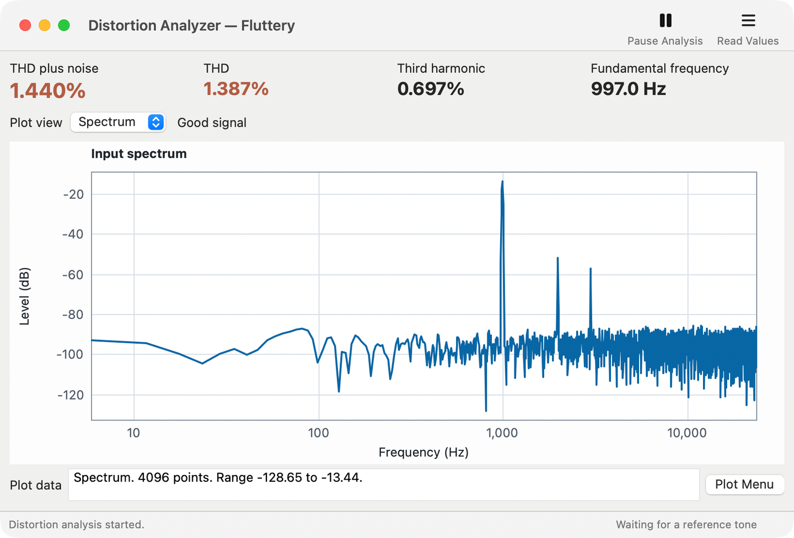
<!-- endplatform -->

<!-- platform: windows -->

Windows illustration

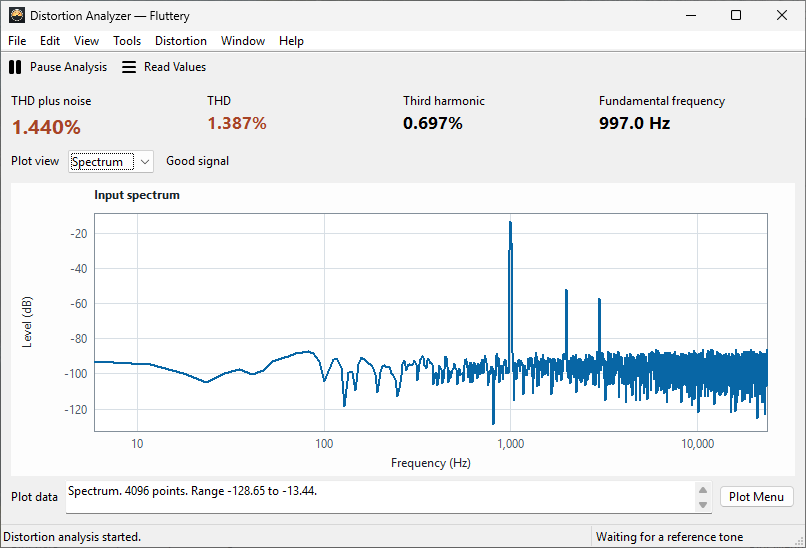

<!-- endplatform -->

<!-- platform: linux -->

Linux illustration

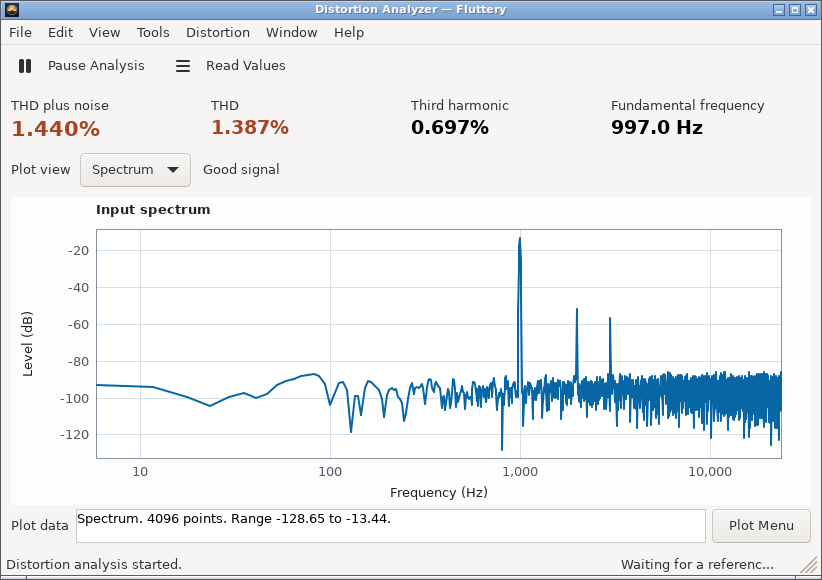

<!-- endplatform -->
<!-- endfigures -->

## Inspect the spectrum and keep a distortion run

1. While the analyser is running, choose **Distortion > Read Plot Data** to focus the graph’s text readout. Move from point to point to read the frequency and level. The horizontal axis is frequency in Hz. The vertical axis is level in dB.
2. Choose **Harmonics** in **Plot view** to see the fitted fundamental and the harmonics within the measurement band. Each bar shows its level relative to the fundamental in dBc. Switch back to **Spectrum** to zoom in on nearby noise or unwanted tones.
3. Choose **Pause Analysis** to hold the display and stop adding readings. Choose **Resume Analysis** to carry on in the same session. Fluttery saves valid readings as it measures.
4. Choose **Distortion > View Results** to open **THD+N results**. The results timeline includes standalone distortion and turntable tracking readings. Choose **File > Save Session** to keep them together.
5. Choose **Distortion > Reset Distortion Results** to stop the analyser and clear its readings. The session keeps any turntable tracking captures.

For repeatable comparisons, use the same test tone and input gain. A physical loopback through the same interface can show the interface's baseline distortion before you connect the equipment under test.

<!-- figures -->
<!-- platform: macos -->
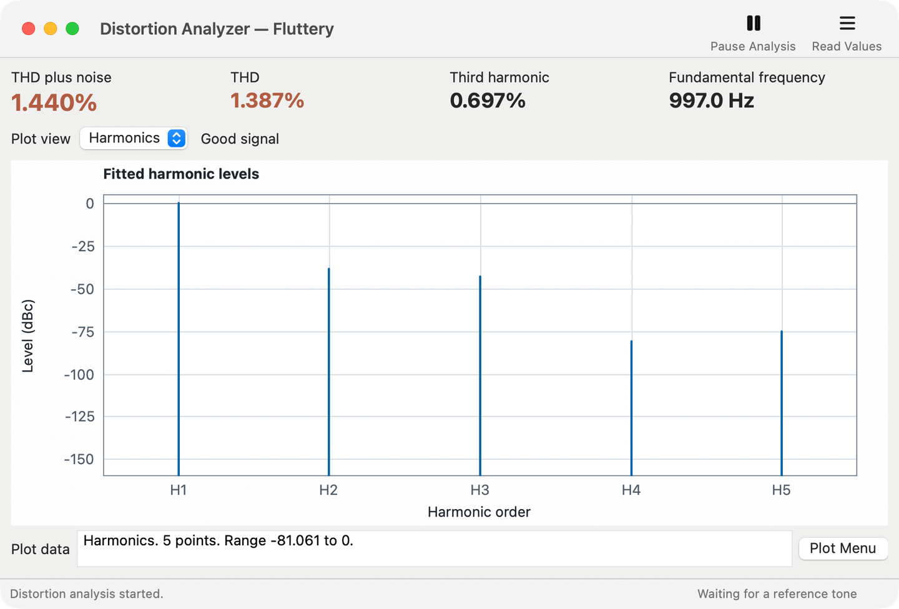
<!-- endplatform -->

<!-- platform: windows -->

Windows illustration

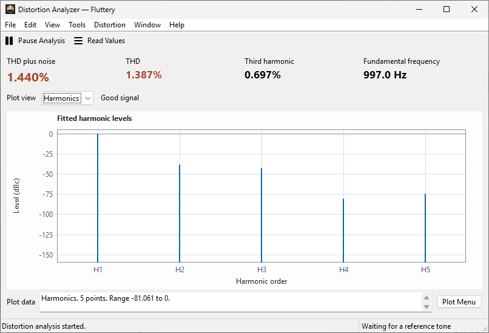

<!-- endplatform -->

<!-- platform: linux -->
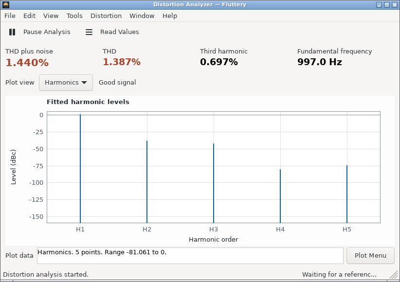
<!-- endplatform -->
<!-- endfigures -->

## Measure spectrum and intermodulation

1. Open **Tools > Signal Tests > Spectrum and Distortion Tests…** and choose **Spectrum**. Choose **Start Spectrum** with a signal on the active audio input.
2. Choose the **FFT window** and **FFT samples**. Use more samples to separate nearby frequencies. Hann is a general-purpose window. Blackman–Harris reduces leakage near strong tones. Flat top reduces amplitude errors when a tone falls between FFT bins. The graph shows spectral density in dBFS per hertz.
3. Increase **Average blocks** to steady the trace when the noise fluctuates. **Peak Hold** adds a trace showing the highest spectral density recorded in each bin since the last reset. Choose **Reset Average and Peak** to start fresh or **Stop** to read the current traces without further updates.
4. For a two-tone test, select **Two-tone intermodulation**. Choose **SMPTE modulation** (60 Hz and 7 kHz), **DIN modulation** (250 Hz and 8 kHz) or **CCIF difference tone** (19 and 20 kHz). Enter the frequencies from your own source if they differ. Choose **Measure Input** for an external source. To play the test signal from Fluttery, connect the return to the interface and choose **Generate and Measure**.
5. Read each channel separately. Modulation mode shows the amplitude modulation of the upper tone and the individual sidebands. Difference mode shows the difference tone relative to the sum of the two references and lists the nearby third-order products. If the noise is too high for an exact reading, Fluttery shows an upper limit. You can still read one channel when the other has no usable test signal. Choose **Save to Session** to keep the readings in Results.

The usual test signals and methods are described in the [AES Pro Audio Reference](https://aes.org/publications/par/i/) and [Audio Precision’s IMD guide](https://www.audioprecision.com/news/more-about-imd). The twin-tone method is also covered by [IEC 60268-3](https://webstore.iec.ch/en/publication/32788).

<!-- platform: macos -->
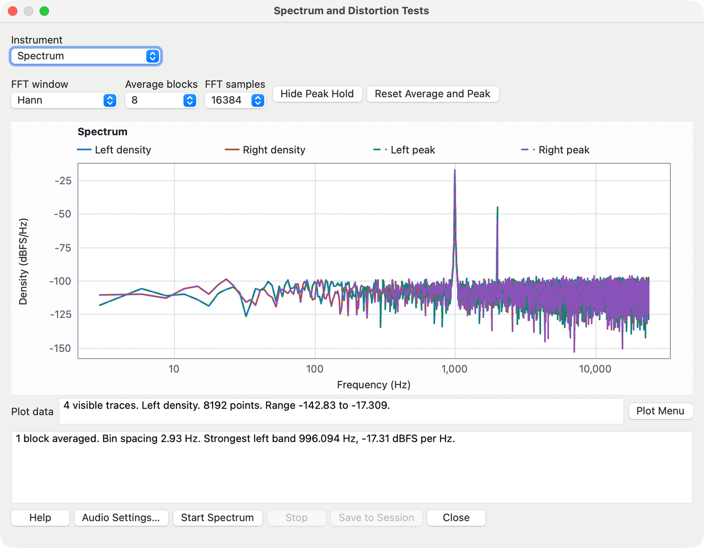
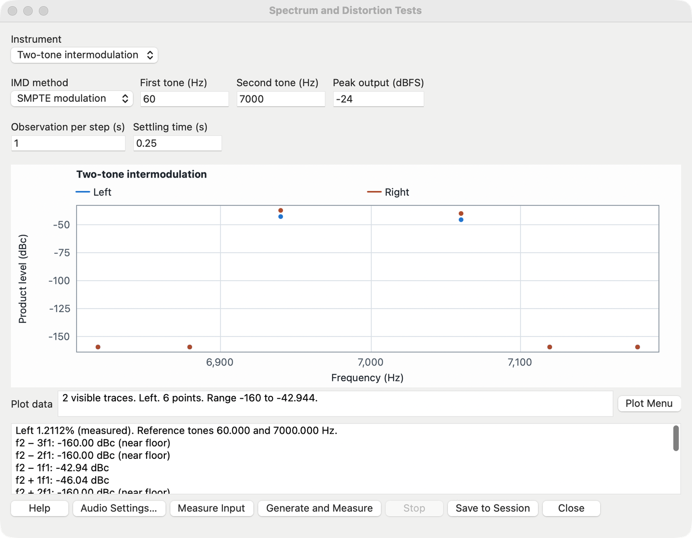
<!-- endplatform -->

<!-- platform: windows -->

Windows illustrations

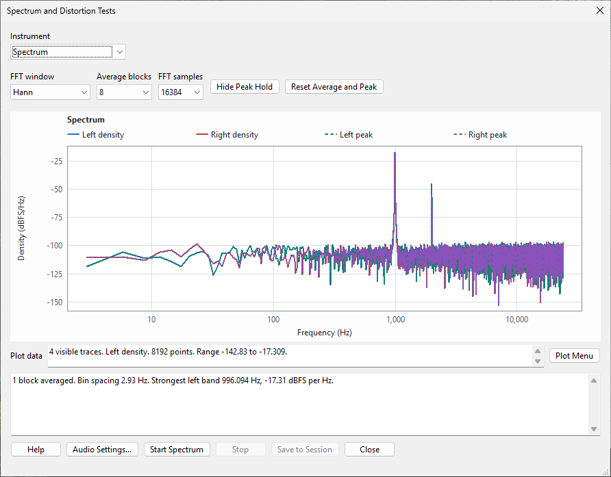
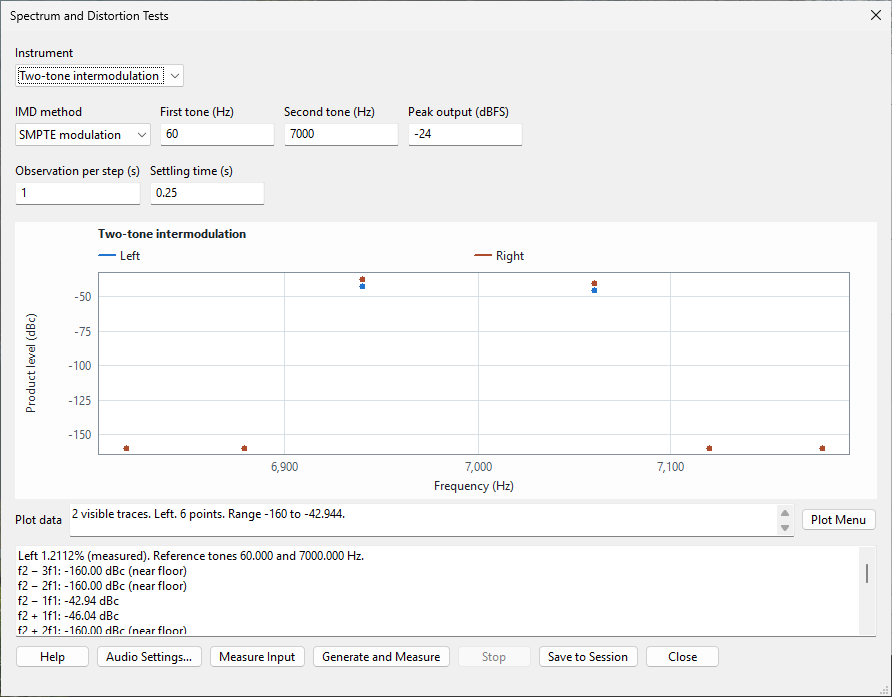

<!-- endplatform -->

<!-- platform: linux -->

Linux illustrations

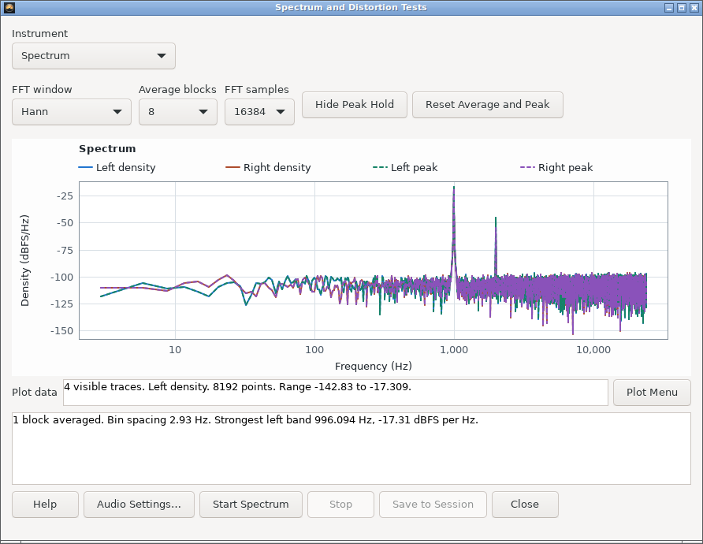
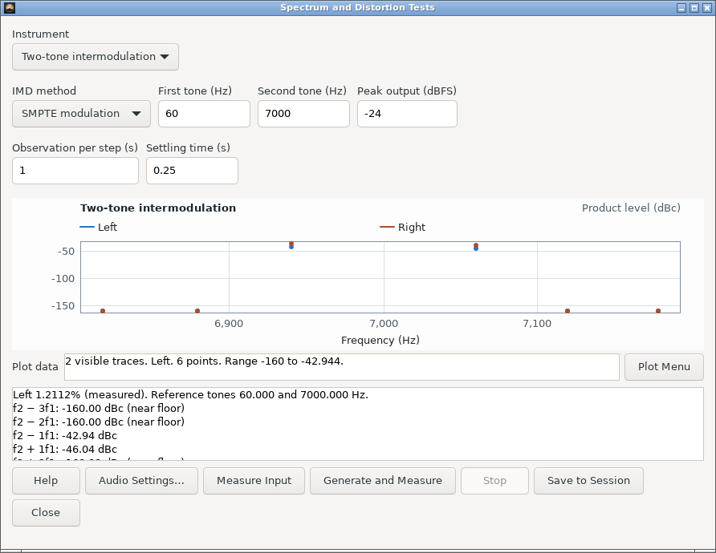

<!-- endplatform -->

## Run a stepped distortion test

1. In **Spectrum and Distortion Tests…**, select **THD versus frequency** or **THD versus level**. Connect the interface output to the device input, then connect the device output back to the interface input. Start with a low test signal.
2. Enter the start and end values and the number of steps. In a frequency test, each step changes frequency by the same ratio at a fixed output level. In a level test, each step changes level by the same number of decibels at a fixed frequency. Output levels are digital peaks.
3. Use **Settling time (s)** to give the equipment time to settle at each step. **Observation per step (s)** sets how much audio Fluttery uses for each reading. Allow more time for low frequencies or low levels of distortion.
4. Choose **Generate and Measure**. The plot shows THD and THD+N separately for each channel. Fluttery can only measure harmonics that fall within the analysis band. If none fall inside it, THD is unavailable. Clipping or a missing signal leaves a gap in the graph.
5. Choose **Save to Session** to keep the series. Review or export it in **Results**. [Review recorded measurements and distortion](07-results.md#review-recorded-measurements-and-distortion)

<!-- platform: macos -->
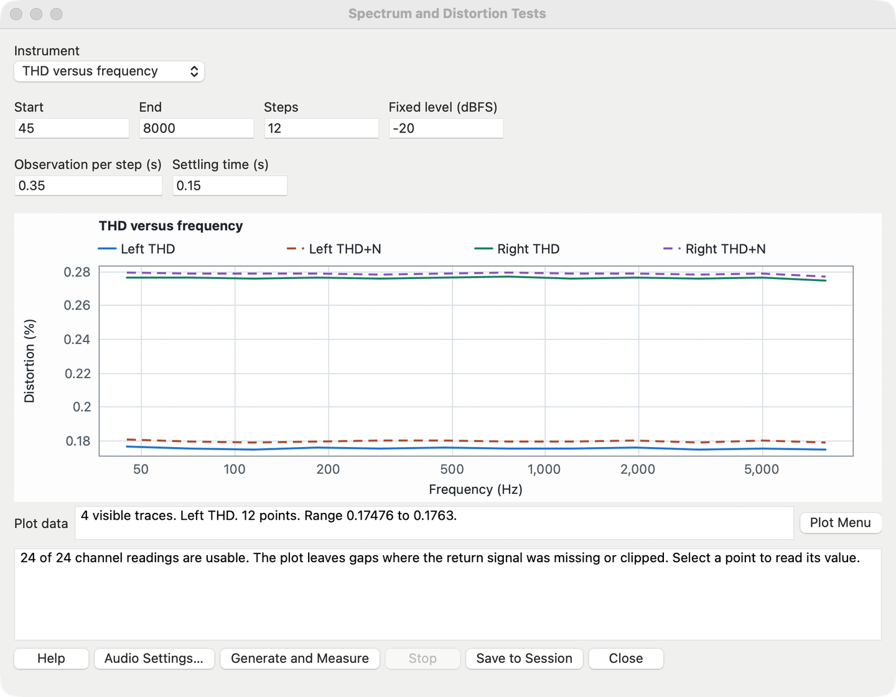
<!-- endplatform -->

<!-- platform: windows -->

Windows illustration

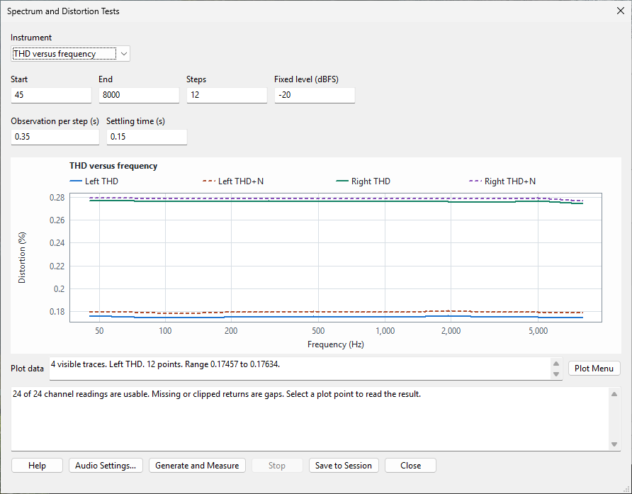

<!-- endplatform -->

<!-- platform: linux -->

Linux illustration

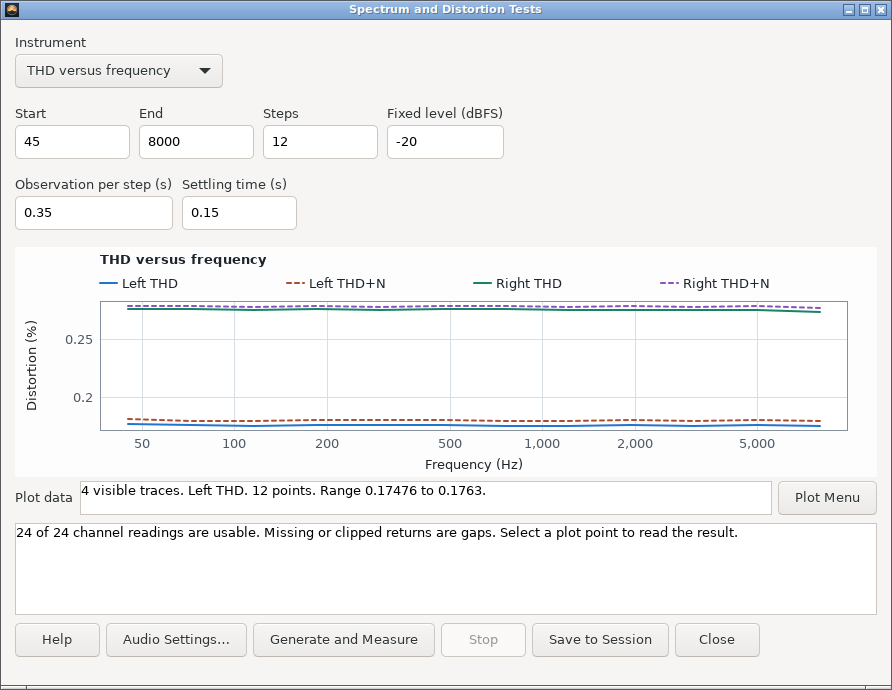

<!-- endplatform -->

## Generate a fixed-frequency test tone

1. Choose **Audio output** in **Settings > Audio I/O** and apply the settings. Connect that output to the equipment you want to test. Start with a low signal level.
2. Choose **Window > Signal Generator**. Set **Frequency standard** to **3000 Hz**, **3150 Hz**, or **Custom**. **Custom frequency (Hz)** accepts a requested frequency from 1 through 24,000 Hz. This selection also sets the measurement reference.
3. Set **Waveform** to **Sine**, **Square**, **Sawtooth**, **Triangle**, **White noise** or **Pink noise**. Sine is the usual choice for measuring wow and flutter or distortion. White noise has equal power per hertz. Pink noise has approximately equal power per octave. Frequency and frequency modulation apply to the tone waveforms.
4. Set **Output volume (%)**. **Signal preview** shows the waveform before you play it. Choose **Hide Signal Preview** in the instrument menu if you want a smaller window. Choose **Start Generator** and slowly raise the level if needed. **Output frequency** and **Read Values** show the frequency Fluttery can play at the output device’s sample rate.
5. To send more of the signal to one channel, open **Options** and set **Stereo pan (%)**. Use −100 for left only, 0 for centre or +100 for right only. Playback uses the channels your output device provides.
6. Choose **Stop Generator** when the test is complete.

If you see **Output unavailable**, check **Audio output**, the device and its cable. You can still feed the analyser through internal loopback.

## Simulate wow and flutter with frequency modulation

1. Set a stable carrier under **Frequency standard**, such as **3150 Hz**, and choose **Sine**.
2. Open **Options** and select **Enable Frequency Modulation**. **Modulation frequency (Hz)** sets how often the change repeats. The range is 0.1 to 100 Hz. Use 4 Hz to check the response near the centre of the default weighting curve.
3. **Modulation depth (%)** sets how far the tone moves from the carrier frequency at its peak. The range is 0 to 5%. For example, a depth of 0.10% gives a peak change of 3.15 Hz on a 3,150 Hz tone.
4. Start the generator and send its signal to the input with a cable or **Enable Internal Loopback**. Set the reference in Wow and Flutter to the carrier frequency. To compare the reading directly with the depth you entered, choose **Unweighted**. Wait for the detector reading to settle before comparing the values.
5. Choose **Show Split Wow and Flutter** to compare the two frequency bands. Change the modulation frequency from below to above your configured **Wow / flutter split (Hz)** and observe which reading changes most.
6. Clear **Enable Frequency Modulation** to return to the fixed carrier or choose **Stop Generator** to end the test.

<!-- figures -->
<!-- platform: macos -->
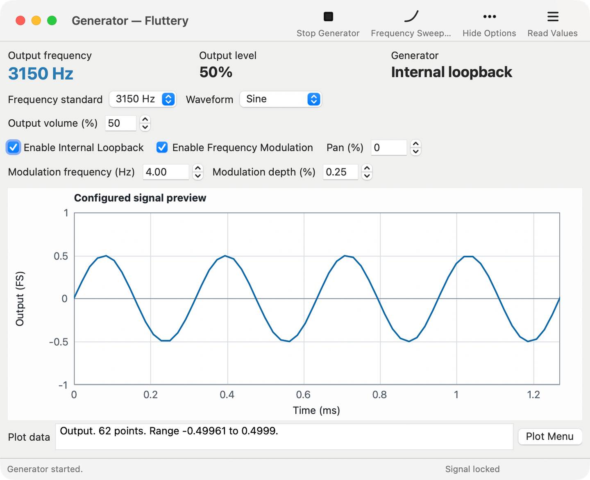
<!-- endplatform -->

<!-- platform: windows -->

Windows illustration

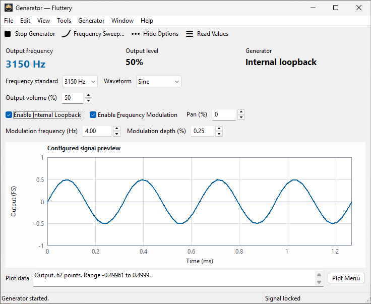

<!-- endplatform -->

<!-- platform: linux -->

Linux illustration

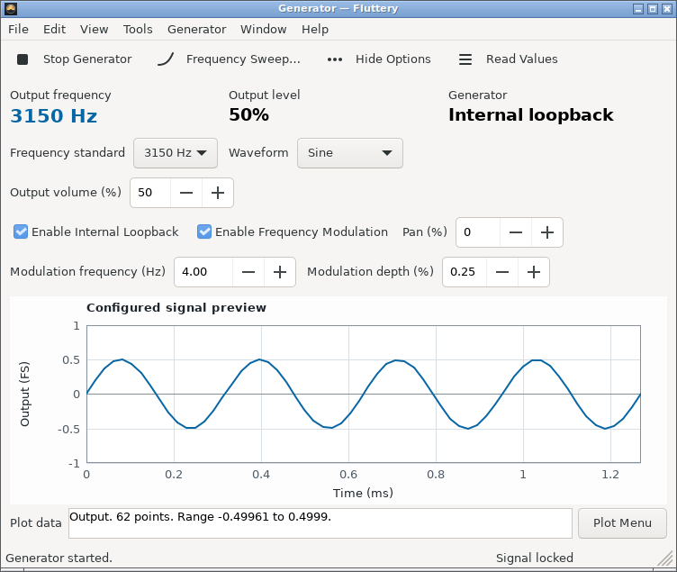

<!-- endplatform -->
<!-- endfigures -->

## Check the instrument with a loopback

1. To test without a cable, open the generator’s **Options** and select **Enable Internal Loopback**. Set the volume above zero, centre the pan and play a sine wave. Fluttery sends the signal straight to its analysis tools. It can also play the tone through the selected output device.
2. Open **Wow and Flutter**, **Oscilloscope**, or **Distortion Analyzer** and check that the signal matches the tone you set. Start recording or analysing if you want to keep session data. The tools receive the generator signal while internal loopback is on and the generator is running. Choose **Read Values** to check both settings.
3. To check the interface, turn off internal loopback, connect its line output to its line input, and start live input if needed. Keep input monitoring off to avoid feeding the input signal back to the output. Compare the readings with the internal loopback test to see how the interface affects the signal.
4. If you see no signal, check that the generator is running, the output volume is above zero and you’ve selected the input you connected. For a test that uses the left input, centre the pan or send the tone to the left.
5. Stop the generator when you’re done. Use a known reference from a separate device to calibrate the audio clock.

## Create a frequency sweep

1. Open **Window > Signal Generator**. Choose **Generator > Frequency Sweep…** or use **Frequency Sweep…** on the toolbar.
2. Choose a **Sweep preset** for the audible range, bass, midrange, treble or turntable resonance. The audible range is also available in descending order.
3. For a custom sweep, enter the start and end frequencies, duration, waveform and amplitude. Enter a higher start frequency to sweep downwards. Amplitude is a percentage of the output’s full-scale peak.
4. Choose **Linear** to change the frequency by the same number of hertz each second. Choose **Logarithmic** to change it by the same ratio each second. A logarithmic sweep spends the same time in each octave.
5. Choose **Play Sweep** to use the selected audio output. To feed the signal straight to Fluttery’s analysis tools, turn on **Enable Internal Loopback** in the Signal Generator’s **Options** before playing. You can leave the sweep window open while you use another tool. Choose **Stop Sweep** to stop early.

Start with a low amplitude when playing through an amplifier or speakers. Keep the highest frequency at or below 49% of the playback sample rate. For a 20 kHz sweep, use 44.1 kHz or higher. If you change a setting during playback, Fluttery uses the new value the next time you play or export the sweep.

Use **Plot preview** to check how the frequency or amplitude changes over time. A wide frequency range uses kilohertz. A lower one uses hertz. **Sweep activity** shows how far playback has reached, along with the current frequency and amplitude. [Explore a graph with the keyboard](02-workspace.md#explore-a-graph)

<!-- sweep figures -->
<!-- platform: macos -->
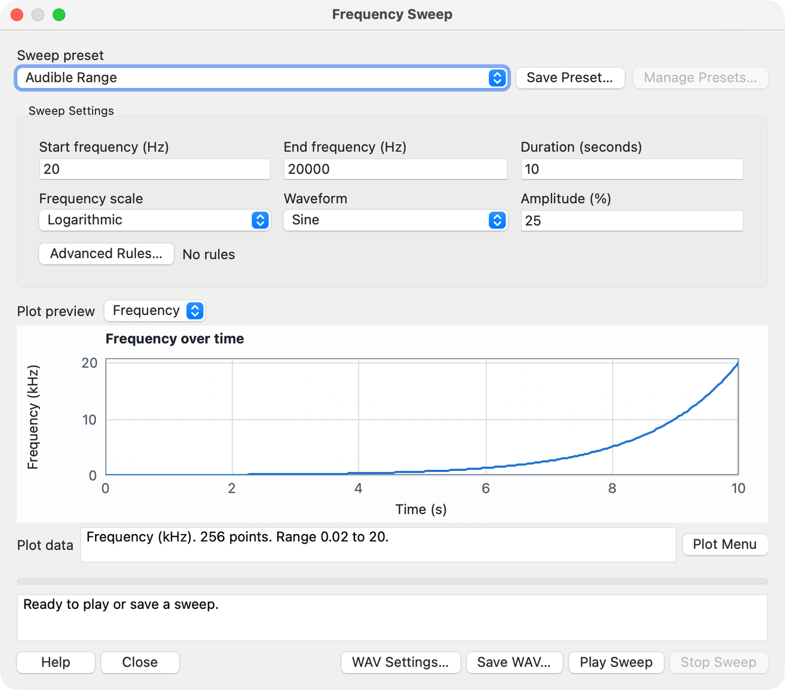
<!-- endplatform -->

<!-- platform: windows -->

Windows illustration

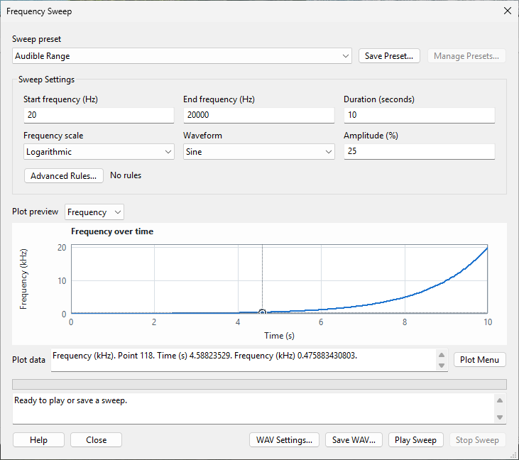

<!-- endplatform -->

<!-- platform: linux -->

Linux illustration

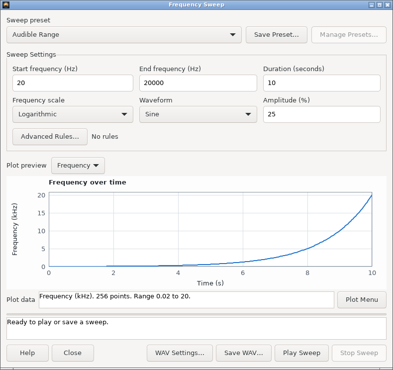

<!-- endplatform -->
<!-- end sweep figures -->

## Change waveform, frequency scale or amplitude during a sweep

1. Open **Advanced Rules…** and add a rule at a frequency inside the sweep range. Fluttery applies the rules in playback order, so descending sweeps start with the rule at the highest frequency.
2. Set a waveform if you want the sweep to change shape for the next part. For example, a sweep from 20 Hz to 20,000 Hz can start as a sine and switch to a triangle at 200 Hz.
3. To change the amplitude, choose **Step** for an immediate adjustment at the rule frequency, **Linear Ramp** for a steady change in amplitude over time, or **Logarithmic Ramp** for a steady change in level in decibels. A ramp starts at the previous amplitude change, or at the beginning of the sweep, and reaches the new level at the rule frequency.
4. Choose the frequency curve you want from that point on. You can switch from linear to logarithmic or the other way around. The sweep’s original scale sets the time at which it reaches each rule. The curve in the rule changes how the frequency moves between those points.
5. Edit or delete a rule in the list to adjust the sweep. Use one rule per frequency and put any changes that occur together in that rule. You can make an amplitude ramp finish at the end frequency. Choose **Apply Rules** to return to the sweep.

To fade out, add a rule at the end frequency. Set the amplitude to zero and choose a ramp. A logarithmic ramp to or from zero uses a short taper to reach silence at its zero end.

<!-- sweep figures -->
<!-- platform: macos -->
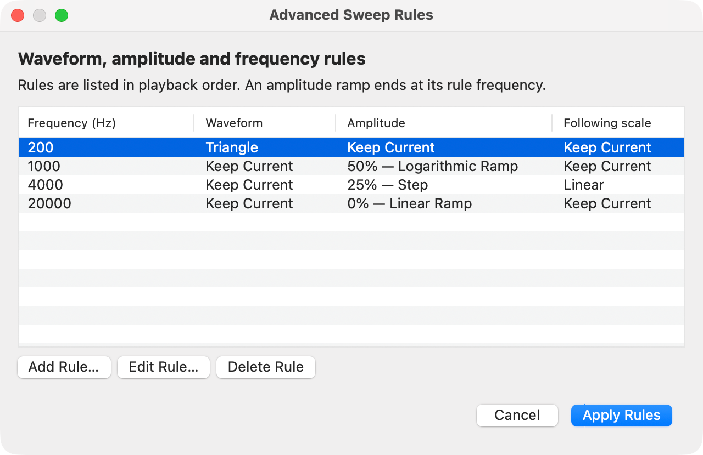
<!-- endplatform -->

<!-- platform: windows -->

Windows illustration

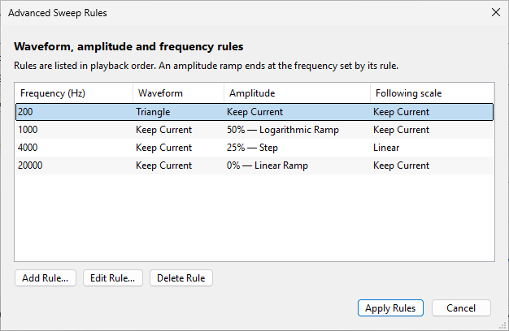

<!-- endplatform -->

<!-- platform: linux -->

Linux illustration

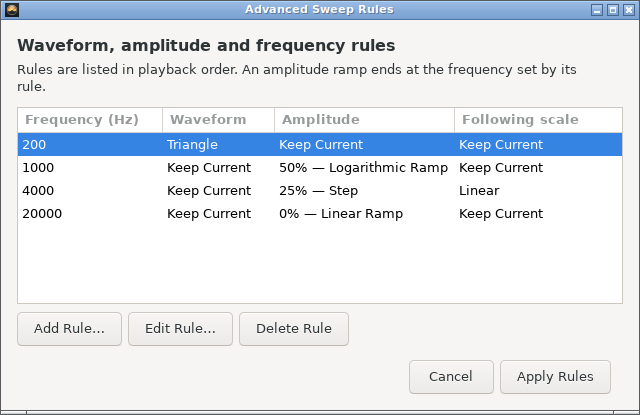

<!-- endplatform -->

<!-- platform: macos -->
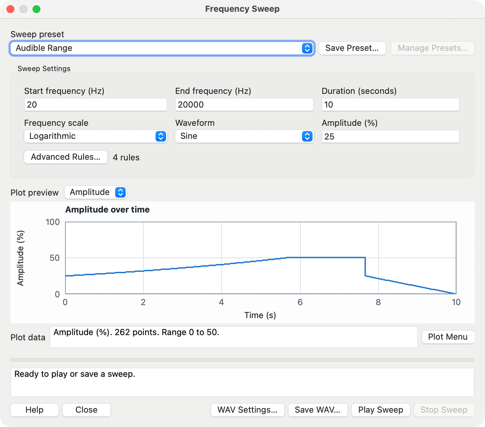
<!-- endplatform -->

<!-- platform: windows -->

Windows illustration

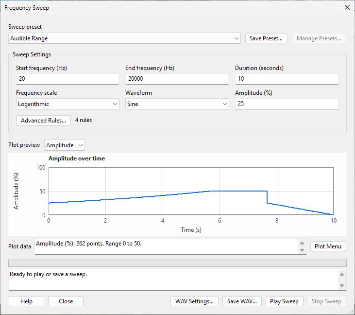

<!-- endplatform -->

<!-- platform: linux -->

Linux illustration

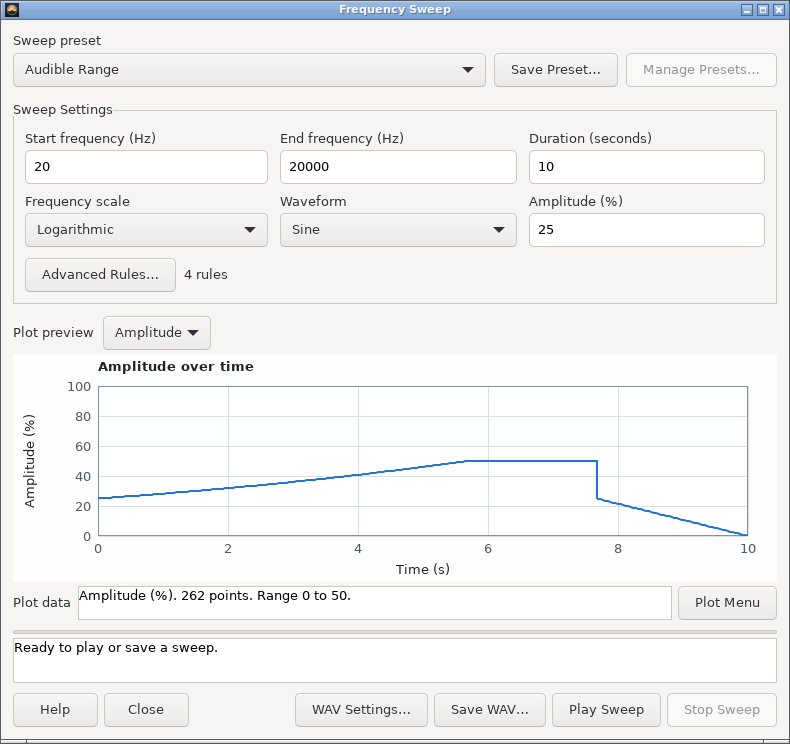

<!-- endplatform -->
<!-- end sweep figures -->

## Save a sweep as a WAV file

1. Design a sweep or load a preset.
2. Open **WAV Settings…**. Choose the sample rate, mono or stereo, and 16-, 24- or 32-bit PCM. Both channels of a stereo file contain the same signal.
3. Choose **Save WAV…**, enter a filename, and choose where to save it. The export uses the sweep’s amplitude and rules.
4. Check the export status for progress, or choose **Cancel Export** to stop. A higher sample rate or bit depth makes a larger file. Choose a sample rate high enough for the highest frequency in the sweep.

## Save and manage named sweep presets

1. Set up the sweep and WAV format you want to reuse.
2. Choose **Save Preset…** and enter a name. This saves the range, duration, scale, starting waveform and amplitude, the advanced rules and the WAV settings.
3. Select the named preset from **Sweep preset** to load it. To change it, edit the values and use **Save Preset…** with the same name. Use a different name to keep both versions.
4. Use **Manage Presets…** to rename or delete a saved preset, then choose **Apply Changes**. To make your own version of a factory preset, save it under a new name.

## Keyboard shortcuts

| Command | macOS | Windows and Linux |
| --- | --- | --- |
| Open Wow & Flutter | `Command+1` | `Control+1` |
| Open Distortion Analyzer | `Command+4` | `Control+4` |
| Open Signal Generator | `Command+5` | `Control+5` |
| Open Session Results | `Command+6` | `Control+6` |
| Read Current Values | `Command+Shift+R` | `Control+Shift+R` |
| Open Keyboard Commands | `Command+Shift+K` | `Control+Shift+K` |
| Describe the focused control | `Command+Shift+H` | `Control+Shift+H` |
| Save Session | `Command+S` | `Control+S` |
| Move between search and the list in Keyboard Commands | `F6` | `F6` |
| Read the selected command description | `F7` | `F7` |
| Move between frequency bins with the plot focused | `Left Arrow` or `Right Arrow` | `Left Arrow` or `Right Arrow` |
| Pan or zoom with the plot focused | `Shift+Arrow` to pan, `+` or `-` to zoom | `Shift+Arrow` to pan, `+` or `-` to zoom |
| Restore the default plot axes | `Home` | `Home` |
| Open the Plot Menu from the plot or plot data | `Shift+F10` | `Shift+F10` |
| Move through the sweep rule table or editor fields | `Tab` or `Shift+Tab` | `Tab` or `Shift+Tab` |
| Select a rule while the table has focus | `Up Arrow` or `Down Arrow` | `Up Arrow` or `Down Arrow` |
| Toggle the focused checkbox | `Space` | `Space` |

For distortion measurements, search **Keyboard Commands** for **Audio Settings**, **Start Analysis**, **Pause Analysis**, **Resume Analysis**, **Reset Distortion Results**, **View Results** or **Read Plot Data**. For a bench test, look for **Spectrum and Distortion Tests**, **Peak Hold**, **Measure Input**, **Generate and Measure**, **Stop** or **Save to Session**.

In the generator, look for **Start Generator**, **Stop Generator**, **Select Frequency Standard**, **Edit Custom Frequency**, **Select Waveform**, **Edit Output Volume** or **Focus Internal Loopback**. Select **Custom** before editing the frequency. Open **Options** and turn on frequency modulation before using **Edit Modulation Frequency** or **Edit Modulation Depth**. You can also search for **Focus Frequency Modulation**, **Edit Stereo Pan** and **Start Live Input**.

Search for **Frequency Sweep** to open the sweep tool. There, look for **Play Sweep**, **Stop Sweep**, **Advanced Rules**, **WAV Settings**, **Save WAV**, **Save Preset**, **Manage Presets** or the field you want to edit. In Advanced Rules, search for **Add**, **Edit** or **Delete**.

## Support Fluttery

If you like Fluttery and you’d like to support my work, you can [make a donation](https://www.paypal.com/donate/?hosted_button_id=WMLX4PLED9PRE). There’s no pressure or hard sell. Fluttery is and always will be free.
