# Sessions, results and reports

Open **Window → Session Results** to see your wow and flutter history, saved turntable readings and distortion results. Use **Show** to pick a view. You can set the view you start in under **Settings → General → Default results view**.

When a shortcut names Keyboard Commands, open **Help → Keyboard Commands…**, find the named command, then press Return or Enter. The list displays a two-letter shortcut for each command available in the current window.

## Create, open and save a session

1. Choose **File → New Session** to start a set of measurements in a new window. Your current session stays open. To see another tool for the same session, choose **File → New Window**.
2. Run your measurements. Fluttery adds wow and flutter samples to the session as you record. To keep a turntable or distortion reading, use the recording or capture action in that tool.
3. In Results, choose **Session metadata** from **Show**. Fill in **Technician**, **Equipment** and **Notes** as needed. The notes are a good place to record which test record and track you used, how you connected the equipment and any other measurement conditions.
4. Choose **File → Save Session**. When asked, pick where to save it. Use **Save Session As…** to keep a separate copy.
5. Use **File → Open Session…** to reopen a Fluttery session or load a Fluttery JSON export. After opening a JSON export, choose **File → Save Session** to save it as a Fluttery session.

Fluttery uses the name in **Settings → Reports → Default technician** when you create a session. Any changes you make in **Session metadata** belong to the current session. Save it to keep them.

In the Wow & Flutter tool, choose **Wow & Flutter → Clear Wow and Flutter History** to remove the current run's readings, spectral history, signal losses and embedded audio. Earlier saved runs, instrument measurements, metadata and the current session file stay in place. Choose **File → Clear Session…** to clear the whole session after confirmation. If you've already saved a copy to disk, you can reopen it with **Open Session…**.

## Review saved instrument settings

If a session used different instrument settings, **Review Session Settings** shows the saved values alongside your current ones. Choose **Keep Current Settings** to open the session with the setup you're using now.

1. Pick an item in the list and read **Selected difference**. Before offering a saved calibration, Fluttery checks whether it can use the original devices and sample format.
2. Tick the changes you want, or choose **Select All Compatible**. If a calibration needs its original audio route, select the device and sample format along with the calibration.
3. Choose **Use for This Session** to use the selected settings until you replace or clear the session. Choose **Save as My Settings** to make them your defaults. Values that Fluttery can't identify or use remain visible in the list and saved in the session.

To restore a detector or weighting preset, tick the values that go with it. If you choose just one of those values, Fluttery uses a custom setup and keeps the others as they are. Choosing an item marked **Use default** removes an override that was absent from the saved setup.

To check the settings again later, select a run and choose **Results → Review Saved Run Settings…**. For a run imported from a WAV file, the settings show the file's sample rate and channel details. There is no live interface route for that run.

<!-- platform: linux -->

Linux illustration

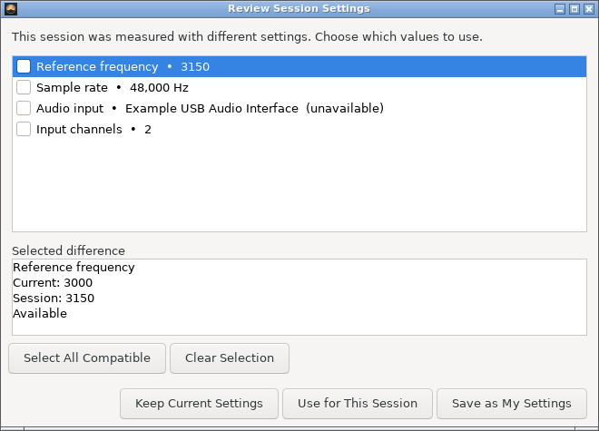

<!-- endplatform -->

## Keep runs, signal losses and original audio

Fluttery starts with compact history, which is enough for a quick check. If you need more detail, open **Settings → General → Session capture** before starting the run.

| Option | What to keep |
| --- | --- |
| **Keep complete run history** | Every analysis reading and earlier runs in the same session. With this off, Fluttery keeps recent readings up to the limit in **Maximum compact history samples**. |
| **Keep detailed signal-loss information** | The start and end of interruptions and why a reading was unavailable, for example when the reference was lost or the input clipped. |
| **Include original input audio** | A lossless copy of the audio from the input alongside its readings. For WAV analysis, this means all channels from the selected part of the file. Fluttery keeps up to 512 MiB of compressed audio per run. **Session statistics** shows how much it kept and tells you if the capture was interrupted or reached the limit. |

1. Apply your settings, then record a wow and flutter run or import an analysed WAV. If you save while Fluttery is still capturing the original input, it finishes the run before saving so the file includes all the audio captured so far.
2. If the session contains earlier runs, choose one from **Saved run** in Results. The plots, sample table, statistics and report then show that run. **Recorded measurements** still shows individual readings for the whole session.
3. Choose **Results → Read Signal Losses…** to see when the signal dropped out during the selected run. If you kept the audio, **Export Original Input Audio…** saves it as a WAV. If the format changed during capture or the stream was interrupted, Fluttery saves the WAV segments together in a ZIP file.
4. To make a session smaller, choose **Results → Remove Original Input Audio…** for the selected run, confirm and save. This keeps the instrument readings and signal-loss information.

If Fluttery can't use a reading, it leaves a gap in the plot and an empty cell in the sample table. You still see those gaps when detailed signal-loss information is off.

<!-- platform: linux -->

Linux illustration

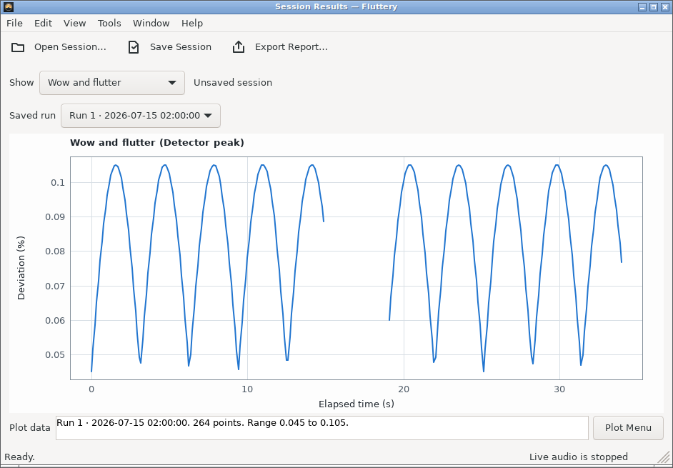

<!-- endplatform -->

## Review wow and flutter

| Show | What to read |
| --- | --- |
| **Spectrum (FFT)** | Shows how much modulation there is at each frequency. Check the frequency in hertz at a peak to help track down a repeating mechanical source. The 0 Hz bin represents a steady component. |
| **Wow and flutter** | Shows wow and flutter over time as a percentage. Look here for changes during a run or an unusually high peak. |
| **Speed drift** | Plots the measured reference frequency over time. Compare steady sections to see how much the frequency moved during a run. |
| **Spectrogram** | Shows how modulation changes over time. Time runs along the horizontal axis, frequency runs up the vertical axis and colour shows level. You can read all three values in the data controls. |
| **Session samples** | Timestamp, detector peak, raw block peak, RMS and frequency for each retained sample. Empty cells mark unavailable readings. **Previous Page** and **Next Page** move through longer runs. |
| **Session statistics** | Shows the sample count, the minimum, maximum and average for the selected peak source, average RMS and frequency statistics. With enough readings, Fluttery gives frequency drift in hertz and percent, and standard deviation in hertz and parts per million. The summary tells you how many samples it left out. |

Under **Settings → Measurement → History graph source**, choose the smoothed **Detector peak** or **Raw block peak** for the history graph and its statistics. Both readings are available in the sample table. Use the same standard, reference and detector settings for runs you intend to compare.

The flutter spectrum uses decibels relative to one hertz RMS of speed modulation per FFT bin. In the spectrogram, a blank interval marks a loss of continuous usable input, including the settling time after the reference returns.

Focus the plot to explore it with the keyboard, or select **Results → Read Plot Data** to reach the plot's text and data controls. **Show Plot Controls** makes the controls visible if they are hidden. **View → Read Current Values…** opens a stable text copy of the readings in the active view.

<!-- figures -->
<!-- platform: macos -->
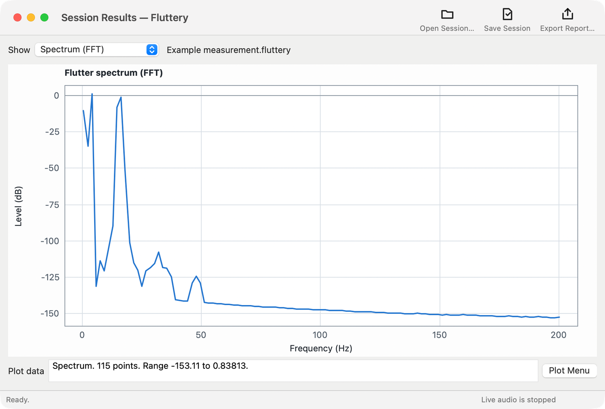
<!-- endplatform -->

<!-- platform: windows -->

Windows illustration

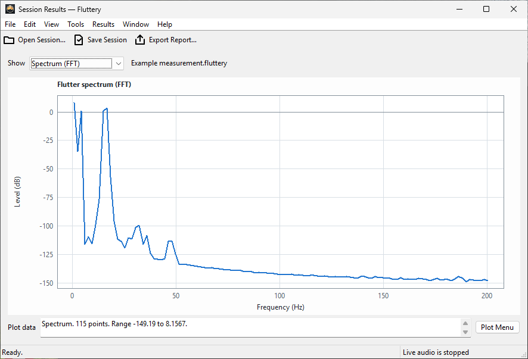

<!-- endplatform -->

<!-- platform: linux -->

Linux illustration

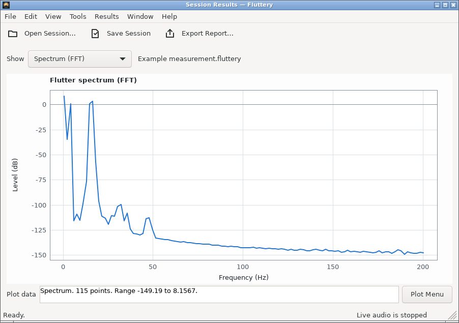

<!-- endplatform -->

<!-- platform: macos -->
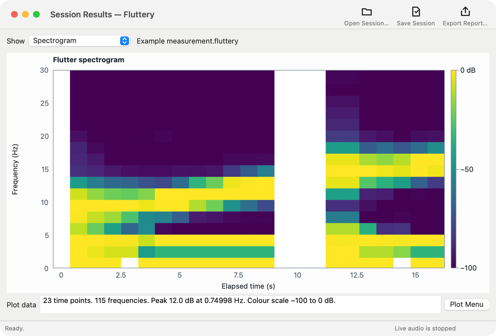
<!-- endplatform -->

<!-- platform: windows -->

Windows illustration

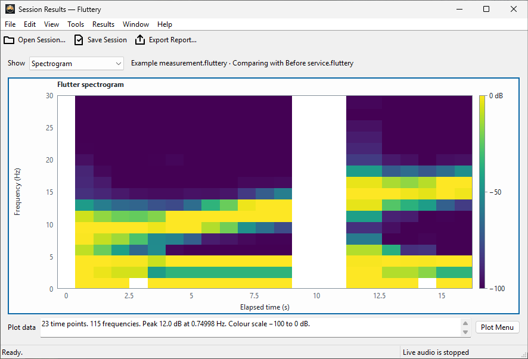

<!-- endplatform -->

<!-- platform: linux -->

Linux illustration

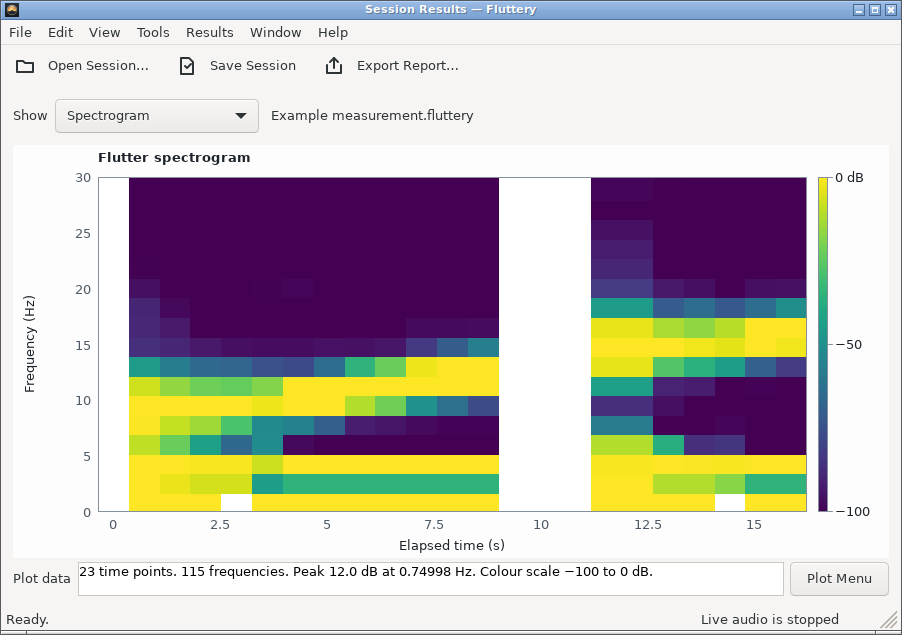

<!-- endplatform -->
<!-- endfigures -->

## Review recorded measurements and distortion

Choose **Recorded measurements** to see saved speed, crosstalk, channel balance, distortion, noise floor, resonance, tracking, alignment, frequency response, two-tone intermodulation and stepped distortion measurements. Leave **Type** on **All measurement types** or pick just the one you want to see. Select a row. Under **Display**, choose **Details** for a summary, **Graph** for a plot or **Sample table** for individual points when available. If the graph is empty, check **Details** to see what the entry contains.

If you captured a response with a matching calibration, choose **Display → Graph** and turn on **Compare with Raw** to plot the measured and corrected gain together. In **Sample table**, the same control shows measured and corrected gain, phase and group delay when the capture includes them. Fluttery compares the saved values even if you've changed your interface setup since then. From **Details**, you can open the graph with both traces by choosing **Results → Compare with Raw**. Choose **Results → Hide Raw Comparison** to go back.

The speed table shows which playback speed, reference tone and test-record speed you used. If you measured crosstalk in both directions, Fluttery lists each separately with the measured leakage and noise floor. A **≥** beside a separation value means the leakage was too low to measure directly, so the value is a lower bound.

From a turntable measurement, choose **Turntable → View Results** to go straight to its saved reading or history. Where you land depends on the tool and what you've recorded.

Choose **THD+N results** to see Distortion and Tracking distortion readings together in the order you recorded them. The summary gives the minimum, average and peak THD+N. The graph and sample table show where each reading came from. You may also see THD, right-channel THD+N and the measured fundamental frequency, depending on what you recorded. Use **Display → Sample table** when you need exact numbers.

## Compare sessions

1. Open one session or record a new wow and flutter run.
2. Choose **File → Compare With Session…** and pick a Fluttery session or a Fluttery JSON export containing wow and flutter history.
3. Fluttery opens **Wow and flutter** in Session Results and lines up the traces from the start of each run. Choose **Speed drift** to compare measured frequency or **Session statistics** to compare summary values.
4. Choose **Results → Read Comparison…** for the peaks, average frequencies and sample counts of both runs. Fluttery subtracts the comparison run's value from the current run's value. It gives the peak difference in percentage points and the average frequency difference in hertz.
5. Choose **Results → Clear Comparison** to remove the comparison. Keep the comparison file if you want to load it again the next time you open the session.

<!-- figures -->
<!-- platform: macos -->
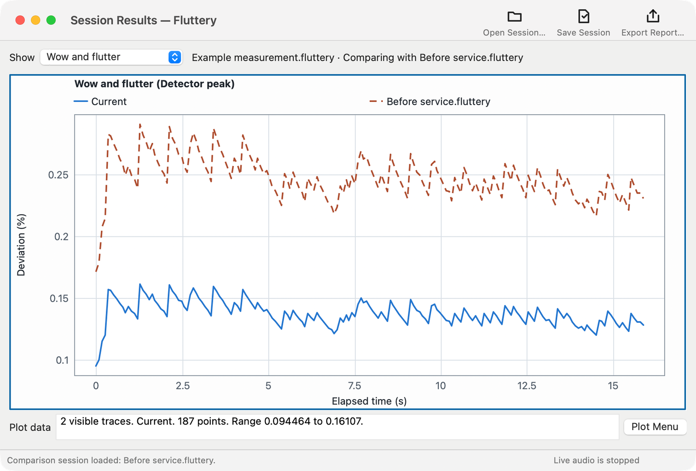
<!-- endplatform -->

<!-- platform: windows -->

Windows illustration

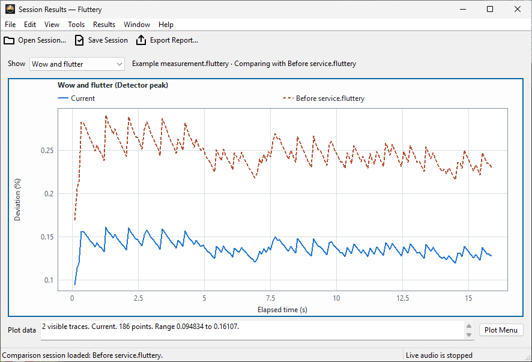

<!-- endplatform -->

<!-- platform: linux -->

Linux illustration

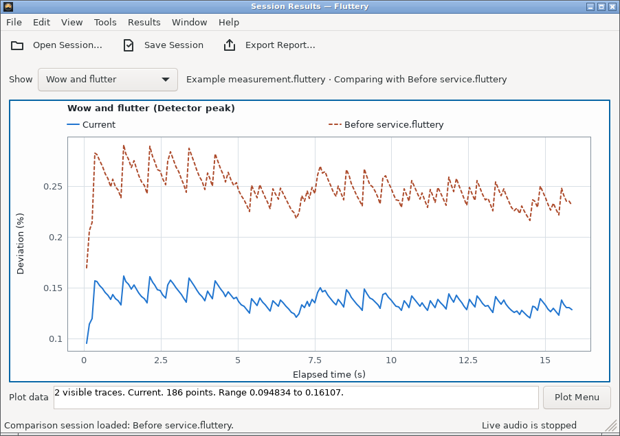

<!-- endplatform -->

<!-- platform: macos -->
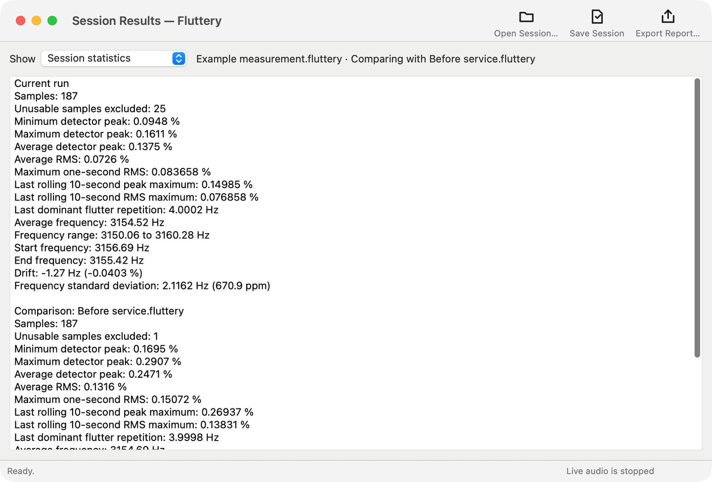
<!-- endplatform -->

<!-- platform: windows -->

Windows illustration

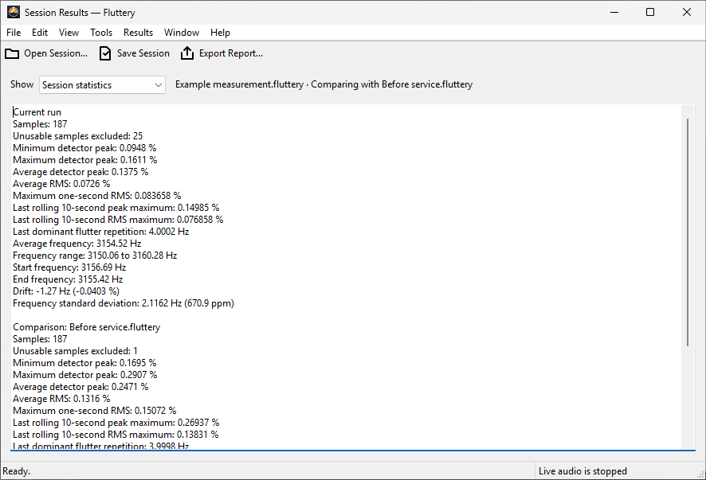

<!-- endplatform -->

<!-- platform: linux -->

Linux illustration

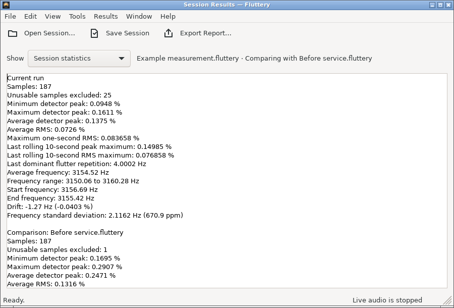

<!-- endplatform -->
<!-- endfigures -->

## Configure and export reports

Open the session you want to report on. In **Settings → Reports**, choose the sections you want and decide whether to **Include report metadata**, **Include data tables** or **Include graph text descriptions**. For printing, set **Paper size** and **PDF layout scale**. You can also set a suggested filename and choose a logo here. Choose **Apply Settings** when you're done. For details on each option, see the [Reports settings reference](91-settings-reference.md#reports).

Choose a format from **File → Export**, or choose **Export Report…** on the Session Results toolbar to see the available formats. In the save dialog, check the filename and where the report will go. Wait until Fluttery tells you the export has finished before starting another export or print job.

| Export | What it contains |
| --- | --- |
| **CSV data…** | Rows for the run's samples, any signal-loss details you kept and the measurement sections you enabled. Empty cells mark unavailable readings. Open the file in a spreadsheet or text editor. |
| **JSON data…** | History, saved spectra and signal-loss details, and recorded measurements. Use the file to process readings elsewhere or open them again in Fluttery. **Include report metadata** controls whether it contains names, equipment and notes. Use **Save Session** to keep earlier runs and embedded input audio. |
| **PDF report…** | A report laid out for the paper size you chose, with the sections, charts, tables and optional text descriptions you enabled. |
| **Interactive HTML report…** | A report you can open on its own in a browser. Use **Zoom in**, **Zoom out** and **Reset zoom** to change the view. Use **Explore data points** to choose a trace and point, or **Explore spectrum levels** to choose a time and frequency on a spectrogram. The report shows the selected value in text. |
| **Complete ZIP archive…** | The PDF, CSV, JSON and HTML exports and any available session graph images, all in one file. |
| **Graph image…** | A PNG, SVG or PDF of the current Results graph. If the current view has no graph, Fluttery can offer other graphs from the session. Use [image export options](02-workspace.md#save-or-copy-a-plot-image) to choose the view, dimensions and appearance. |

<!-- figures -->
<!-- platform: macos -->
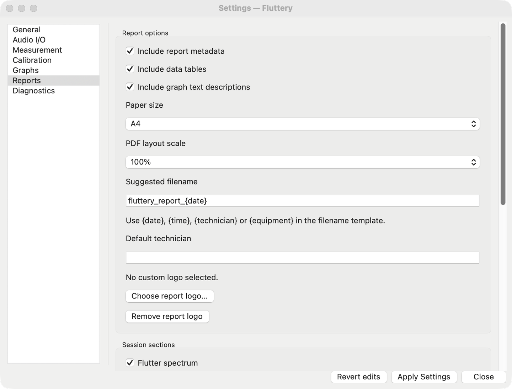
<!-- endplatform -->

<!-- platform: windows -->

Windows illustration

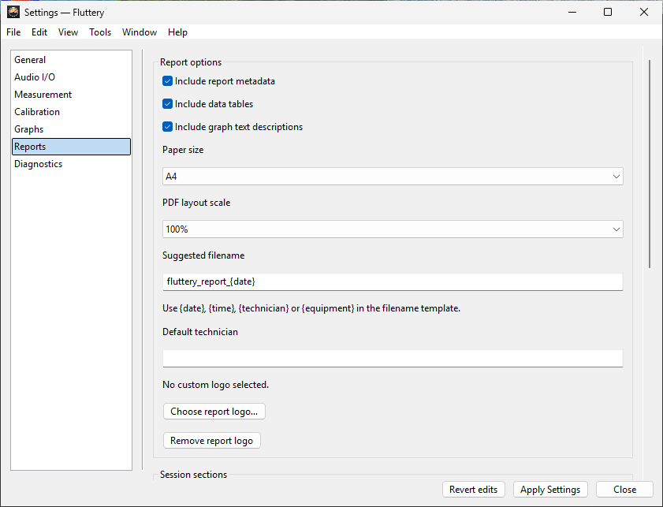

<!-- endplatform -->

<!-- platform: linux -->

Linux illustration

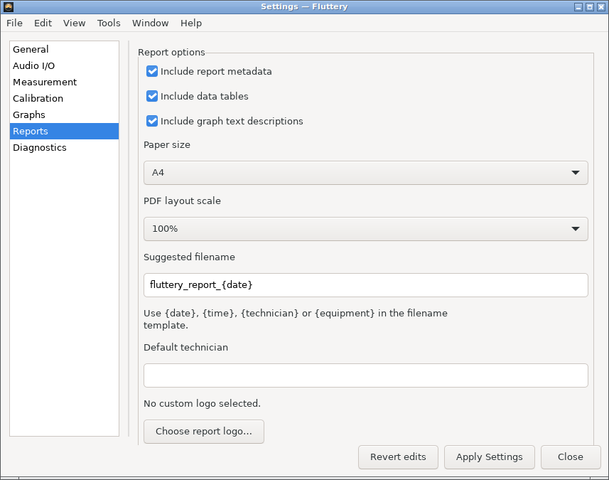

<!-- endplatform -->
<!-- endfigures -->

## Print a report

1. In **Settings → Reports**, choose the paper size and the sections you want to print, then apply your settings.
2. Choose **File → Print Report…**.
3. In the print dialog, choose your printer. Set the page range, paper and orientation where available, then print. If the dialog offers a PDF destination, you can save a copy there. To use Fluttery's own PDF report settings, choose **File → Export → PDF report…**.

## Keyboard shortcuts

| Command | macOS | Windows and Linux |
| --- | --- | --- |
| Open Session Results | `Command+6` | `Control+6` |
| New Session | `Command+N` | `Control+N` |
| New Window for the current session | `Command+Shift+N` | `Control+Shift+N` |
| Open Session… | `Command+O` | `Control+O` |
| Save Session | `Command+S` | `Control+S` |
| Save Session As… | `Command+Shift+S` | `Control+Shift+S` |
| Clear Wow and Flutter History | `Command+R` | `Control+R` |
| Clear Session… | `Command+Shift+E` | `Control+Shift+E` |
| Open Keyboard Commands | `Command+Shift+K` | `Control+Shift+K` |
| Read Current Values | `Command+Shift+R` | `Control+Shift+R` |
| Compare with Raw or Hide Raw Comparison | `Command+Shift+B` | `Control+Shift+B` |
| Print Report… | `Command+P` | `Control+P` |
| Move between differences in Review Session Settings | `Up Arrow` or `Down Arrow` | `Up Arrow` or `Down Arrow` |
| Select or clear the highlighted compatible difference | `Space` | `Space` |
| Keep Current Settings | `Escape` | `Escape` |
| Move between plot points | `Left Arrow` or `Right Arrow` with the plot focused | `Left Arrow` or `Right Arrow` with the plot focused |
| Change trace or spectrogram frequency | `Up Arrow` or `Down Arrow` with the plot focused | `Up Arrow` or `Down Arrow` with the plot focused |
| Pan or zoom with the plot focused | `Shift+Arrow` to pan, `+` or `-` to zoom | `Shift+Arrow` to pan, `+` or `-` to zoom |
| Fit Plot | `Home` with the plot focused | `Home` with the plot focused |
| Open the Plot Menu | `Shift+F10` with the plot focused | `Shift+F10` with the plot focused |
| Move through a table | Arrow keys with the table focused | Arrow keys with the table focused |
| Move to the next field or button in a dialog | `Tab` | `Tab` |
| Activate the focused button | `Space` or `Return` | `Space` or `Return` |

In **Keyboard Commands**, search for **Review Saved Run Settings**, **Focus Saved run**, **Read Signal Losses**, **Export Original Input Audio** or **Remove Original Input Audio**. After focusing **Saved run**, use the arrow keys to choose a run.

To change what you’re reviewing, search for **Focus Results view**, **Focus Measurement type filter**, **Focus Selected measurement view** or **Focus Distortion history view**. **View Results** opens the results from the current instrument when available. You can also find **Read Plot Data**, **Previous Page** and **Next Page**.

To compare sessions, look for **Compare With Session**, **Read Comparison** or **Clear Comparison**. To export, find **Export Report** or search by format, such as **CSV data**, **JSON data**, **PDF report**, **Interactive HTML report**, **Complete ZIP archive** or **Graph image**.

## Support Fluttery

If you like Fluttery and you’d like to support my work, you can [make a donation](https://www.paypal.com/donate/?hosted_button_id=WMLX4PLED9PRE). There’s no pressure or hard sell. Fluttery is and always will be free.
