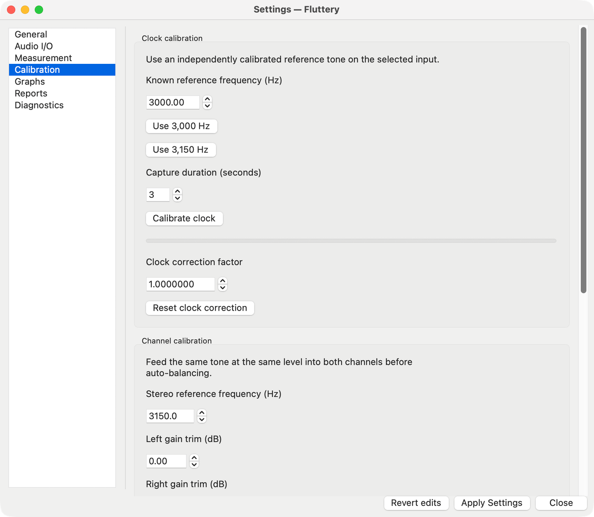
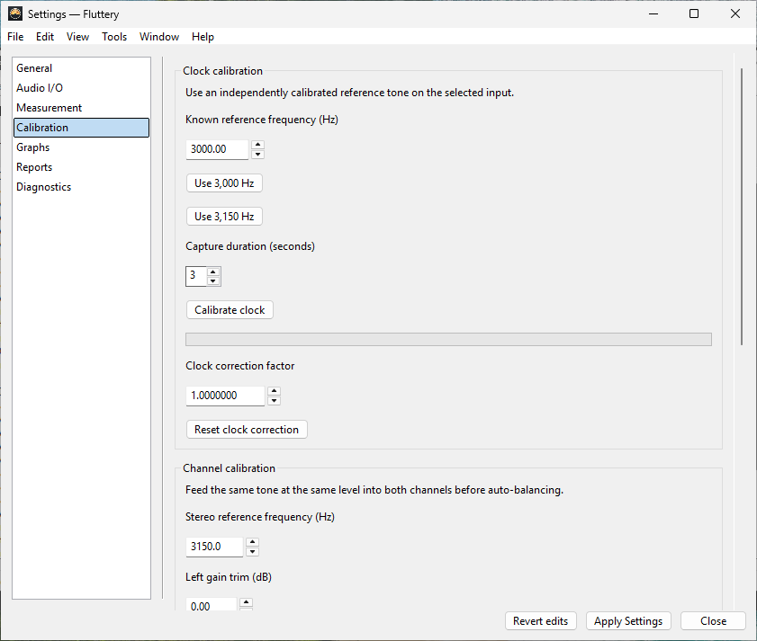
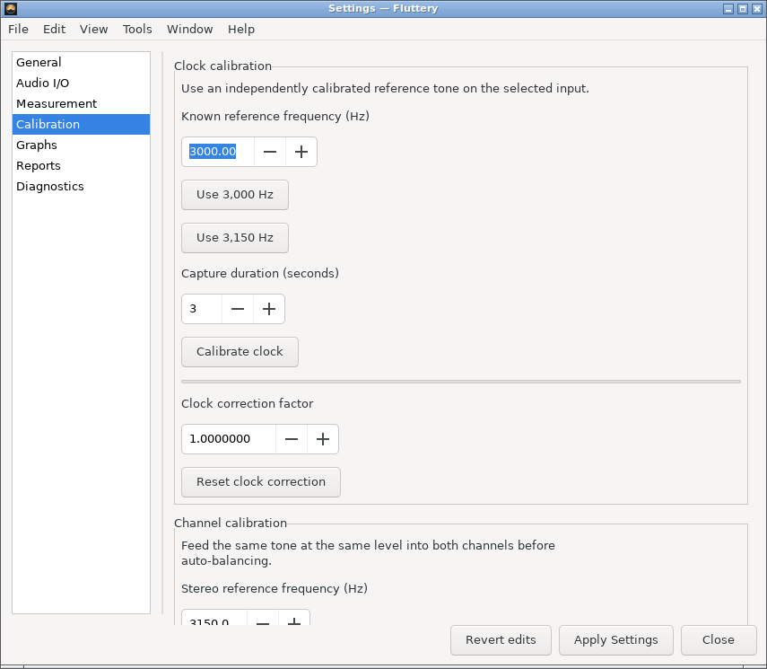

# Calibration

Calibrate the clock if your interface reads a known frequency consistently high or low. If the input channels read different levels with the same signal, adjust their gain trims. Both controls are under **Calibration** in **Window → Settings**.

[Interface Response Calibration](10-frequency-response.md#calibrate-an-interface) measures the interface’s output and input together. Use that profile for a device or tape recording test on the same audio route. For electrical measurements, enter a known voltage in [Voltage Calibration](11-bench-levels.md#calibrate-voltage). To measure the delay between the interface’s channels, use the [azimuth assistant](10-alignment.md#measure-tape-head-azimuth).

## Prepare the reference signal

1. Stop any wow and flutter recording. Turn off **Enable Internal Loopback** in the Signal Generator before calibrating a physical input.
2. In **Settings → Audio I/O**, choose the interface and sample rate you’ll measure with. Choose **Stereo** to calibrate both channels, then choose **Apply Settings**.
3. Connect a steady external reference to the left input to calibrate the clock. For stereo calibration, send the same signal at the same level to both inputs.
4. Choose **Tools → Audio → Start Live Input** or **Start live input** in **Settings → Audio I/O**. Open **Calibration** and check **Live calibration levels** to see that the signal is coming in without clipping.

An interface can use the same clock for its input and output. A tone from that interface is fine for checking your connections. To measure its clock error, use a source with its own clock. If you change the interface or sample rate, check the correction again or recalibrate.

## Calibrate the sample clock

1. Enter the exact frequency of the source in **Known reference frequency (Hz)**. **Use 3,000 Hz** and **Use 3,150 Hz** fill in the two common reference frequencies.
2. Set **Capture duration (seconds)**. The default is three seconds. Keep the tone steady throughout the capture.
3. Select **Calibrate clock**. Follow **Calibration progress**, then check the result in **Calibration status**.
4. Check **Clock correction factor**. If calibration succeeds, Fluttery saves the factor. It’s the known frequency divided by the measured frequency and is usually close to 1.
5. Leave the reference source connected and check the corrected frequency in the measurement tool.

If you know the correction factor, enter it in **Clock correction factor** and choose **Apply Settings**. **Reset clock correction** sets the factor back to 1 straight away. If Fluttery reports an unstable tone, check the source and input level before trying again.

<!-- figures -->
<!-- platform: macos -->

<!-- endplatform -->

<!-- platform: windows -->

Windows illustration

<!-- endplatform -->

<!-- platform: linux -->

Linux illustration

<!-- endplatform -->
<!-- endfigures -->

## Match the stereo channels

1. Set both inputs to the same gain and feed them the same steady reference signal. Check that **Input channels** is set to **Stereo** and live input is running.
2. In **Calibration**, enter your source frequency in **Stereo reference frequency (Hz)** and set **Capture duration (seconds)**.
3. Select **Auto-balance stereo channels**. Keep the signal and gain controls steady until **Calibration status** reports the result.
4. Check **Live calibration levels**. A positive left-minus-right reading means the left channel is louder. With the same signal on both inputs, the corrected difference should be close to 0 dB.

Fluttery splits the adjustment between the two channels and saves the trims if calibration succeeds. To set them by hand, enter **Left gain trim (dB)** and **Right gain trim (dB)**, then choose **Apply Settings**. If the left input is 1 dB louder, set the left trim to −0.5 dB and the right trim to +0.5 dB. **Reset channel trims** sets both trims to 0 dB and restores the 3,150 Hz stereo reference straight away.

Check the corrected difference with the reference still connected. Fluttery applies the trims when it analyses stereo measurements. The physical output and the oscilloscope still use their original signal levels.

## Keyboard shortcuts

| Command | macOS | Windows and Linux |
| --- | --- | --- |
| Open Settings from Window | `Command+7` | `Control+7` |
| Open Keyboard Commands | `Command+Shift+K` | `Control+Shift+K` |

Search **Keyboard Commands** for **Start Live Input** or **Stop Live Input**. In Calibration, search for **Use 3,000 Hz**, **Use 3,150 Hz**, **Calibrate clock**, **Read Calibration progress**, **Focus Clock correction factor** or **Reset clock correction**.

For stereo gain matching, look for **Focus Stereo reference frequency**, **Auto-balance stereo channels**, **Focus Live calibration levels**, **Focus Left gain trim**, **Focus Right gain trim** or **Reset channel trims**. Search for **Apply Settings** when you’re ready to save.

## Support Fluttery

If you like Fluttery and you’d like to support my work, you can [make a donation](https://www.paypal.com/donate/?hosted_button_id=WMLX4PLED9PRE). There’s no pressure or hard sell. Fluttery is and always will be free.
