# Cartridge and tape alignment

Use the alignment assistants to compare readings from a test record or tape as you adjust your equipment. The cartridge and phono assistants are under **Tools → Cartridge Setup**. Head azimuth and bias are under **Tools → Tape Deck**. Check the instructions for your test record or tape for the signal to use, and the equipment manual for the adjustment limits. [IEC 60098 analogue records and reproducing equipment](https://webstore.iec.ch/en/publication/64407) · [Audio Precision tape alignment guide](https://www.audioprecision.com/news/aligning-analog-tape-decks-apx)

## Work through an alignment assistant

1. Read the setup step, then connect the line output of your phono stage or tape deck to the stereo line input of your interface. Open **Audio I/O Settings…** to choose the device, channels and sample rate. Choose **Start Live Input** to begin.
2. Choose **Next** to move to a measurement step. In **Advanced Settings…**, you can change the test frequencies, analysis interval and limits for that step. Fluttery remembers these settings when you close the app. To reset them, choose **Restore Defaults**, then **OK**. Azimuth uses a 0.4-second interval by default for quicker feedback. Quiet-level captures use 1.2 seconds and broadband captures use 1.5 seconds to average more input. Check the test tones and permitted settings before you take a reading. If you’re using the built-in tape test signals, use **Start Test Signal** and **Stop Test Signal**. The generator level is digital, so check the actual recording level on the deck or interface.
3. Enter a label for the setting you’re testing. You can also name the test track. Check **Alignment readings** or choose **Read Alignment Values** to read a copy that won’t change underneath you. Choose **Live History** to see how the reading has changed over the last few moments. **Capture Reading** saves the current stable reading and its labels. Use the same track, gain and source for each setting you want to compare.
4. Choose **Captured Readings** under **Plot view** to compare settings in the current step. If you ran more than one test, choose the track, frequency and target under **Compared test**. Each setting appears once per test. If you’ve taken several readings at a setting, the plot uses the median for each channel. Move between points to read the setting label and the number of readings. Dashed lines show the gain or bias target, or the allowed azimuth tolerance.

   **Captured Readings…** and **Review Readings…** open the table of individual readings. Where scores are available, the table ranks comparable settings by their median score, lowest first. Use **Delete Reading…** to remove a reading or **Export CSV…** to save the table to a file. **Save to Session** stores a copy under **Alignment readings** in Session Results.
5. Choose **Back** to revisit an earlier step. Closing the assistant stops any test signal or temporary monitoring it started. Reopen it during the same app session to carry on with the readings you’ve already taken.

## Compare anti-skate settings

1. Set the tracking force within the cartridge manufacturer’s permitted range. Choose a moderately demanding test groove with the same steady tone on both channels. The default frequency is 315 Hz. If your record uses a different tone, enter its frequency.
2. Open **Anti-skate Assistant…** and go to **Compare balance**. Play the same groove as you try nearby anti-skate settings. For each setting, enter its value, wait for the tone to settle and choose **Capture Reading**.
3. Compare the left and right THD+N readings. Check the higher reading and the difference between the channels. A setting scores well when distortion is low on both channels and the difference is small. If either channel exceeds the limit in **Advanced Settings…**, the reading stays in the table without a score.
4. Verify the result on another suitable band. Label it separately. Then check tracking force and azimuth again because changes can affect each other. [AnalogMagik anti-skate procedure](https://www.analogmagik.com/antiskate)

<!-- illustration: alignment-antiskate -->
<!-- platform: macos -->
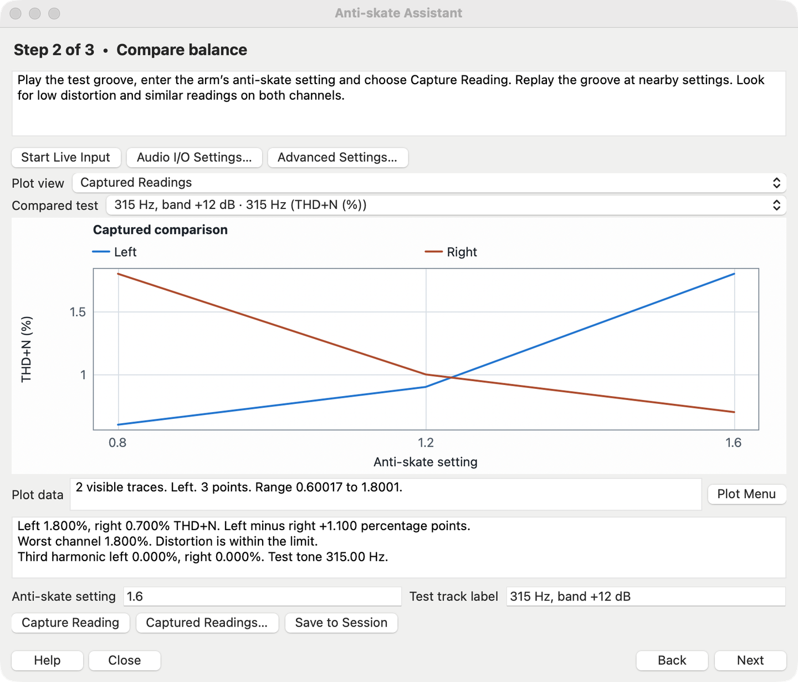
<!-- endplatform -->

<!-- platform: windows -->

Windows illustration

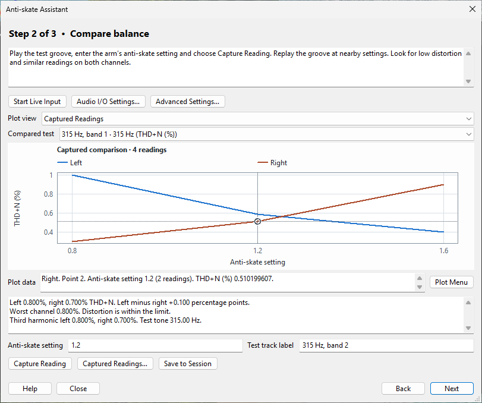

<!-- endplatform -->

<!-- platform: linux -->

Linux illustration

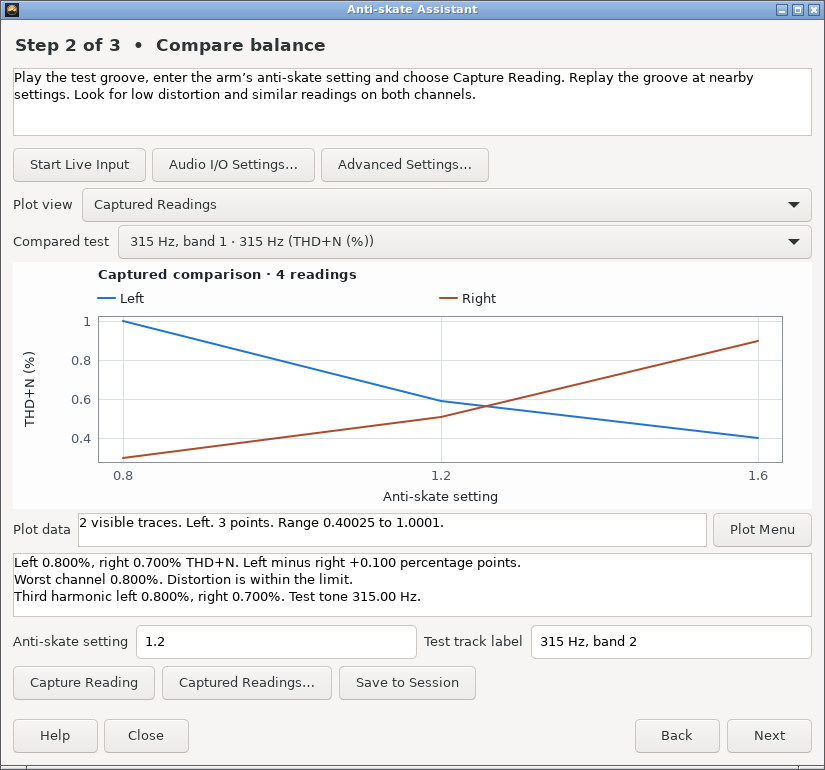

<!-- endplatform -->

<!-- end illustration: alignment-antiskate -->

## Compare tracking force settings

1. Measure the tracking force with a stylus gauge at record height. Enter the cartridge manufacturer’s force limits in **Advanced Settings…**. Choose a stereo tracking band with a stated test frequency and enter that frequency there too.
2. Play the same groove at each force you want to try, staying within the cartridge’s limits. Enter the gauge reading in grams and save the measurement once it settles. Fluttery scores each setting by the higher of its two channel distortion readings. The lowest score comes first. Use track names or recorded levels to keep readings from different grooves separate.
3. Use **Check a more demanding groove** to try the best settings again at a suitable higher level. Compare readings from matching bands and stop if the stylus keeps mistracking. Recheck anti-skate after changing the force. [IEC 60098](https://webstore.iec.ch/en/publication/64407) · [AnalogMagik cartridge setup guidance](https://www.analogmagik.com/product)

<!-- illustration: alignment-tracking-force -->
<!-- platform: macos -->
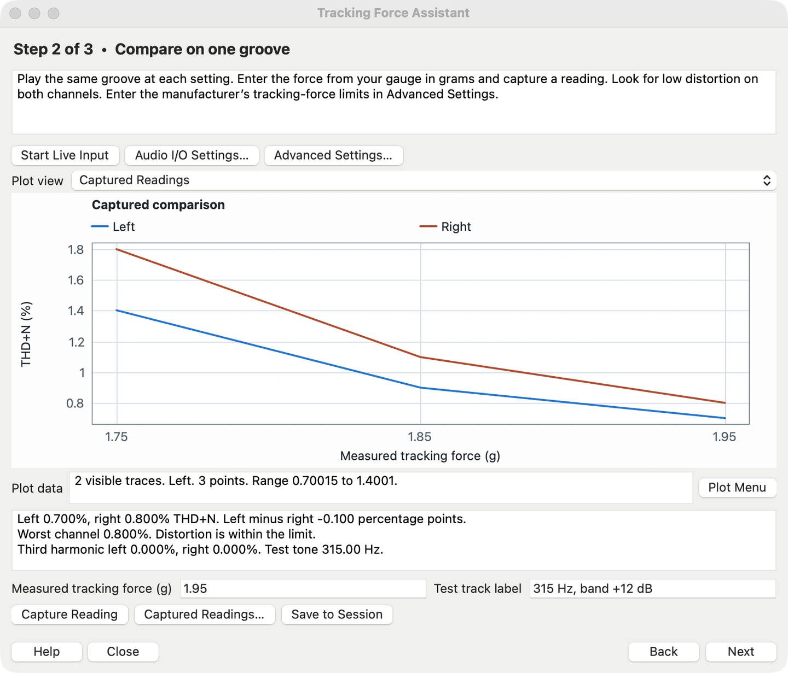
<!-- endplatform -->

<!-- platform: windows -->

Windows illustration

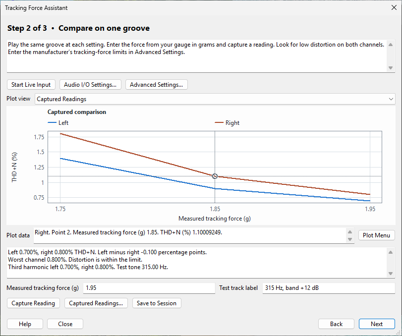

<!-- endplatform -->

<!-- platform: linux -->

Linux illustration

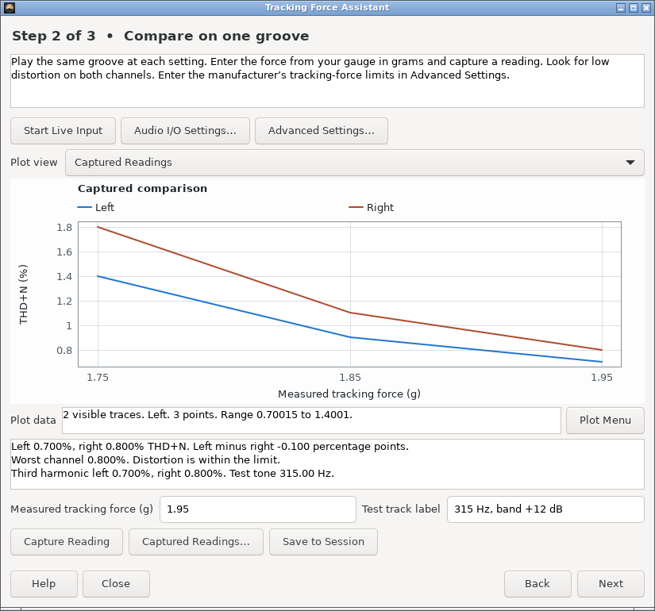

<!-- endplatform -->

<!-- end illustration: alignment-tracking-force -->

## Compare vertical tracking angle and stylus rake

1. Start with the cartridge and tonearm set up according to their instructions. Choose a two-tone intermodulation distortion track with known frequencies and enter both in **Advanced Settings…**. The defaults are 300 Hz and 3,000 Hz.
2. Choose the measurement method that suits the test track. **Sidebands around upper tone** measures the first two pairs of sidebands around the higher tone. **Difference and third-order products** measures the difference frequency and both third-order products near the original tones. Fluttery expresses the combined RMS of the selected products as a percentage of the upper tone. Choose frequencies that produce separate peaks within the input’s usable range.
3. Label each arm height or angle so you can return to it. Play the track at each setting and capture the readings. Repeat the test and compare left and right distortion. Rank settings by the higher of their two channel readings, then try the best ones on another suitable track. To find the actual angle, measure the mechanism or stylus separately. [AnalogMagik VTA and stylus rake procedure](https://www.analogmagik.com/vta)

<!-- illustration: alignment-vta -->
<!-- platform: macos -->
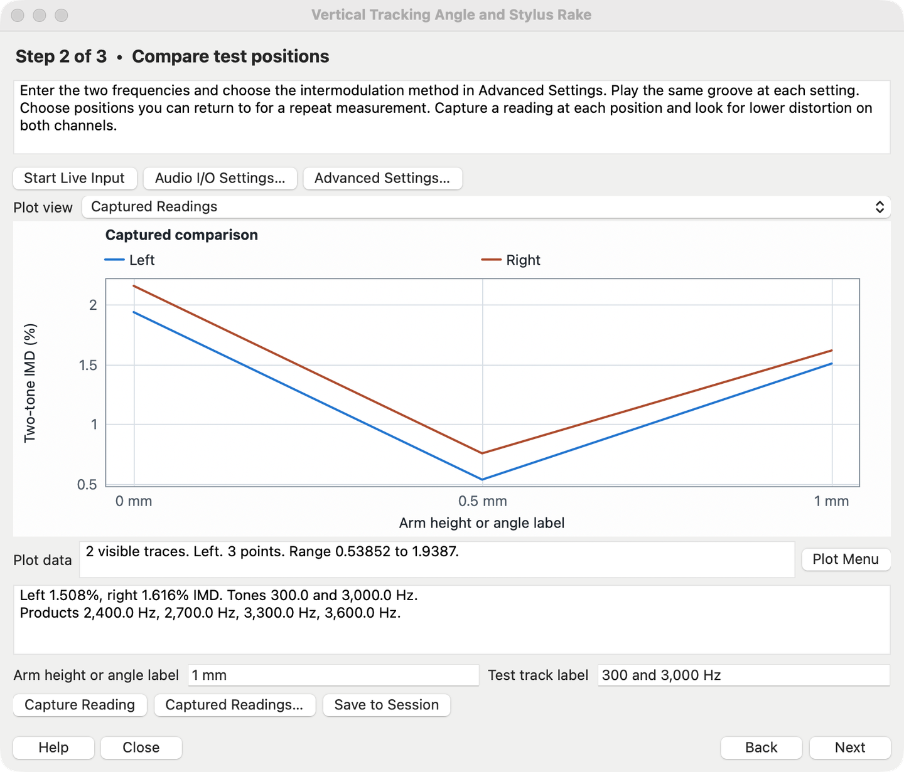
<!-- endplatform -->

<!-- platform: windows -->

Windows illustration

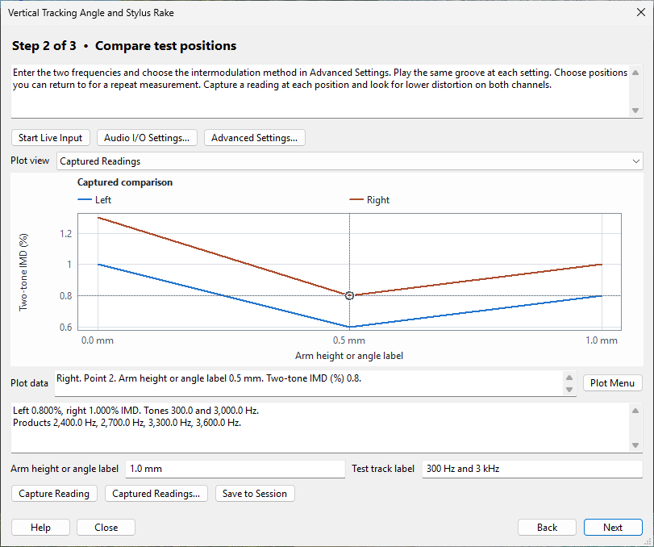

<!-- endplatform -->

<!-- platform: linux -->

Linux illustration

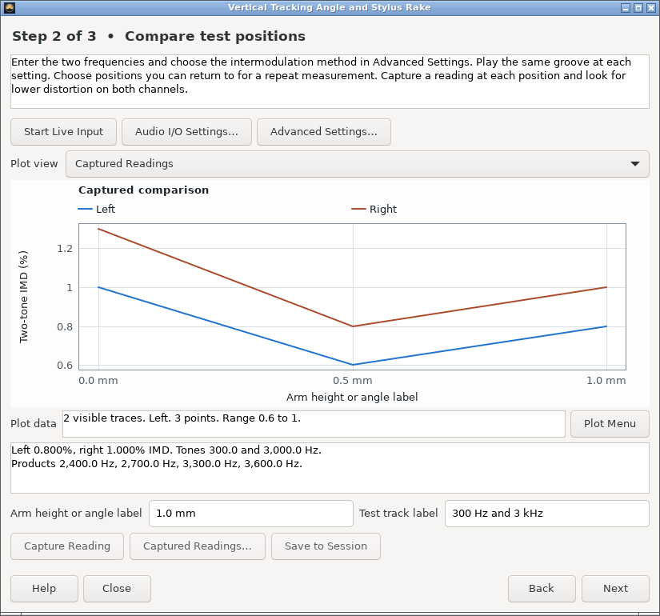

<!-- endplatform -->

<!-- end illustration: alignment-vta -->

## Compare phono stage loading

1. Change the phono stage’s load resistance or capacitance within its permitted range. Keep the cartridge, cable and interface gain the same. Choose a reference groove and comparison grooves with stated signal levels.
2. In **Capture a reference for each load**, play the reference groove and capture a reading at each load. Label each load, for example `47 kΩ, 200 pF`, and use its label again in the next step. The default reference is 1,000 Hz.
3. In **Compare response at other frequencies**, set the frequency and expected relative level in **Advanced Settings…**. Play that groove at each load. Fluttery subtracts the reference you captured for each channel and compares the result with the target you entered.
4. Repeat with the other known frequencies. Enter the label of a load you’ve already measured and choose **Loading Response**. The plot compares the median at each frequency with the target. If you tested more than one band at a frequency, it uses the last band you measured there and its repeat readings. Compare the curves for different loads and choose one within the cartridge manufacturer’s recommended range. [AnalogMagik loading and gain guide](https://www.analogmagik.com/loading-gain)

<!-- illustration: alignment-phono-loading -->
<!-- platform: macos -->
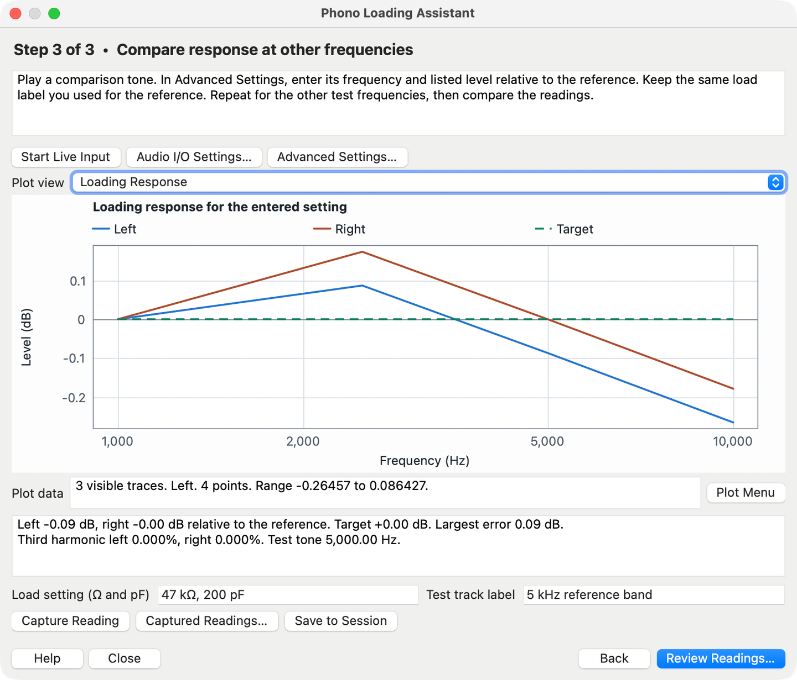
<!-- endplatform -->

<!-- platform: windows -->

Windows illustration

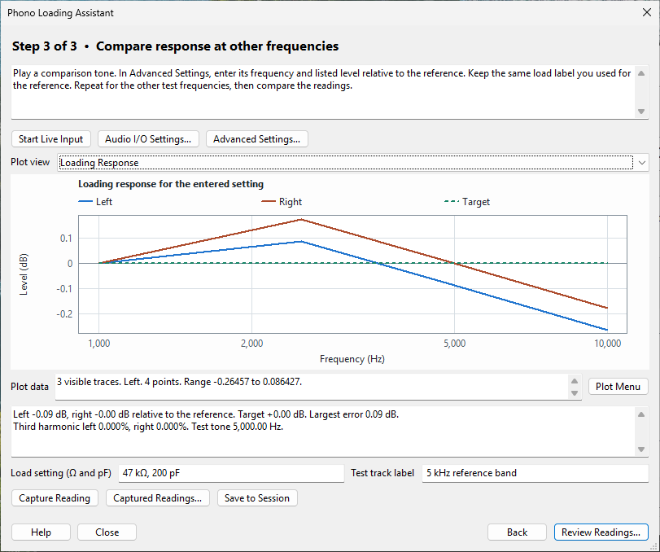

<!-- endplatform -->

<!-- platform: linux -->

Linux illustration

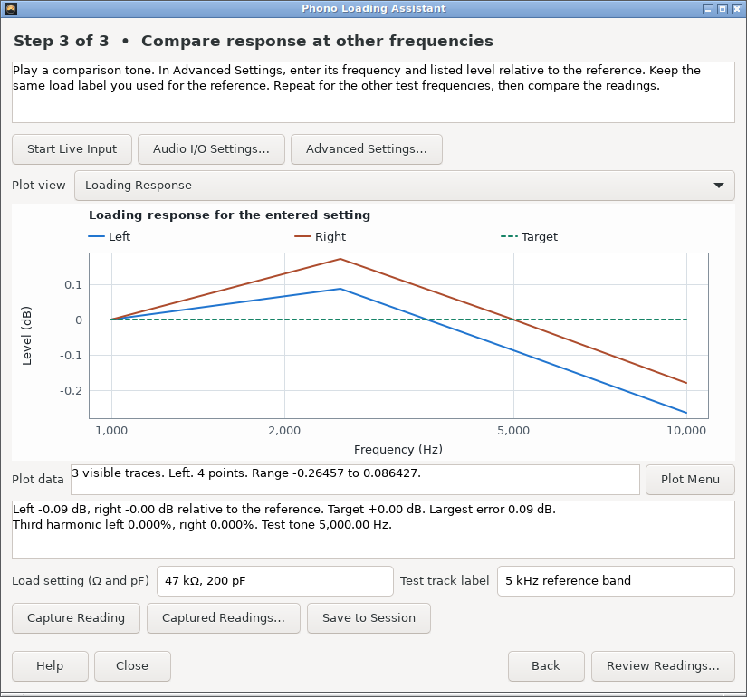

<!-- endplatform -->

<!-- end illustration: alignment-phono-loading -->

## Compare phono stage gain

1. Leave the interface gain as it is. At each phono gain setting, capture a quiet reading from the same unmodulated groove. For electronics noise alone, take the quiet reading with the stylus stationary. Label each capture with the phono gain in dB.
2. Play the same reference groove at each gain and use the matching label when you capture the reading. Check the nominal level and channel balance. If you captured a quiet reading, you can also check the relative signal-to-noise ratio. Set the nominal reference level in dBFS RMS in **Advanced Settings…**.
3. Play a suitably loud test track at each gain and use **Check peak headroom**. Set the headroom you want in **Advanced Settings…**. For example, a peak sample at −6 dBFS leaves 6 dB of digital headroom. Fluttery ranks the settings that meet the headroom target on both channels. It uses the lower signal-to-noise ratio of the two channels and ranks the highest of those values first. Check the phono stage’s own overload indicators as well as the interface readings. [AnalogMagik loading and gain guide](https://www.analogmagik.com/loading-gain)

<!-- illustration: alignment-phono-gain -->
<!-- platform: macos -->
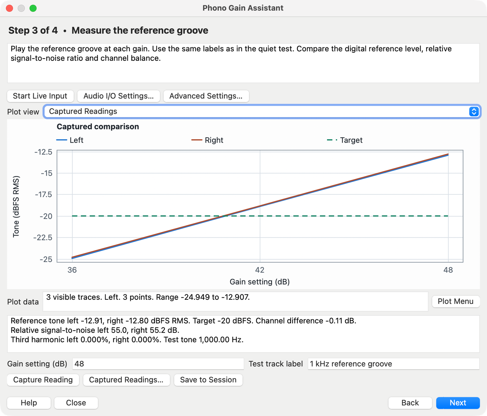
<!-- endplatform -->

<!-- platform: windows -->

Windows illustration

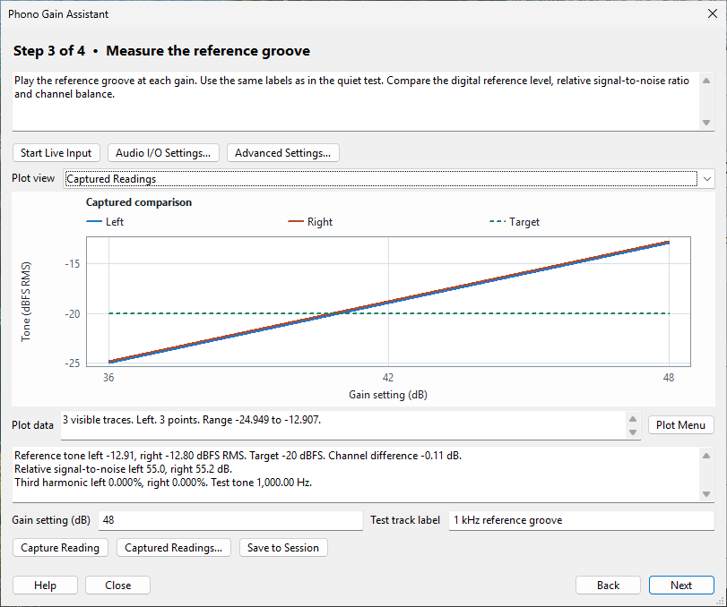

<!-- endplatform -->

<!-- platform: linux -->

Linux illustration

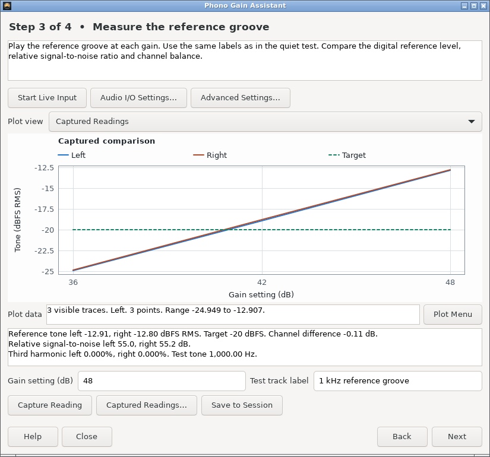

<!-- endplatform -->

<!-- end illustration: alignment-phono-gain -->

## Measure tape head azimuth

1. Use a reference tape with the same in-phase tone in both channels and enter its nominal frequency. Tape-head alignment commonly uses a high-frequency test tone. Follow the deck’s service instructions and check the recording track format before making adjustments. [Audio Precision ATS-1A tape alignment manual](https://www.audioprecision.com/fileadmin-ap/technical-library/AP-8211.0043_ATS1-A_Users_Manual.pdf?force=)
2. Before you connect the deck, measure the interface delay. Feed the same tone from a common source into both interface channels. Wait for the reading to settle, then choose **Capture Interface Offset…**. You can also enter or adjust the offset in **Advanced Settings…**. Recheck it if you change the interface or audio route.
3. Connect the tape deck and play the reference tone. The readout shows the corrected right-channel delay in microseconds, the phase in degrees, the raw delay and the stability. A positive delay means the right input arrives later than the left. Set the allowed delay in **Advanced Settings…**. Choose **Live History** to see the tolerance limits or **Stereo XY** to see the two channels together. Choose **Listen to Left Minus Right** to hear the difference as you adjust the head. Headphones at a low monitoring level make the null easier to hear.
4. Take a high-frequency reading at the current head position. If the tape has a lower in-phase tone, go to **Verify at another frequency**. Use the same position label, head adjustment, audio route and offset. Fluttery compares the two readings to work out which cycle of the higher tone fits. This assumes the physical delay is within half a cycle of the lower tone. If you have only one tone, check the single-tone range on screen and bear in mind that the delay could differ by one or more whole cycles.

<!-- illustration: alignment-head-azimuth -->
<!-- platform: macos -->
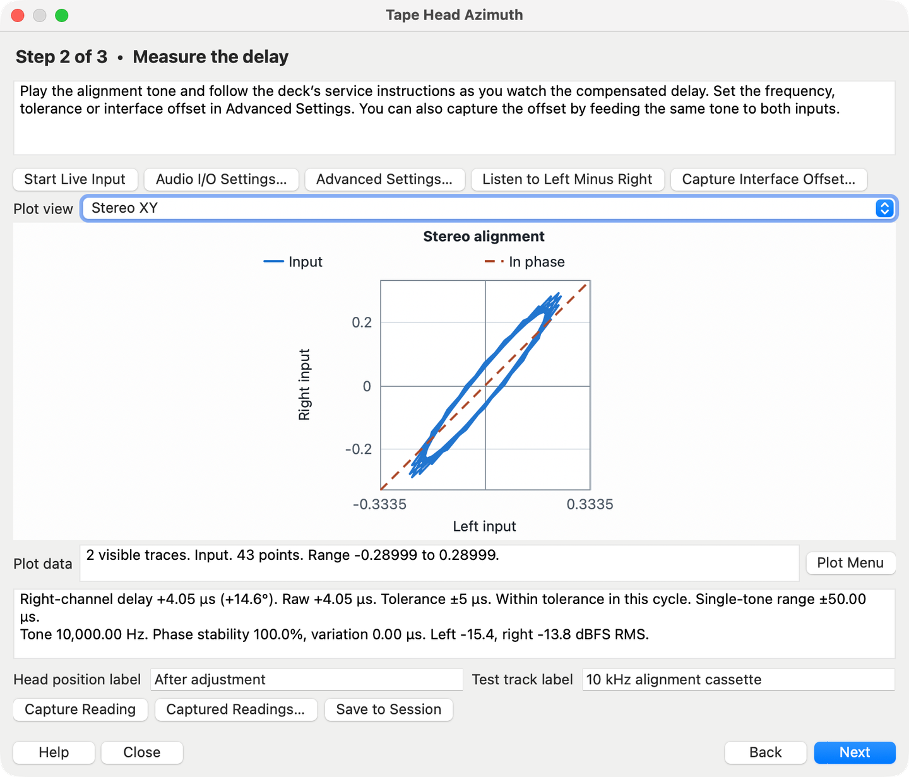
<!-- endplatform -->

<!-- platform: windows -->

Windows illustration

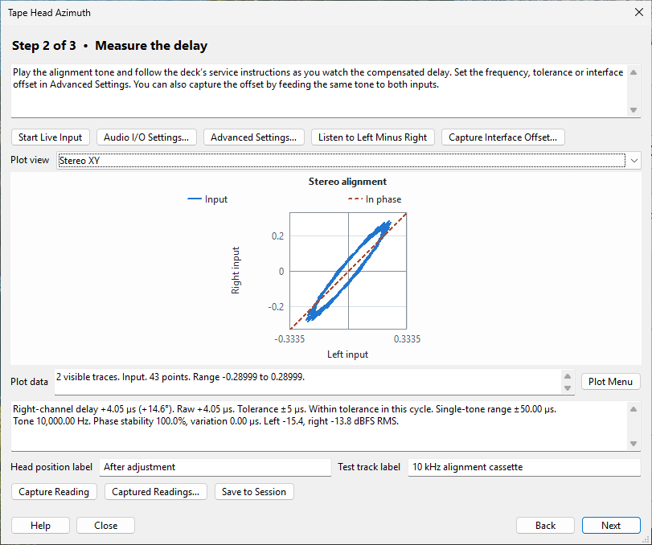

<!-- endplatform -->

<!-- platform: linux -->

Linux illustration

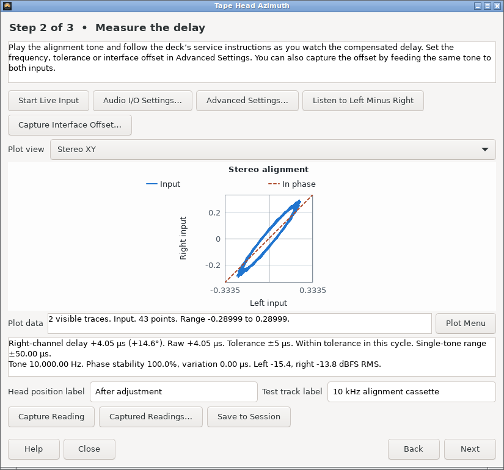

<!-- endplatform -->

<!-- end illustration: alignment-head-azimuth -->

## Adjust tape bias and record level

1. Connect the generator output to the deck and the playback outputs to the interface. Load a blank tape and follow the manufacturer’s instructions for the formulation and speed you’re using. On a three-head deck, you can listen off tape while recording. On a two-head deck, record a short labelled section at each setting, rewind and play it back. Keep the interface gains the same. [Audio Precision record alignment guide](https://www.audioprecision.com/news/aligning-analog-tape-decks-apx)
2. Capture the record-level reference from the direct signal or the deck’s source monitor. The default is a 400 Hz sine wave. Use **Start Test Signal** or an external source and follow the service instructions for level and frequency. Give the reference capture a name you can recognise later.
3. In **Find the bias peak**, use the high-frequency, low-level signal specified for the deck. Start at low bias and take readings as you increase it, until the output has passed its peak. Fluttery uses the highest reading you captured on each channel. To use a measurement you’ve picked yourself, choose **Use Current Level as Bias Peak**.
4. In **Set the overbias drop**, enter the target drop for your tape and machine. By default, this step uses the same generator frequency and level as **Find the bias peak**. Increase the bias past the measured peak. Check the drop on each channel against the target line in **Captured Readings**.
5. In **Match record level**, use the same source tone and level as in the reference step. These are the defaults for this step. Fluttery pairs captures with matching frequency and level. Compare the returned signal with the 0 dB target in **Captured Readings**. The readout also shows the third-harmonic percentage if that harmonic falls within the analysis band. Check the bias again after a significant change in level.
6. In **Verify broadband response**, open **Advanced Settings…** and choose white or pink noise and its level. Capture the direct signal or the source monitor with **Use Current Curve as Reference**. Switch to tape monitoring and keep the signal settings the same. You can read digital band levels before taking the reference or compare the relative one-third-octave bands afterwards. For a more detailed playback or recording test, use the frequency response tool. [Audio Precision overbias procedure](https://www.audioprecision.com/fileadmin-ap/technical-library/ATS-1_DD_Users_Manual.pdf?force=)

<!-- illustration: alignment-tape-bias -->
<!-- platform: macos -->
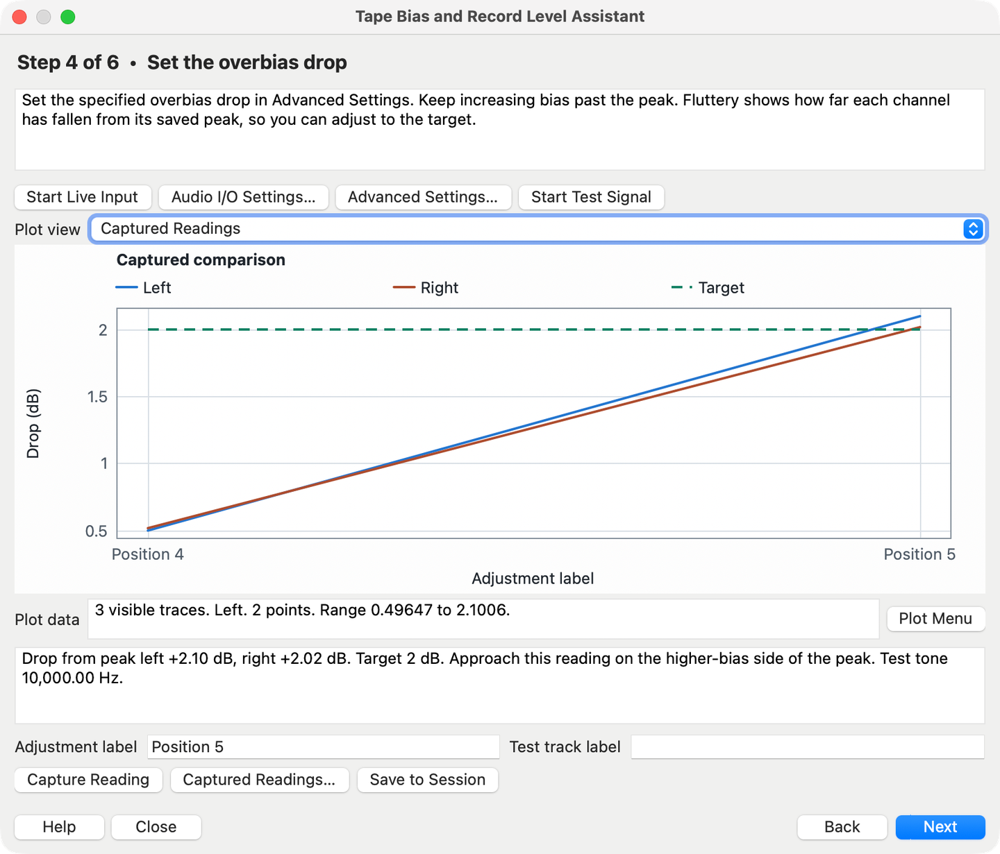
<!-- endplatform -->

<!-- platform: windows -->

Windows illustration

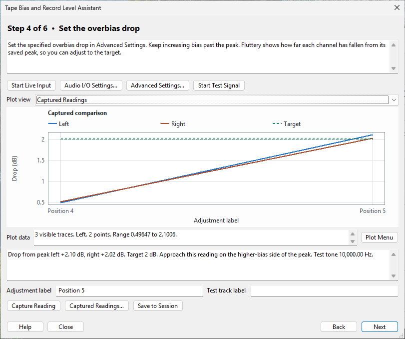

<!-- endplatform -->

<!-- platform: linux -->

Linux illustration

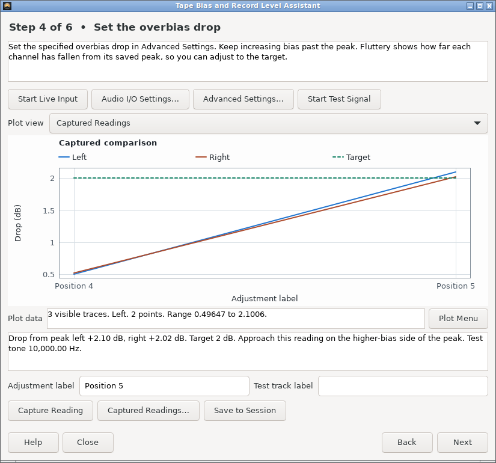

<!-- endplatform -->

<!-- end illustration: alignment-tape-bias -->

## Keyboard shortcuts

| Command | macOS | Windows and Linux |
| --- | --- | --- |
| Open Keyboard Commands | `Command+Shift+K` | `Control+Shift+K` |
| Describe the focused control | `Command+Shift+H` | `Control+Shift+H` |
| Open help for the current assistant | `F1` | `F1` |
| Move through the form | `Tab` or `Shift+Tab` | `Tab` or `Shift+Tab` |
| Choose another plot point | `Left Arrow` or `Right Arrow` | `Left Arrow` or `Right Arrow` |
| Choose a different trace or reading | `Up Arrow` or `Down Arrow` | `Up Arrow` or `Down Arrow` |
| Close the current assistant | `Escape` | `Escape` |

Search for an assistant by name in **Keyboard Commands**. Once it’s open, look for **Next**, **Back**, **Advanced Settings**, **Capture Reading** or the label of the setting, plot or reading you want.

For tape-head alignment, look for **Capture Interface Offset** or **Listen to Left Minus Right**. For tape bias and record level, search for **Start Test Signal** or **Use Current Level as Bias Peak**.

## Support Fluttery

If you like Fluttery and you’d like to support my work, you can [make a donation](https://www.paypal.com/donate/?hosted_button_id=WMLX4PLED9PRE). There’s no pressure or hard sell. Fluttery is and always will be free.
