# Frequency response and interface calibration

Frequency response shows how much signal makes it through a device at each frequency. Fluttery works out the gain by comparing the signal that comes back with the test signal. For tape playback, you can use an alignment tape and compare its recorded tones with a reference tone on that tape.

## Measure a device

1. Open **Tools > Signal Tests > Frequency Response…**. Choose your interface and sample rate through **Audio I/O…**.
2. Connect the interface’s output to the device’s input, then connect the device’s output to the interface’s input. Use line-level connections. If an external mixer routes the return signal back to the output, turn off its input monitoring.
3. Choose **Logarithmic Sweep**, **White Noise** or **Pink Noise**. A sweep plays the frequencies in order. White noise has roughly equal energy per hertz, and pink noise has roughly equal energy per octave. Use a longer capture to resolve lower frequencies and average out more noise.
4. Set the frequency limits, signal duration and peak output in dBFS. The default device test is a ten-second sweep from 20 Hz to 20 kHz at −20 dBFS. Start with a low output level, especially when testing tape, a phono preamplifier or anything connected to speakers. For a noise test, Fluttery measures the gain against the exact noise signal it generated. Noise and a sweep can have different RMS levels even when their peaks are the same.
5. Choose **Measure Response**. The live waveform stays on the same full-scale range throughout the capture. **Response activity** shows the peak input level for each channel and flags clipping. When the run finishes, use **Plot** to switch between gain, phase and the other readings. **Channel Balance** shows the right channel minus the left in decibels. A positive value means the right channel is louder at that frequency. **Phase** is relative to the aligned test signal. **Coherence** is available for white and pink noise and ranges from 0 to 1. A low value means the two signals correlate poorly at that frequency.
6. Choose **Pin Trace** to keep a run on the graph while you test another device or setting. You can pin up to five runs in the current test. A pin keeps the original data. Fluttery applies correction only if the route matches the profile. **Export CSV…** saves the current trace and pins with the measured gain, corrected gain, phase and coherence where available. Captured measurements also appear in [Results](07-results.md#review-recorded-measurements-and-distortion).

Fluttery uses the short tones at the start and end of the test to measure the timing offset and clock drift. If it can’t match them automatically, open **Advanced…** and enter the start marker’s position in the recording in milliseconds. You can also enter the clock drift in parts per million. Set it to zero to turn off drift compensation.

Increase **Extra capture time** if the device delays the return signal. Adjust **Points per octave** to change the detail on the graph. **Capture channels** defaults to **Automatic**. It follows Audio I/O for live input and uses the recorded channels for WAV files. Choose **Mono** to analyse the first channel or **Stereo** to require both. Select stereo in Audio I/O before measuring two live channels.

To use the same range, signal, level and other test options the next time you open Fluttery, choose **Save as Defaults** in **Advanced…**. Each test has its own defaults. Choose **Restore Factory Defaults** to reset the current test. A start marker offset or clock drift value you entered by hand applies to the current test setup until you close Fluttery.

With a timed logarithmic sweep, Fluttery separates early harmonic returns from the main impulse response. The gain and phase then show the fundamental response at the level you chose. The extra audio at the end of the capture includes any delayed parts of the response. [Angelo Farina’s swept-sine paper](https://angelofarina.it/Public/Papers/134-AES00.PDF) · [SciPy cross-spectrum reference for noise tests](https://docs.scipy.org/doc/scipy/reference/generated/scipy.signal.csd.html)

<!-- response figures -->
<!-- platform: macos -->
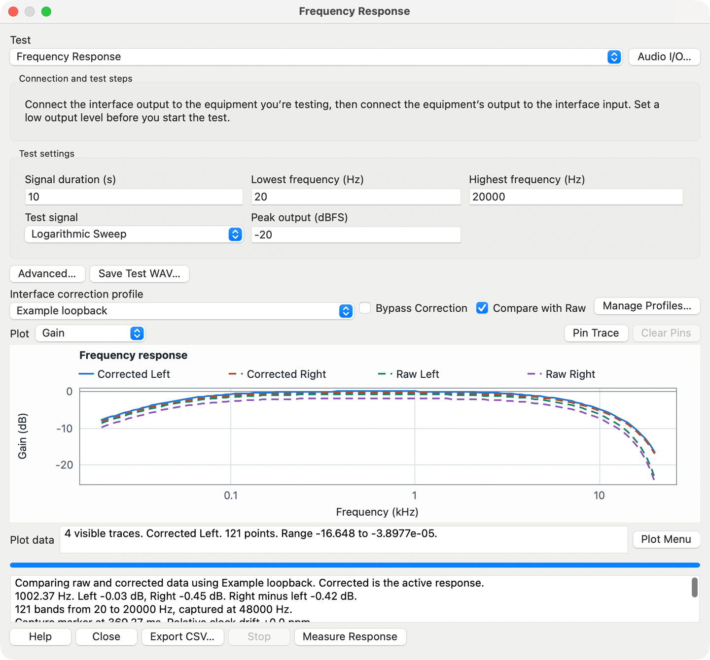
<!-- endplatform -->

<!-- platform: windows -->

Windows illustration

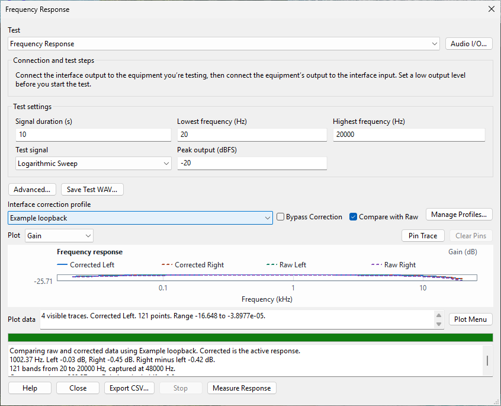

<!-- endplatform -->

<!-- platform: linux -->

Linux illustration

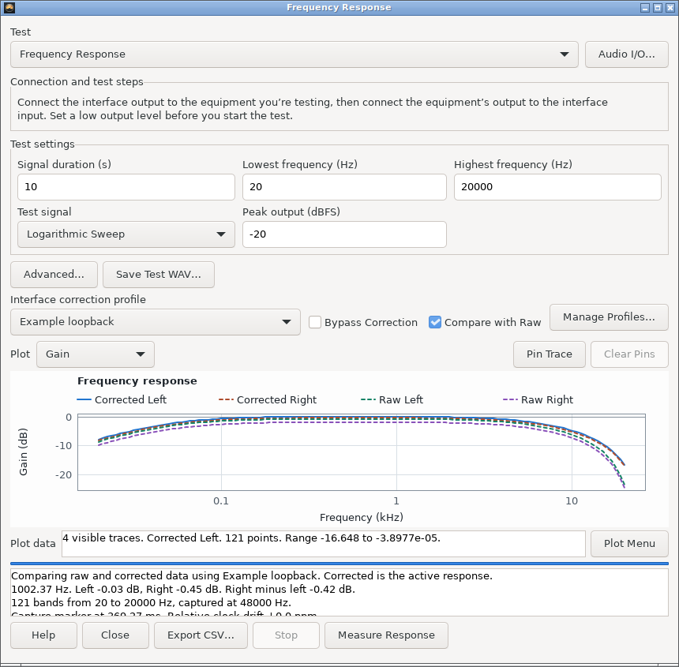

<!-- endplatform -->

<!-- end response figures -->

## Calibrate an interface

1. Open **Tools > Calibration > Interface Response Calibration…**. Choose the input, output and sample rate you will use for the device tests.
2. Choose **Prepare Loopback** to mute Fluttery’s software monitoring. Turn off direct monitoring on the interface and take the device you’re testing out of the signal path. Connect the interface’s line output to its line input. For stereo, connect left to left and right to right. Keep the interface set to line input and use the hardware gain settings you plan to measure with.
3. Choose **Measure Loopback**. Watch the return waveform or select **Live Gain** or **Live Phase** for a preview. During a sweep, the preview shows the frequencies the signal has reached so far. Once the capture finishes, Fluttery works out the delay and measures gain, phase, noise and baseline distortion where the capture supports it. To change bandwidth, timing or channels before you repeat the test, open **Advanced…**.
4. Unplug the loopback cable from the input, then choose **Confirm Cable Disconnected**. Fluttery keeps monitoring muted until you confirm, even if the test fails or you cancel it. If you close Fluttery during the test, it returns to this step when you reopen it.
5. Choose **Save Calibration…** and give the profile a name that identifies the interface and signal path. When you’re looking at readings from a device later, check the loopback noise and distortion to see how much of the result might come from the interface.
6. Use **Manage Profiles…** to inspect, rename or delete a profile, or adjust its gain trim. Measure the loopback again if you change the interface settings, cables, gain or sample rate.

The loopback measures the entire path from the interface output back to the input. To calibrate voltage or check clock accuracy, use an independent voltage or frequency reference. The loopback distortion reading describes your interface at the level you tested. How that distortion combines with distortion from the device depends on phase and level.

<!-- response figures -->
<!-- platform: macos -->
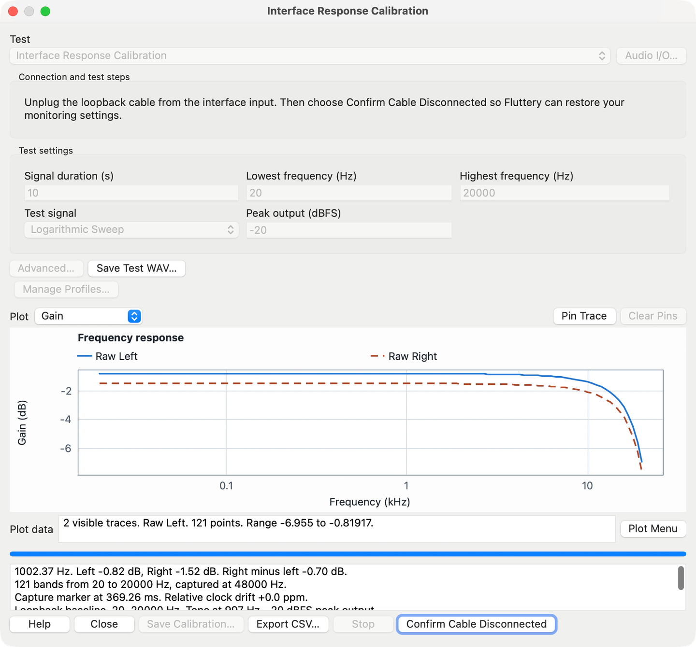
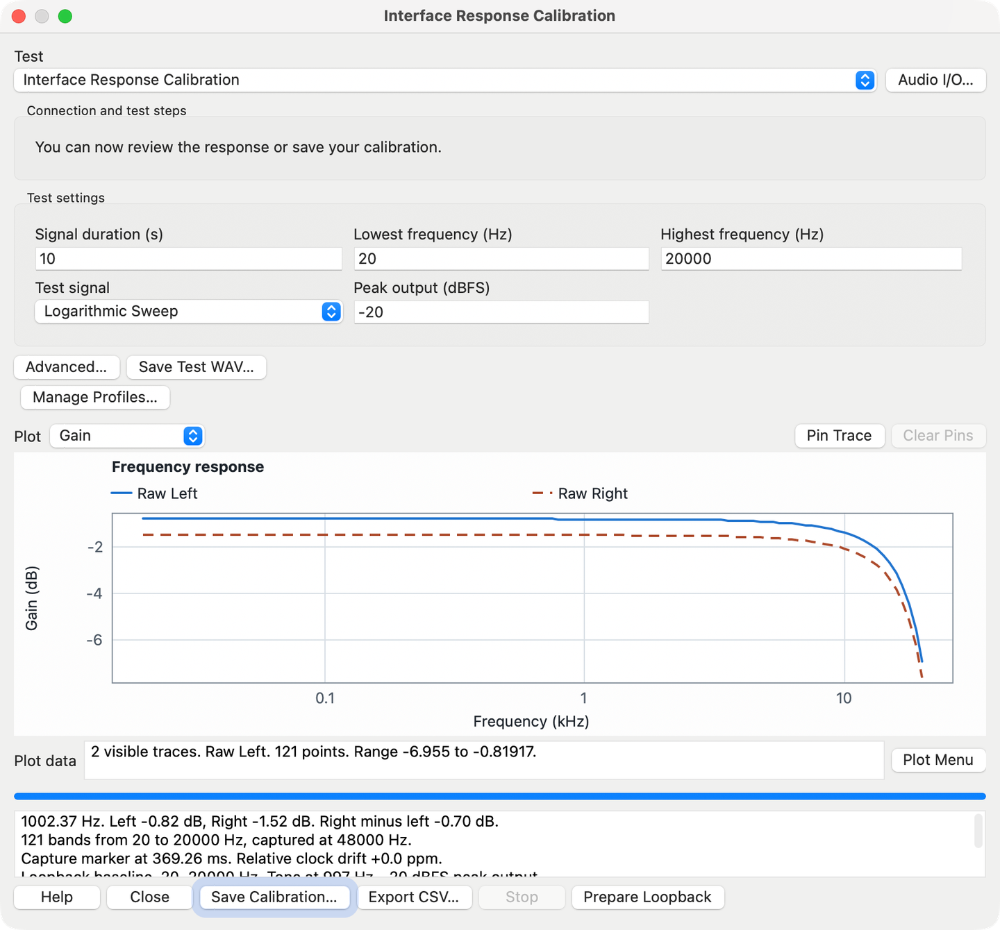
<!-- endplatform -->

<!-- platform: windows -->

Windows illustration

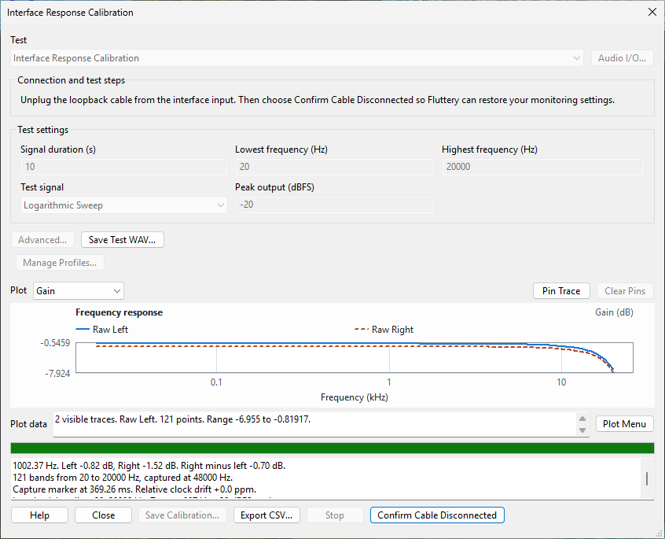
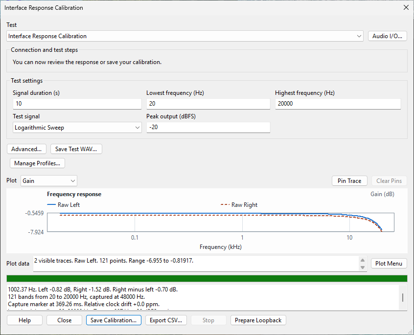

<!-- endplatform -->

<!-- platform: linux -->

Linux illustration

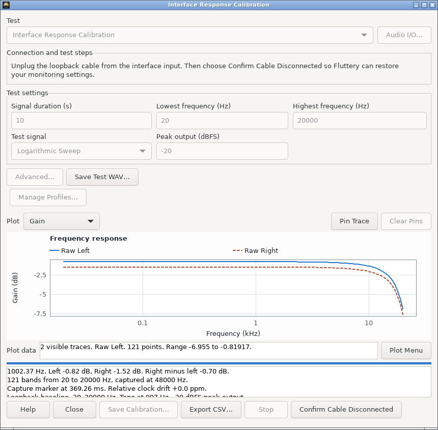
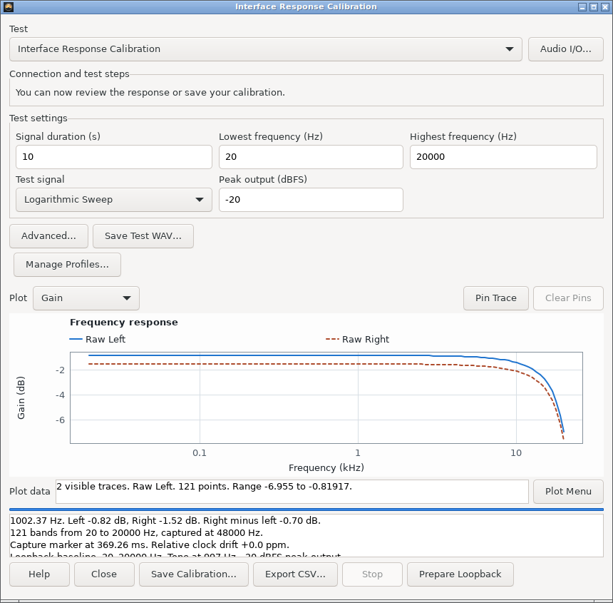

<!-- endplatform -->

<!-- end response figures -->

## Apply and compare interface response correction

1. In **Frequency Response** or **Tape Recording Response**, check **Interface correction profile**. The default is **Automatic (match audio route)**. Fluttery uses a saved profile automatically if exactly one matches the devices and sample rates and covers the channels in the capture. If more than one matches, choose the one you made with your current interface settings.
2. Capture the return signal, then choose **Gain**, **Phase** or **Group Delay** under **Plot** when available. Fluttery subtracts the interface’s measured response at frequencies where both the capture and the profile have usable readings. During a sweep, **Live Gain** and **Live Phase** can show the correction for the frequencies the sweep has reached.
3. Turn on **Compare with Raw** to show the measured and corrected traces from one capture on the same axes. Use the plot’s keyboard controls to move between traces and read the points.
4. Turn on **Bypass Correction** to make the raw response active. Leave **Compare with Raw** on to keep both traces on screen, or turn it off to see only the active response. Turn bypass off to apply the profile again. To turn correction off for this test, choose **No interface correction**. To remove a saved profile, use **Manage Profiles…**.

If Fluttery doesn’t know the audio route for an imported return WAV, it opens the file without response correction. Tape playback shows the measured response relative to the tape’s reference tone. **Export CSV…** lists the active response and profile and includes both sets of readings when available. Open [Recorded measurements](07-results.md#review-recorded-measurements-and-distortion) to see the saved measured and corrected readings from a capture with a matching profile.

## Measure tape playback response

1. Open **Tools > Tape Deck > Tape Playback Response…**. Connect the deck’s playback outputs to the audio interface.
2. Use a reference alignment tape with a sweep or stepped sine tones. The default **Capture time** is 30 seconds. Set it long enough to cover the track. In **Advanced…**, set **Playback reference (Hz)** to a frequency on the tape. For repeated readings at each frequency, choose **Median**, **RMS Average**, **95th Percentile** or **Peak Hold**. Peak hold uses the highest reading. The 95th percentile reduces the influence of isolated peaks.
3. Choose **Capture Playback** and start the deck. Choose **Stop** after the last track, or turn on **Stop at the end of a test tape** in Measurement settings. Fluttery waits until it detects a usable test signal before it starts listening for a long stretch of silence. It leaves that silence out of the measurement. To analyse an existing recording, choose **Open Return WAV…**.
4. Read each channel’s gain relative to the reference level. Both traces use the average of the channels’ reference levels, so you can still see any difference in level between them. A stepped tone track shows the bands Fluttery measured. Gaps mean the test had no signal at those frequencies or the readings were unusable. Choose **Export CSV…** for the frequency and level of each point.

Use the playback test to set playback equalisation before checking the recording path. This test uses only the interface input, so the combined output-to-input calibration does not apply. If you use a tape recorded on the deck you’re testing, the result includes both the record and playback responses. [Audio Precision’s tape deck alignment guide](https://www.audioprecision.com/news/aligning-analog-tape-decks-apx) explains why a reference tape is needed.

<!-- response figures -->
<!-- platform: macos -->
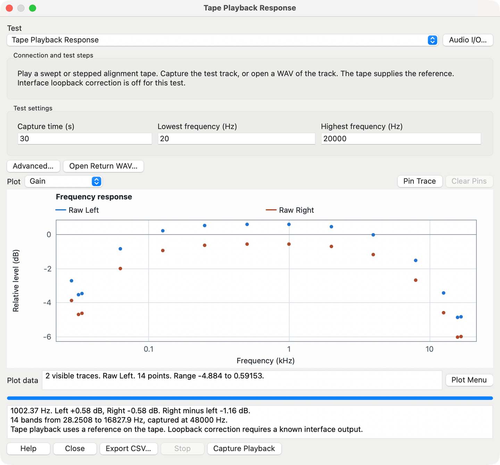
<!-- endplatform -->

<!-- platform: windows -->

Windows illustration

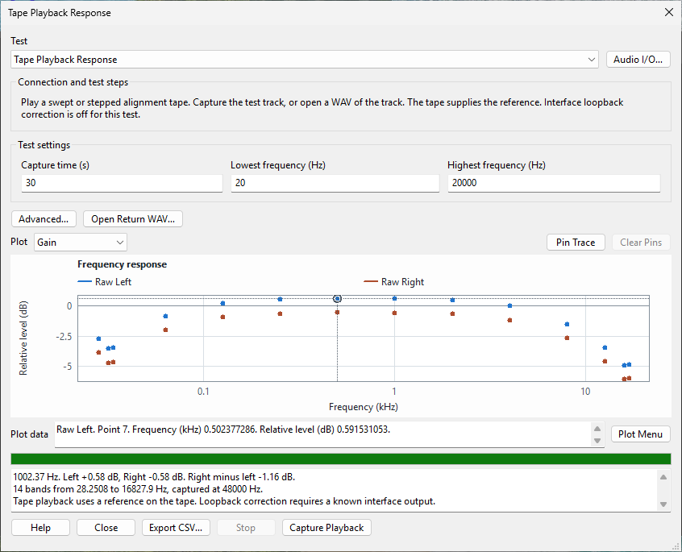

<!-- endplatform -->

<!-- platform: linux -->

Linux illustration

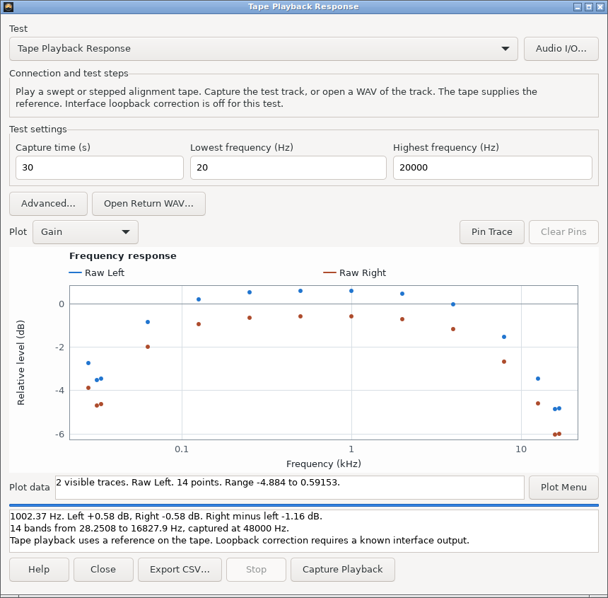

<!-- endplatform -->

<!-- end response figures -->

## Measure tape recording response

1. Align playback with a suitable reference tape first. Load a blank tape. Connect the interface output to the deck’s recording input, then connect the deck’s output to the interface input. Follow the deck’s service instructions for the record and playback settings.
2. Open **Tools > Tape Deck > Tape Recording Response…**. Choose your test signal and level. To compare recording levels, pin each finished curve and repeat the test at a new level.
3. For a two-head deck, keep the default **Two-head deck, rewind and replay**. Start recording and choose **Record Test Signal**. When the signal finishes, stop recording and rewind the tape. Choose **Capture Recorded Tape**, then press Play so Fluttery can find the start marker. The default gives you five seconds of extra capture time. Increase it if you need more time to cue the tape or the transport is slow to start.
4. For a three-head deck, choose **Three-head deck, off-tape**. Select the deck’s tape monitor, start recording and choose **Measure off Tape**. Fluttery plays the test and captures what the deck reads from tape. If the final marker is missing, increase the extra capture time.
5. To measure a previously recorded return, choose **Open Return WAV…**. You can reuse a generated reference saved with **Save Test WAV…**. Set the original range, duration, signal and level before loading it with **Open Test WAV…**. Fluttery matches the timing markers and uses the saved samples as its reference.

The result shows the signal played back from tape. Keep the playback alignment and monitoring path the same when you compare recording settings. If you captured through a route that matches the profile, you can [compare the corrected and measured curves](#apply-and-compare-interface-response-correction).

**Follow speed changes in tape recording sweeps** measures gain at the frequencies played back from tape. Clear it in **Advanced…** if the transport is stable and you need a matched phase plot. Very uneven tape speed can reduce the coherence of a white or pink noise measurement. For the order of adjustment, see [Audio Precision’s recording alignment workflow](https://www.audioprecision.com/news/aligning-analog-tape-decks-apx#record-alignment).

<!-- response figures -->
<!-- platform: macos -->
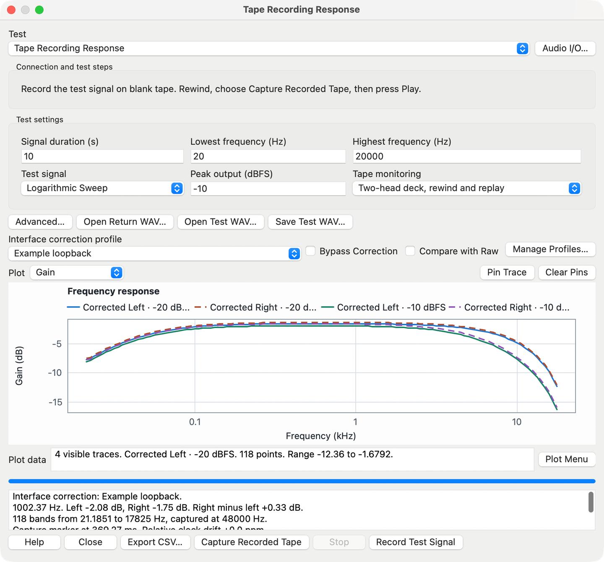
<!-- endplatform -->

<!-- platform: windows -->

Windows illustration

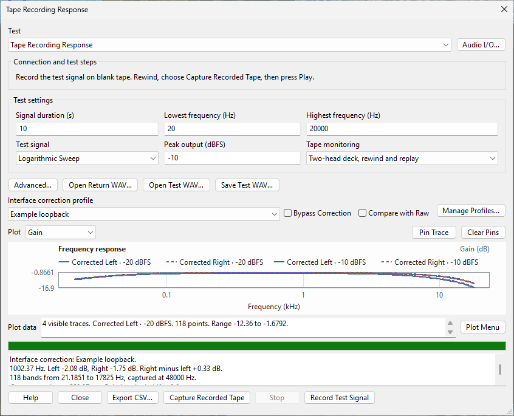

<!-- endplatform -->

<!-- platform: linux -->

Linux illustration

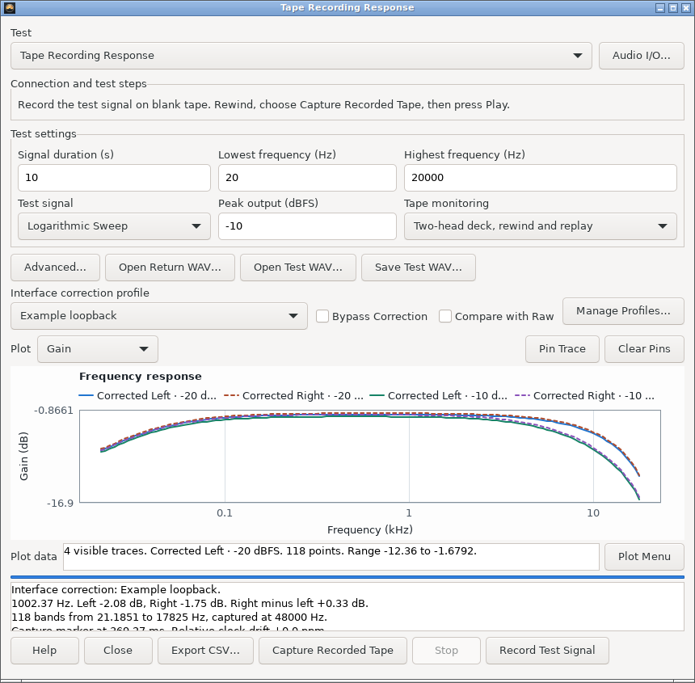

<!-- endplatform -->

<!-- end response figures -->

## Keyboard shortcuts

| Command | macOS | Windows and Linux |
| --- | --- | --- |
| Open Keyboard Commands | `Command+Shift+K` | `Control+Shift+K` |
| Describe the focused control | `Command+Shift+H` | `Control+Shift+H` |
| Open help for the active response test | `F1` | `F1` |
| Move through the controls | `Tab` or `Shift+Tab` | `Tab` or `Shift+Tab` |
| Toggle the focused correction or comparison checkbox | `Space` | `Space` |
| Move between plot traces | `Up Arrow` or `Down Arrow` with the plot focused | `Up Arrow` or `Down Arrow` with the plot focused |
| Read the selected point | `Return` with the plot focused | `Return` with the plot focused |
| Close the tool and stop any active capture | `Escape` | `Escape` |

In **Keyboard Commands**, search for the test by name, or look up a control such as **Measure Response**, **Read Response Activity**, **Audio I/O**, **Advanced**, **Save as Defaults** or **Pin Trace**.

For calibration, look for **Prepare Loopback**, **Measure Loopback**, **Confirm Cable Disconnected**, **Save Calibration** or **Manage Profiles**. For a response measurement, you can search for **Interface correction profile**, **Bypass Correction** or **Compare with Raw**.

In a tape test, look for **Capture Playback**, **Record Test Signal**, **Measure off Tape**, **Capture Recorded Tape**, **Stop** or the test and return WAV commands, such as **Open Return WAV**.

## Support Fluttery

If you like Fluttery and you’d like to support my work, you can [make a donation](https://www.paypal.com/donate/?hosted_button_id=WMLX4PLED9PRE). There’s no pressure or hard sell. Fluttery is and always will be free.
