# Voltage, noise and recordings

Use these tools to measure voltage and noise or to analyse a recorded test tone. To see how a device’s gain or phase changes with frequency, use the [frequency response tools](10-frequency-response.md).

## Measure AC voltage

1. Connect the output you want to measure to the interface. Use a line input for a line-level signal. If you’ve calibrated the input, use the same hardware gain, pad and input settings.
2. Open **Tools > Signal Tests > AC Voltmeter…**. Choose **Start Input** if capture is stopped. Use **Audio Settings…** to change the source or choose stereo.
3. **Level measurements** shows the current AC RMS and sample peak. With **Automatic** plot units, the graph uses volts RMS if you’ve calibrated every active channel. Otherwise it uses dBFS RMS. Focus the plot and use the arrow keys to read earlier points. Focus **Level measurements** to pause updates to the text.
4. Choose **Calibrate…** to set up voltage readings. Once you’ve saved a calibration, the channel readout also shows volts RMS, peak volts, dBV and dBu.
5. Open **Measurement Options…** and select a band. The presets are **Audio**, **Wideband AC**, **Hum and rumble** and **Voice band**. Choose **Custom** to set both frequency limits yourself. **Millivolts RMS** is handy for small calibrated signals. Use a longer observation window if the readings are fluctuating, and keep any calibration tone well inside the band. **Apply** saves this instrument’s options. **Restore Defaults** restores the default values before you apply them.

Fluttery removes DC before measuring the AC level. If you’ve set a limited frequency band, the filter settles using audio from before the selected window so the reading can include the whole window. The near-clipping indicator uses the digital samples from that window before filtering. The voltage readings depend on the input hardware and gain you used for calibration. [Audio Precision’s level measurement guide](https://www.audioprecision.com/fileadmin-ap/technical-library/TN-104.pdf)

<!-- bench figure -->
<!-- platform: macos -->
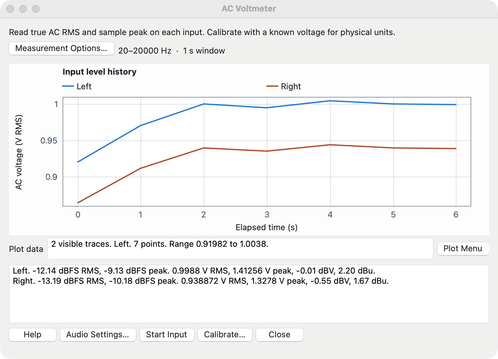

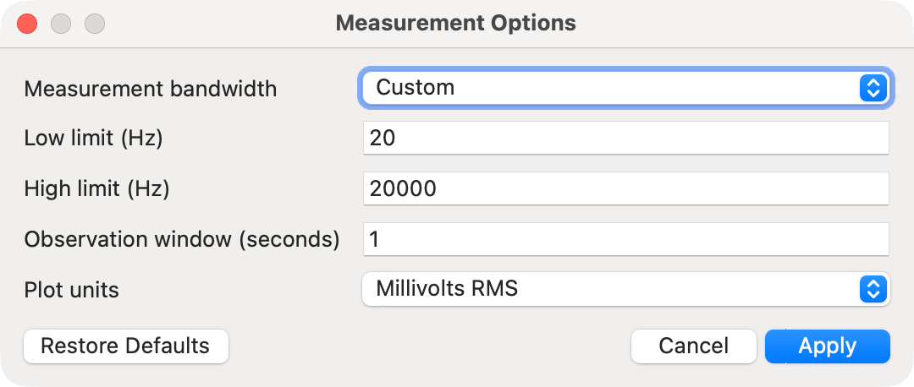
<!-- endplatform -->

<!-- platform: linux -->

Linux illustration

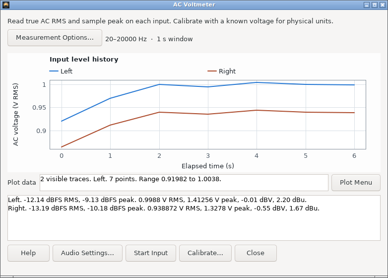

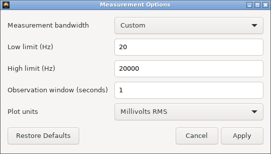

<!-- endplatform -->
<!-- end bench figure -->

## Calibrate voltage

1. Open **Tools > Calibration > Voltage Calibration…**. Choose **Start Input** and select the channel you want to calibrate. Choose **Both** only if the same known voltage is present on each input.
2. Feed the input a clean, steady sine wave. A 1 kHz tone is a common choice. Measure the RMS voltage at the interface input with a reference meter that supports that frequency. Enter the reading in **Reference voltage (V RMS)**.
3. Wait for the level to settle on the live graph, then choose **Capture Reference**. Fluttery fits the sine wave before filtering it, which keeps the meter’s roll-off out of the calibration. Use a longer observation window for low frequencies. If the signal is too quiet, unstable, clipped or outside the selected band, check the source and interface gain before trying again.
4. Check the detected frequency and the values in **Left V per full scale** and **Right V per full scale**. You can enter either factor yourself. Leave the field blank for any channel you haven’t calibrated. Choose **Save Calibration** to keep the values for this device and sample rate. To remove the calibration, clear both fields, choose **Save Calibration** and confirm.
5. Open **AC Voltmeter** and check the result against a second measurement at a known voltage. Recalibrate if you change the hardware gain, pad or connection.

<!-- bench figure -->
<!-- platform: macos -->
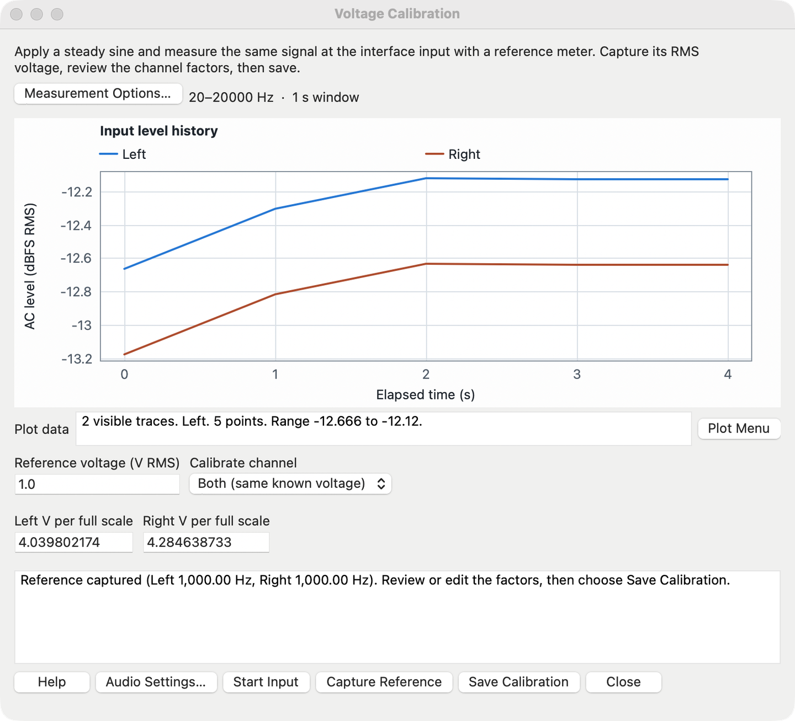
<!-- endplatform -->

<!-- platform: windows -->

Windows illustration

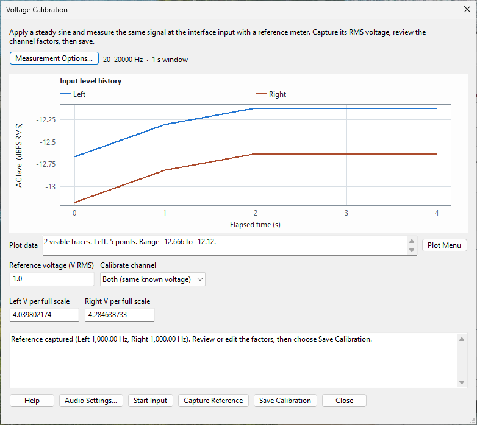

<!-- endplatform -->

<!-- platform: linux -->

Linux illustration

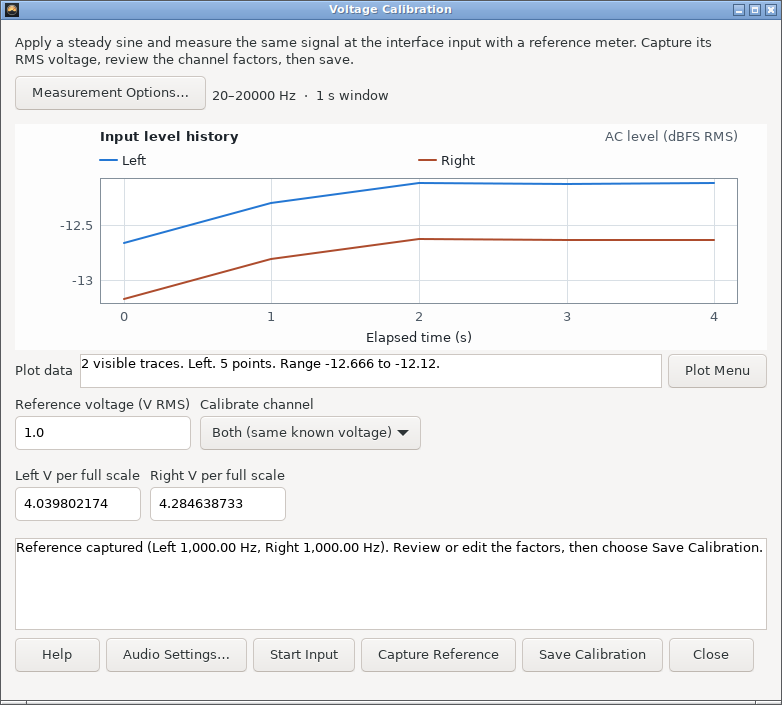

<!-- endplatform -->
<!-- end bench figure -->

## Measure A-weighted signal to noise

1. Open **Tools > Signal Tests > A-weighted Signal-to-Noise…**. Choose the input, bandwidth and observation time. The default is 20 Hz to 20 kHz with a two-second window. Choose **Start Input** if needed.
2. Play the reference signal through the equipment at the level you want to use. Check the live graph for a steady, unclipped reading, then choose **Capture Reference**.
3. Remove the test signal. Leave the equipment in the same mode and keep the gain, bandwidth and audio route as they were. Wait for **Capture Noise** to become available and allow a full observation window with the test signal off. If the input stops or is interrupted, capture the reference again.
4. Choose **Capture Noise**. **Level measurements** shows the A-weighted and unweighted signal-to-noise ratios for each channel. With **Plot** set to **Automatic**, the graph switches to the noise spectrum. The solid lines show the unweighted spectrum and the dashed lines show A-weighting. To go back to the live plot, choose **Level history**. You can repeat the noise capture at different equipment settings as long as the reference level and audio path stay the same.

Fluttery uses the same frequency limits for the reference and noise readings. In the A-weighted ratio, the IEC weighting applies only to the noise. The graph shows noise power per hertz in twelfth-octave bands. The numerical readings include noise across the whole measurement band. If the device outputs digital silence, Fluttery reports the ratio as unavailable. Check whether the device mutes itself when there’s no signal. Note the reference level, bandwidth and equipment mode so you can compare results later. [IEC 61672-1](https://webstore.iec.ch/en/publication/5708) · [Audio Precision’s SNR procedure](https://www.audioprecision.com/fileadmin-ap/technical-library/TN-104.pdf)

<!-- bench figure -->
<!-- platform: macos -->
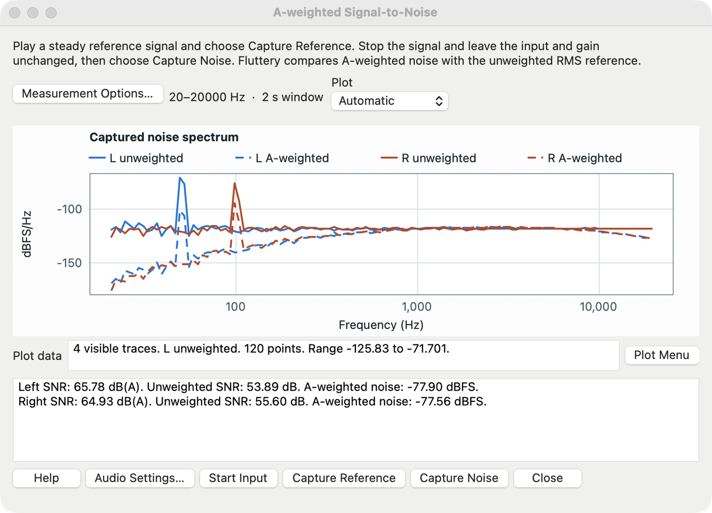
<!-- endplatform -->

<!-- platform: windows -->

Windows illustration

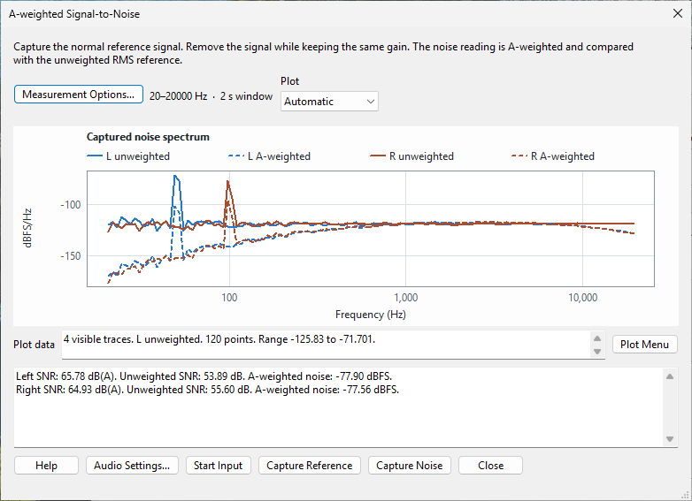

<!-- endplatform -->

<!-- platform: linux -->

Linux illustration

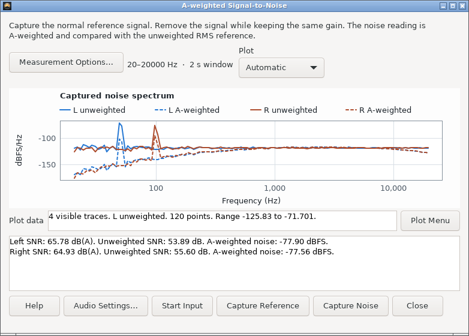

<!-- endplatform -->
<!-- end bench figure -->

## Analyse a test-tone WAV

1. Open **Window > Wow & Flutter** and choose **Wow & Flutter > Analyse Recorded Tone WAV…**. Choose an uncompressed PCM or floating-point WAV file containing the original recorded test tone.
2. Choose the recorded channel. Set **Start (s)** to skip a leader or cue tone. Set **Duration (s)** to limit analysis to one section, or leave it at zero to use the rest of the file.
3. Set the reference frequency to match the recording. **Current measurement settings** uses the detector you’ve already set up. You can also choose **AES6 weighted peak**, **Unweighted** or **Scrape flutter**. AES6 uses a 3,150 Hz test tone. Scrape flutter uses a 12,500 Hz tone and needs audio sampled at 44.1 kHz or higher.
4. Select **Use saved clock correction** if you measured that correction with the recorder and sample rate used for this file. If you want to keep every reading, any signal losses or the original audio in the session, set those options in **Settings → General → Session capture** before you analyse the file.
5. Choose **Analyse**. Under **Plot view**, choose the peak reading for your mode, RMS variation, speed error or the modulation spectrum of the last usable signal. The time plots cover the whole interval you selected, including the time before the reference locked. On long recordings in compact history mode, the plot keeps the highest and lowest readings and shows gaps where the reference dropped out. Check **WAV analysis results** for the usable signal duration and measurements.
6. Choose **Use in Session…** to send the readings and spectra to Results. With **Include original input audio** on, Fluttery also saves the original samples for the selected interval, including every channel in the file. See [Keep runs, signal losses and original audio](07-results.md#keep-runs-signal-losses-and-original-audio) for how to review or export it.

See [AES6 weighted peak](03-measure.md#measure-aes6-weighted-peak), [slow drift and repeating variation](03-measure.md#inspect-short-peaks-slow-drift-and-repeating-variation), and [high-band scrape flutter](03-measure.md#measure-high-band-scrape-flutter) for the observation times and what each readout represents.

<!-- bench figure -->
<!-- platform: macos -->
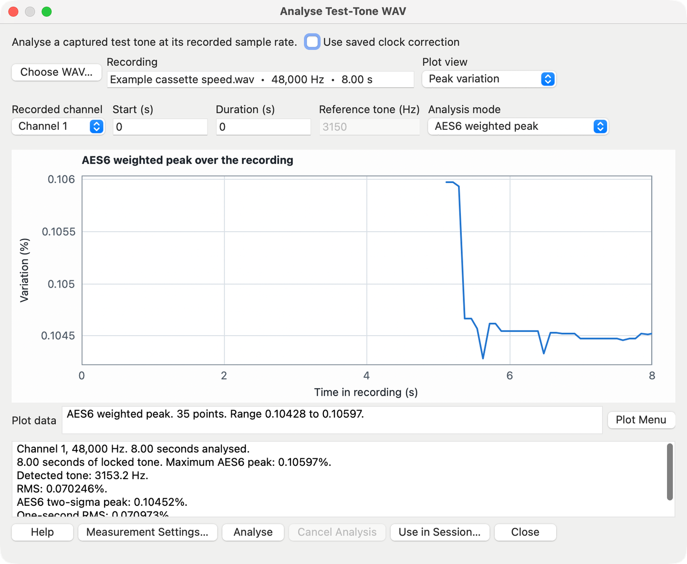
<!-- endplatform -->

<!-- platform: windows -->

Windows illustration

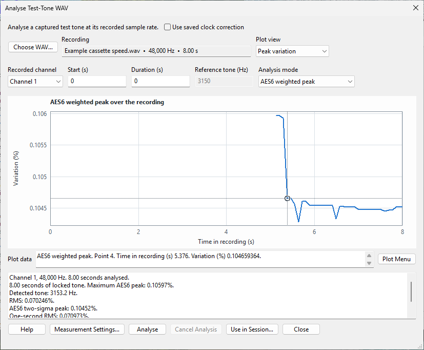

<!-- endplatform -->

<!-- platform: linux -->

Linux illustration

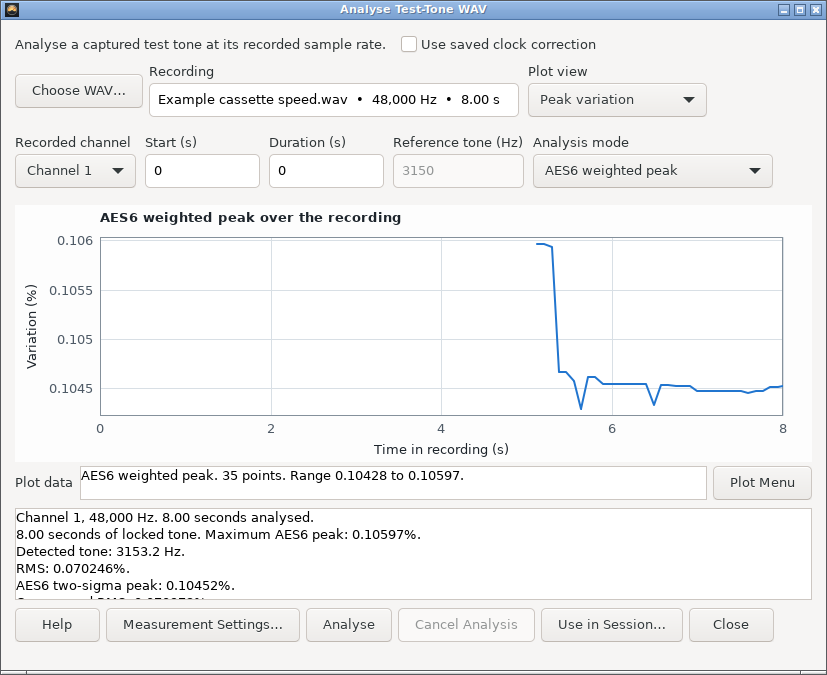

<!-- endplatform -->
<!-- end bench figure -->

## Save raw speed as WAV

1. Open **Window > Wow & Flutter** and choose **Wow & Flutter > Save Unweighted Speed WAV…**. Start live input or the internal test signal. Set the reference tone in **Measure Settings** and check that Fluttery locks to the test signal.
2. Choose **Start Saving…** and select a destination. The activity readout shows how long you’ve been recording and whether the reference tone is locked.
3. Choose **Finish and Save** to save the WAV or **Discard** to cancel. If [tape-end detection](03-measure.md#stop-at-the-end-of-a-test-tape) was on when you started the capture, Fluttery can finish and save automatically after the test signal ends.
4. Open the saved WAV in an audio analysis application to inspect the speed variation. It’s a mono, signed 32-bit PCM file. The samples give the speed error before Fluttery removes the steady offset or applies perceptual weighting. A decoded sample of 0.01 full scale means +1% speed error. When you record from a physical input, WAV timing uses the calibrated sample clock. Fluttery marks clipping, ambiguous tones and reference changes in progress as gaps. An ordinary audio reader returns zero for those samples. If you’re analysing the data, look in the WAV’s `flty` chunk for `invalidFrames`. Each pair gives the first invalid frame, counted from zero, and the frame immediately after the gap.

<!-- bench figure -->
<!-- platform: macos -->
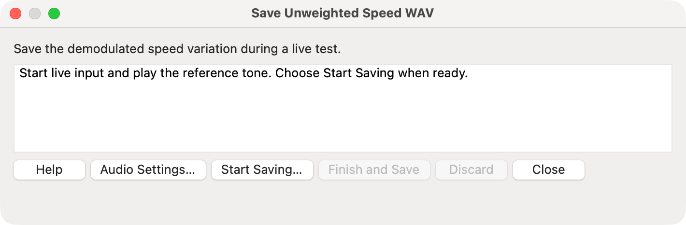
<!-- endplatform -->

<!-- platform: windows -->

Windows illustration

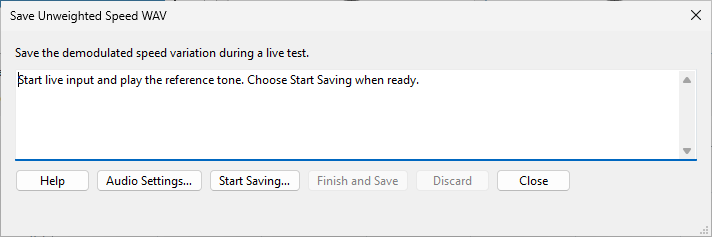

<!-- endplatform -->

<!-- platform: linux -->

Linux illustration

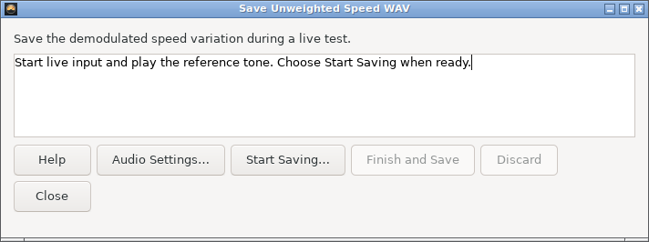

<!-- endplatform -->
<!-- end bench figure -->

## Keyboard shortcuts

| Command | macOS | Windows and Linux |
| --- | --- | --- |
| Open Keyboard Commands | `Command+Shift+K` | `Control+Shift+K` |
| Describe the focused control | `Command+Shift+H` | `Control+Shift+H` |

In **Keyboard Commands**, look up a tool by name, such as **AC Voltmeter**, **Voltage Calibration**, **A-weighted Signal-to-Noise**, **Analyse Recorded Tone WAV** or **Save Unweighted Speed WAV**. With the tool open, search for the label of the button or field you need. For example, look for **Measurement Options**, **Capture Reference**, **Save Calibration**, **Capture Noise**, **Plot view**, **Choose WAV**, **Use in Session** or **Finish and Save**.

## Support Fluttery

If you like Fluttery and you’d like to support my work, you can [make a donation](https://www.paypal.com/donate/?hosted_button_id=WMLX4PLED9PRE). There’s no pressure or hard sell. Fluttery is and always will be free.
