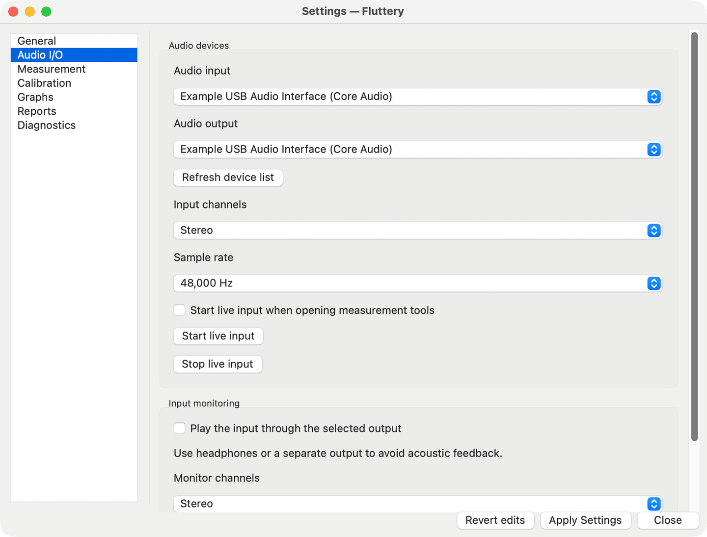
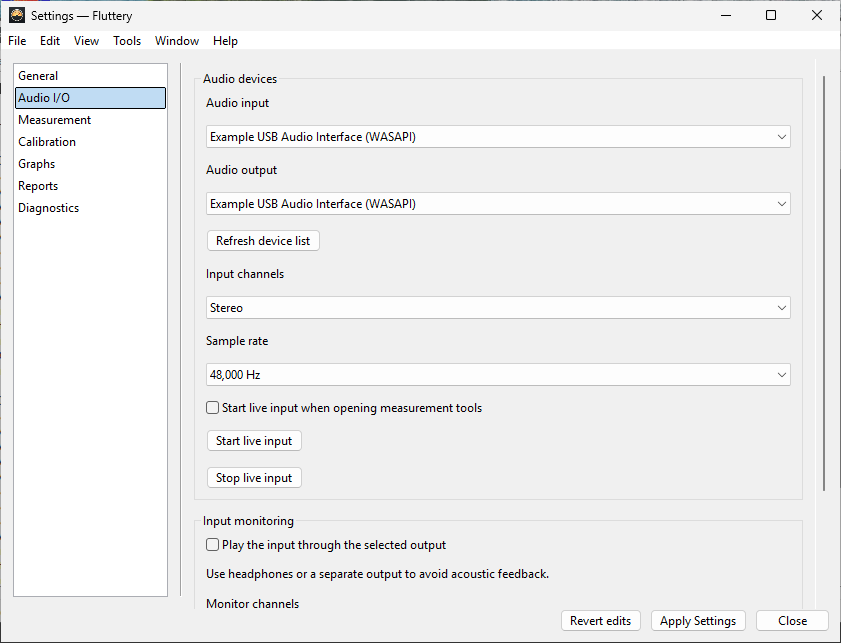
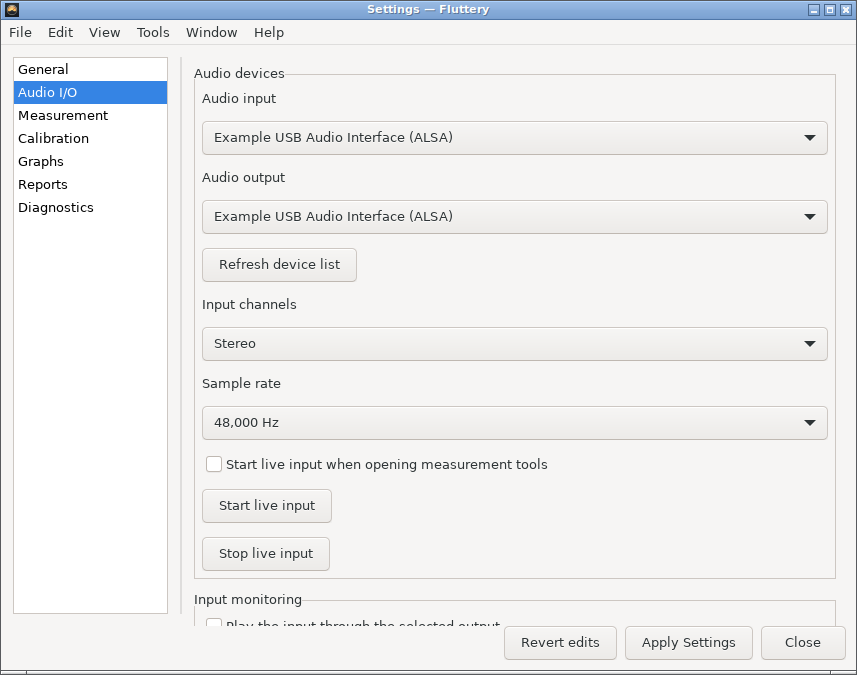
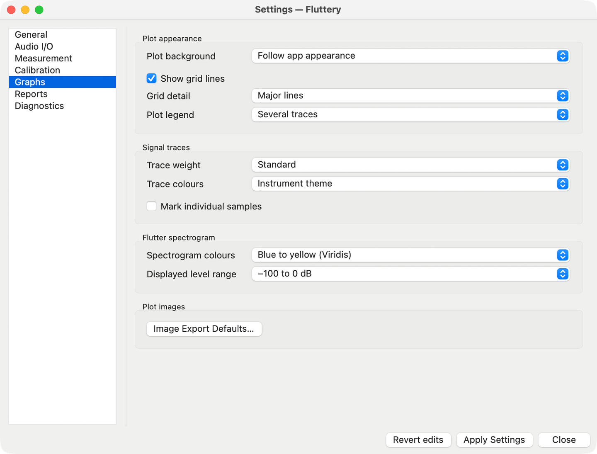
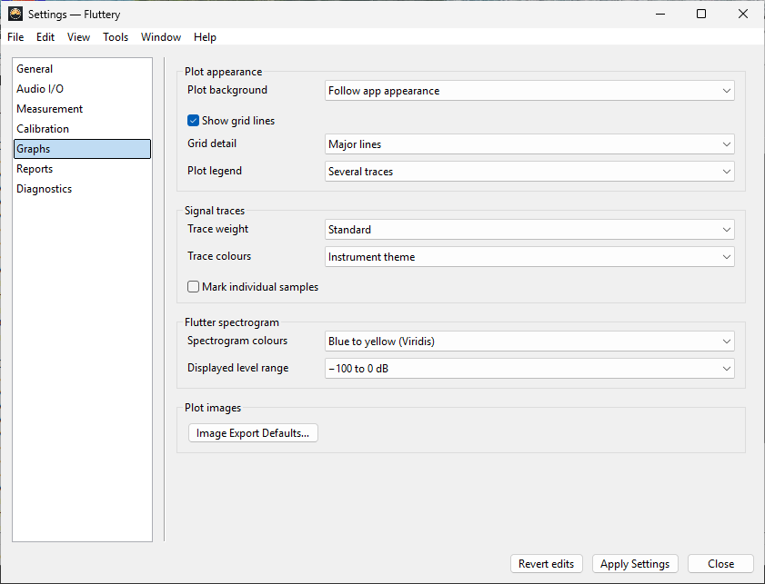
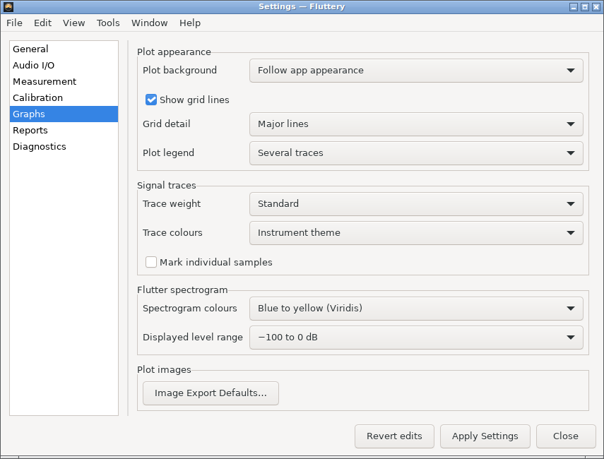
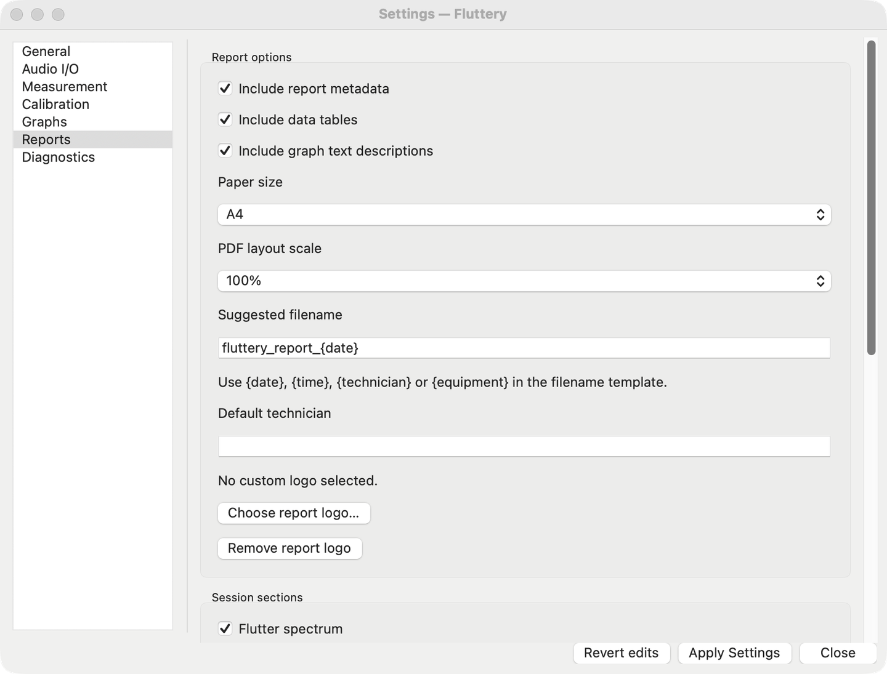
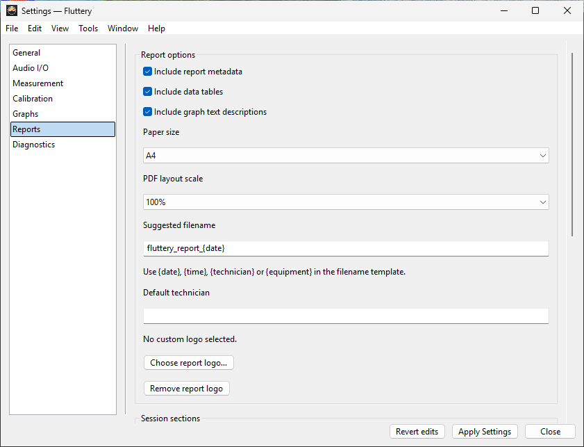
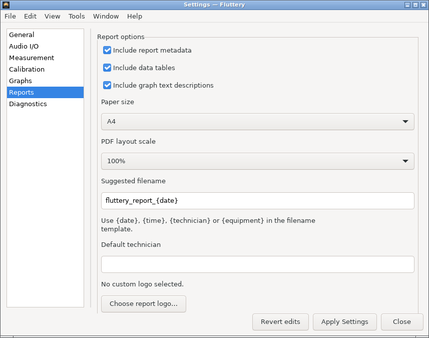

# Settings reference

## Open and apply Settings

Choose **Window → Settings** to open Settings or get back to the pane you were using. You can also open it from **Fluttery → Settings…** on macOS or **Edit → Settings…** on Windows and Linux. In **Settings categories**, use Up or Down Arrow to choose a pane, then press Tab to move into it.

| Action | What it does |
| --- | --- |
| **Apply Settings** | Saves your changes and puts them into effect. Some audio changes restart a running stream. |
| **Revert edits** | Brings back the settings you last applied. |
| **Close** | Closes the Settings window. Use **Apply Settings** first to keep your edits. |
| **Settings action result** | Appears when Fluttery has something to report, such as a refreshed device list or a saved profile. |

When a shortcut names Keyboard Commands, open **Help → Keyboard Commands…** and search for the named action. For an editable control, search for its label and choose the **Focus** result. Settings controls in another pane can be reached from the same list.

## General

| Setting or action | What it does |
| --- | --- |
| **Instrument appearance** | **Modern** (default), **Retro hi-fi**, **Soft contours**, **High contrast**. Each theme has its own instrument colours and synthesised sounds. |
| **Colour mode** | **Follow system** (default), **Light**, **Dark**. |
| **Interface text size (%)** | 80 to 150%. The default is 100%. Changes Fluttery's text size without changing system text size. |
| **Play interface sounds** | On by default. Plays synthesised switch, button and navigation sounds through the system's default output. |
| **Play a quiet cue when a control receives focus** | On by default. Turn this off to keep the other interface sounds without the focus cue. |
| **Show tooltips and help tags** | On by default. Shows a description when you point at a control. You can also ask for a description with **Describe Focused Control…**. |
| **Show expanded text descriptions for graphs** | On by default. Adds a fuller graph summary alongside the exact value of the selected point. |
| **Announce important status changes** | On by default. Tells assistive technology about important changes, such as when a measurement or audio device changes state. |
| **Workspace layout** | **Single Tool per Window** (default) or **Tabbed Workspace**. Use **File → New Window** to see another tool in the same session. Settings opens separately in both layouts. |
| **Maximum compact history samples** | 100 to 10,000, with 1,000 by default. Limits how many readings Fluttery keeps for the current wow and flutter run in compact mode. The same limit applies to individual instrument entries and their compact captures. Fluttery drops the oldest readings first. |
| **Keep complete run history** | Off by default. Keeps every analysis reading and earlier runs in the same session. More runs and longer recordings make the file bigger. |
| **Keep detailed signal-loss information** | Off by default. Saves the times and reasons for interruptions and other unusable readings. |
| **Include original input audio** | Off by default. Saves the input audio losslessly in the session file, up to 512 MiB of compressed audio per run. For WAV analysis, Fluttery keeps every original channel from the part of the file you selected. |
| **Open Fluttery on** | **Measure** (default), **Oscilloscope**, **Turntable**, **Distortion**, **Generator**, **Results** or **Settings**. |
| **Default turntable view** | **Speed (RPM)** (default), **Crosstalk**, **Channel balance**, **Tracking distortion**, **Noise floor** or **Resonance**. |
| **Default results view** | **Flutter spectrum** (default), **Wow and flutter**, **Speed drift**, **Spectrogram**, **Sample table**, **Session metadata**, **Measurements**, **THD+N results** or **Session statistics**. |
| **Automatically check for updates** | On by default. Allows Fluttery to check for new releases. |
| **Check for updates now** | Checks immediately. Also available through **Help → Check for Updates…**. |

## Audio I/O

| Setting or action | What it does |
| --- | --- |
| **Audio input** | **System default** or a listed capture device. |
| **Audio output** | **System default** or a listed playback device. The Signal Generator and input monitoring use this output. |
| **Refresh device list** | Looks for input and output devices again. Use it if a device you've just connected is missing from the list. |
| **Input channels** | **Mono** (default) or **Stereo**. Use Stereo for channel comparisons and stereo calibration. |
| **Sample rate** | **Device default** or 44,100, 48,000, 88,200, 96,000, 176,400 or 192,000 Hz. The list can also show a saved rate or the rate the device is running at. Choose a rate your active devices support. |
| **Start live input when opening measurement tools** | On by default. Starts capture when you open Measure, Oscilloscope or Turntable. If you've stopped it manually, choose **Start live input** to turn it back on. |
| **Start live input** | Applies your settings and opens the selected input. Start recording separately in the measurement tool you're using. |
| **Stop live input** | Stops capture. The generator can still play on its own. |
| **Play the input through the selected output** | Off by default. Enables live monitoring. Use headphones or a separate output to avoid feedback. |
| **Monitor channels** | **Stereo** (default), **Left only**, **Right only**, **Mono mix (average)**, **Mono sum (left + right)** or **Left minus right**. The difference mode sends half the left-minus-right signal to both outputs and requires a stereo input. |
| **Monitor volume (0 to 1)** | 0 mutes monitoring. 1 leaves the level unchanged and is the default. |

<!-- figures -->
<!-- platform: macos -->

<!-- endplatform -->

<!-- platform: windows -->

Windows illustration

<!-- endplatform -->

<!-- platform: linux -->

Linux illustration

<!-- endplatform -->
<!-- endfigures -->

## Measurement

| Setting or action | What it does |
| --- | --- |
| **Profile** | Select **IEC service check**, **JIS RMS check**, **Quick QC**, **Turntable stereo setup**, **AES6 weighted peak** (30 seconds at 3,150 Hz with one-second RMS), **Tape scrape flutter** (30 seconds at 12,500 Hz) or a saved custom profile. |
| **Apply selected profile** | Puts the selected profile's settings into effect and saves them. The profile description tells you what it's for. |
| **Save current settings as a profile…** | Give the profile a name so you can use it again. Fluttery saves the reference, run duration, standard, quality-control options, detector timing, weighting, split frequency, history source, input channel count, test record speed and advanced detection options. |
| **Delete selected custom profile** | Removes the selected custom profile after confirmation. The built-in profiles remain available. |
| **Reference frequency (Hz)** | 1 to 24,000 Hz, with 3,000 Hz by default. Enter the nominal frequency of the test tone. |
| **Show frequency before the reading settles** | Off by default. Shows an estimated frequency on the Measure screen and in **Read Values** while the test tone settles. Fluttery still applies the usual lock and validity checks to wow and flutter, recorded readings and quality control. |
| **Run duration** | **Continuous** (default), **10 seconds**, **30 seconds** or **60 seconds**. Continuous runs until you stop recording. |
| **Measurement standard** | **IEC/DIN peak** (default), **AES6 weighted peak (two-sigma)**, **JIS RMS** or **Unweighted**. AES6 fixes the reference at 3,150 Hz and uses the standard weighting curve. Use the same standard when comparing readings. |
| **Flutter analysis band** | **Rotational wow and flutter** (default) or **Scrape flutter (12,500 Hz reference)**. Scrape flutter analysis covers 200–5,000 Hz and needs an input sample rate of at least 44.1 kHz. |
| **Analogue meter full scale** | **Auto** (default) widens the needle's range as the signal rises and holds it briefly before stepping back down. Choose **0.1%**, **0.4%**, **1%** or **4%** to compare runs on a fixed scale. You can still read the exact value and see when the reading is off the scale. |
| **Test record speed** | **16⅔ RPM**, **33⅓ RPM** (default), **45 RPM**, **78 RPM** or **Custom**. Use the speed at which the test record's stated reference frequency was measured. |
| **Custom test record speed (RPM)** | 1 to 300 RPM when **Custom** is selected. Use the exact speed printed on the test record or its documentation. |
| **78 RPM reference** | **78.26 RPM** (default) or **78.00 RPM**. Used for the 78 RPM record and playback presets. |
| **Analogue needle damping (seconds)** | 0 to 5 seconds. The default is 0.10. Zero removes damping from the needle. |
| **Wow / flutter split (Hz)** | 0.5 to 30 Hz. The default is 6 Hz. Separates slower wow from faster flutter. |
| **History graph source** | **Detector peak** (default) uses the active detector, including AES6 weighted peak or scrape peak when selected. **Raw block peak** plots the largest deviation within each block before the peak detector. |
| **Preset** under **Weighting profile** | **IEC/DIN 45507** (default) uses the published weighting curve. **Broad service** and **Narrow diagnostic** use 4 Hz and unit gain with Q values of 0.707 and 1.414. **Custom** enables the three controls below. |
| **Centre frequency (Hz)** | For Custom weighting, 0.5 to 30 Hz. Sets the centre of the weighting response. |
| **Q** | For Custom weighting, 0.1 to 10. A higher Q narrows the response. |
| **Gain** | For Custom weighting, 0.1 to 10. Scales the weighted output. |
| **Preset** under **Detector timing** | **NAK T-100** (default) uses 0.300 / 0.010 / 2.000 seconds for RMS averaging, attack and release. **Fast setup** uses 0.100 / 0.005 / 0.500 seconds and **Slow / steady** uses 1.000 / 0.050 / 3.000 seconds. Choose **Custom** to set these times yourself. |
| **RMS detector** | **Exponential averaging** (default) uses the chosen RMS time constant. **One-second window** averages the squared samples over the last full second of locked signal. |
| **RMS averaging (seconds)** | For Custom timing, 0.05 to 5 seconds. Sets how much the RMS detector smooths readings over time. |
| **Peak attack (seconds)** | For Custom timing, 0.001 to 0.5 seconds. Sets how quickly the peak detector rises. |
| **Peak release (seconds)** | For Custom timing, 0.05 to 5 seconds. Sets how quickly the peak detector falls after a peak. |
| **Remove steady speed error from wow and flutter** | On by default. Keeps steady speed offset out of wow and flutter readings. |
| **Automatically recognise 3,000 and 3,150 Hz references** | On by default. Fluttery switches to either supported tone when it detects it. |
| **Adapt signal lock to the input level** | On by default. Adjusts the lock threshold as the signal level changes. |
| **Enable pass/fail quality control** | Off by default. Compares the peak against the limit after a sustained lock. Missing readings, an ambiguous reference or input clipping can make the result inconclusive. |
| **Quality control limit (%)** | 0.001 to 100%. The default is 0.100%. Sets the maximum accepted wow and flutter reading for quality control. |
| **Stop at the end of a test tape** | Off by default. After two seconds of a steady test tone, Fluttery starts checking for the end of the tape. It stops the run if it loses lock and the input stays below the threshold for the time set in **Tape-end silence (seconds)**. |
| **Tape-end silence (seconds)** | 1 to 120 seconds. The default is 6. Increase the time to tolerate longer gaps in the test recording. |
| **Tape-end threshold (dBFS)** | −100 to −6 dBFS. The default is −45. Choose a level below the test tone and above the measured quiet leader or noise floor. |

Select a built-in profile to read its description. When you've found the one you want, choose **Apply selected profile**.

## Calibration

| Setting or action | What it does |
| --- | --- |
| **Known reference frequency (Hz)** | 1 to 24,000 Hz. Starts at 3,000 Hz. Enter the actual frequency of the independent source you're using to calibrate the clock. |
| **Use 3,000 Hz** | Fills in 3,000 Hz as the known reference. |
| **Use 3,150 Hz** | Fills in 3,150 Hz as the known reference. |
| **Capture duration (seconds)** | 1 to 60 seconds. Starts at 3 seconds. Used for both clock and channel calibration. |
| **Calibrate clock** | Measures the reference on the left input and saves the correction factor on success. |
| **Calibration progress** | Shows the capture progress as a percentage. |
| **Clock correction factor** | 0.000001 to 100. The default is 1. Enter a known correction factor here to apply it manually. |
| **Reset clock correction** | Immediately restores the factor to 1. |
| **Stereo reference frequency (Hz)** | 1 to 24,000 Hz. The default is 3,150 Hz. Set it to the frequency of the tone you're feeding to both inputs. |
| **Left gain trim (dB)** | −24 to +24 dB. The default is 0 dB. Sets the left-channel correction for stereo analysis. |
| **Right gain trim (dB)** | −24 to +24 dB. The default is 0 dB. Sets the right-channel correction for stereo analysis. |
| **Auto-balance stereo channels** | Uses the measured level difference to set and save both gain trims. Requires the same steady reference level on both channels. |
| **Reset channel trims** | Immediately restores both trims to 0 dB and the stereo reference to 3,150 Hz. |
| **Calibration status** | Shows how the capture is going or the result of the last one. |
| **Live calibration levels** | Shows the raw left and right levels and the corrected left-minus-right reading when the stereo tone is available. |
| **Interface Response Calibration…** | Opens the assistant for measuring and saving loopback response. See [Calibrate an interface](10-frequency-response.md#calibrate-an-interface). |
| **Voltage Calibration…** | Opens the assistant for measuring or entering the volts-per-full-scale factors. See [Calibrate voltage](11-bench-levels.md#calibrate-voltage). |
| **Head azimuth interface delay (µs)** | Defaults to 0 µs. The tape-head azimuth assistant subtracts this channel offset. Feed the same signal to both inputs to measure the offset, or enter it if you already know it. |

See [Calibration](08-calibration.md) for the complete procedures.

## Graphs

| Setting or action | What it does |
| --- | --- |
| **Plot background** | **Follow app appearance** (default), **Light** or **Dark**. Use it to set the plot background separately from the rest of the window. |
| **Show grid lines** | On by default. Shows reference lines across plots and graphs. |
| **Grid detail** | **Major lines** (default) or **Major and minor lines**. |
| **Plot legend** | **Several traces** (default), **Always show** or **Hide**. Use **Choose Visible Traces…** from the Plot Menu when the legend is hidden. |
| **Trace weight** | **Fine**, **Standard** (default) or **Bold**. |
| **Trace colours** | **Instrument theme** (default), **Blue and orange** or **High contrast**. |
| **Mark individual samples** | Off by default. Draws a dot at each sample when the plot has room for them. |
| **Spectrogram colours** | **Blue to yellow (Viridis)** (default), **Purple to cream (Magma)** or **Greyscale**. |
| **Displayed level range** | **−40 to 0 dB**, **−60 to 0 dB**, **−80 to 0 dB**, **−100 to 0 dB** (default) or **−120 to 0 dB**. A wider range reveals weaker components. |
| **Image Export Defaults…** | Choose the format, dimensions, resolution, background, axes and plot details for exported images. Copy and Quick Save always use PNG. The default image is 1,600 by 900 pixels with a light background. |

<!-- figures -->
<!-- platform: macos -->

<!-- endplatform -->

<!-- platform: windows -->

Windows illustration

<!-- endplatform -->

<!-- platform: linux -->

Linux illustration

<!-- endplatform -->
<!-- endfigures -->

## Reports

| Setting or action | What it does |
| --- | --- |
| **Include report metadata** | On by default. Adds the session's technician, equipment and notes to exported reports. The suggested filename can then use the technician and equipment fields. |
| **Include data tables** | On by default. Includes measurement tables in formats that support them. |
| **Include graph text descriptions** | On by default. Adds text descriptions of charts to supported reports. |
| **Paper size** | **A1**, **A2**, **A3**, **A4** (default), **A5**, **Letter** or **Legal**. Used in PDF reports and when setting up printing. |
| **PDF layout scale** | **75%**, **100%** (default), **125%** or **150%**. Changes the size of report elements on the page. |
| **Suggested filename** | The default is **fluttery_report_{date}**. You can use **{date}** (year-month-day), **{time}** (hour-minute-second), **{technician}** and **{equipment}**. Fluttery uses **unknown** for empty or hidden technician and equipment values. You can still change the name in the save dialog. |
| **Default technician** | Blank by default. Fluttery fills in this name in new sessions. If the current session's technician field is blank, changing this setting fills it in there too. |
| **Report logo preview** | Shows the current logo. Look beside the preview for its dimensions or status. |
| **Choose report logo…** | Choose a PNG, JPEG, GIF or WebP image up to 20 MB. Fluttery resizes it to fit within 1,200 by 1,200 pixels. Choose **Apply Settings** to save the logo. |
| **Remove report logo** | Clears the logo. Choose **Apply Settings** to save that change. |
| **Flutter spectrum** | Frequency components of the recorded wow and flutter. |
| **Wow and flutter** | Wow and flutter over time. |
| **Speed drift** | Measured frequency over time. |
| **Spectrogram** | Changes in modulation frequency and level over time. |
| **Session statistics** | A summary of the session. |
| **Speed (RPM)** | Recorded turntable speed and deviation. |
| **Crosstalk** | Recorded channel separation. |
| **Channel balance** | Recorded left-to-right level difference. |
| **Tracking distortion** | Recorded turntable tracking distortion. |
| **Noise floor** | Recorded level and any available noise spectra. |
| **Resonance** | Recorded resonance measurements and any available spectra. |
| **Distortion (THD/THD+N)** | Readings from the Distortion tool. |
| **Cartridge and tape alignment readings** | Readings from the cartridge, phono, tape-head and bias assistants. |
| **Frequency response measurements** | Gain from device, interface and tape tests, plus phase and coherence where available. |
| **Two-tone intermodulation** | The method, result and measured products for each channel. |
| **Stepped distortion measurements** | Distortion by frequency or level, with channel and signal details. |

All report sections are on by default. A section appears in the report if the session contains readings for it. The saved session keeps all its measurements regardless of which sections you include.

See [Sessions, results and reports](07-results.md) for format choices and printing.

<!-- figures -->
<!-- platform: macos -->

<!-- endplatform -->

<!-- platform: windows -->

Windows illustration

<!-- endplatform -->

<!-- platform: linux -->

Linux illustration

<!-- endplatform -->
<!-- endfigures -->

## Diagnostics

| Setting or action | What it does |
| --- | --- |
| **Audio device and stream status** | Shows signal lock, input level, detected frequency, analysis timing, dropouts and stream health. |
| **Refresh audio status** | Reads the latest audio and interface sound diagnostics. |
| **Capture audio and application diagnostics** | Off by default. After you apply the setting, Fluttery logs messages you can use to troubleshoot problems. |
| **Recent diagnostic messages** | Shows the latest messages from the diagnostic log. |
| **Refresh log** | Shows the latest collected messages. |
| **Copy log** | Copies the messages to the clipboard. |
| **Save log…** | Saves the messages to a text file. |
| **Clear log** | Clears the messages held in Fluttery. |

Fluttery holds the text steady while you read a diagnostic readout. Move focus away to let it refresh. See [Troubleshooting](09-troubleshooting.md) for help finding and reporting a problem.

## Keyboard shortcuts

| Command | macOS | Windows and Linux |
| --- | --- | --- |
| Open Settings directly | `Command+,` | `Control+,` |
| Open Settings from Window | `Command+7` | `Control+7` |
| Choose a Settings category | `Up Arrow` or `Down Arrow` | `Up Arrow` or `Down Arrow` |
| Enter the selected pane | `Tab` | `Tab` |
| Open Keyboard Commands | `Command+Shift+K` | `Control+Shift+K` |
| Describe the focused control | `Command+Shift+H` | `Control+Shift+H` |
| Close the Settings window | `Command+W` | `Control+W` |
| Larger Text | `Command+=` | `Control+=` |
| Smaller Text | `Command+-` | `Control+-` |
| Reset Text Size | `Command+0` | `Control+0` |

Search for a category in **Keyboard Commands**, such as **Open General settings**, **Open Audio I/O settings** or **Open Calibration settings**. From another tool, search for **Audio Settings** or **Graph Settings** to jump to those panes.

Search for the label of a setting or button to reach it. For example, **Focus Profile** takes you to the list, where you can choose a profile with the arrow keys. **Apply selected profile**, **Apply Settings** and **Revert edits** run their commands. To read the current device status, search for **Focus Audio device and stream status**.

## Support Fluttery

If you like Fluttery and you’d like to support my work, you can [make a donation](https://www.paypal.com/donate/?hosted_button_id=WMLX4PLED9PRE). There’s no pressure or hard sell. Fluttery is and always will be free.
