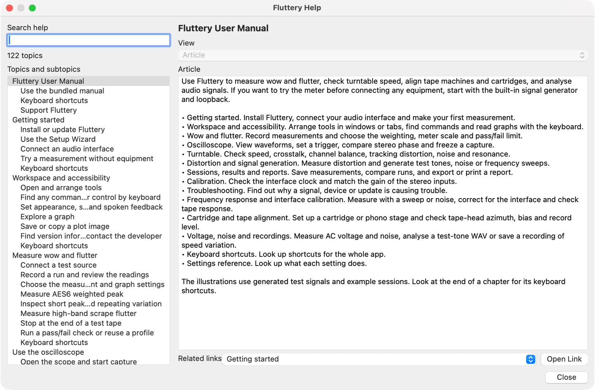
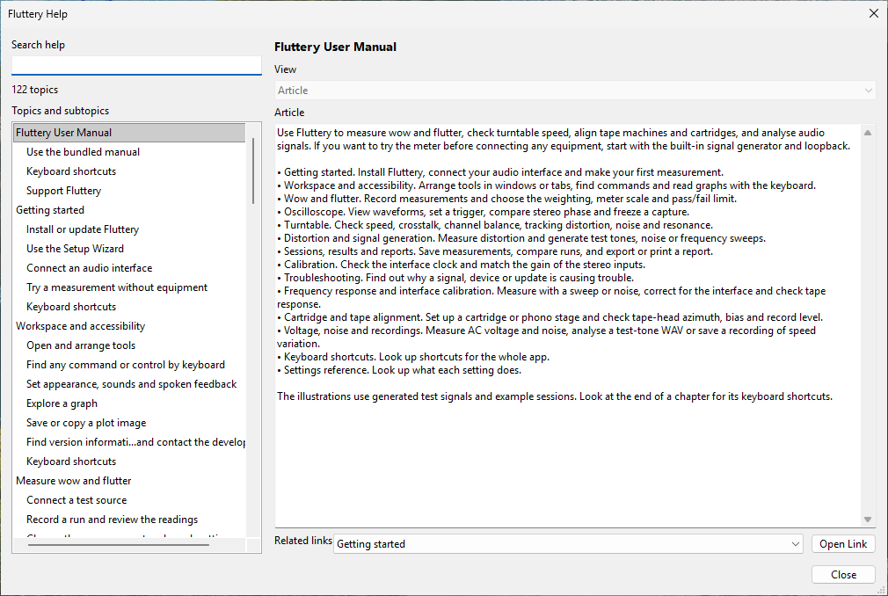
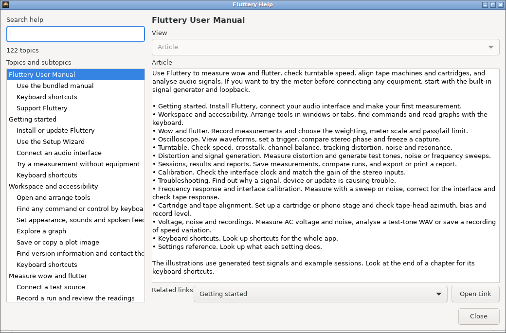
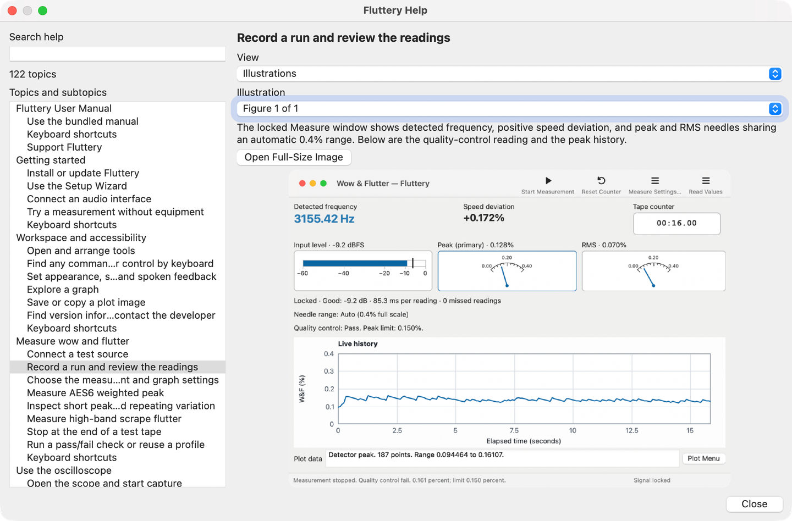
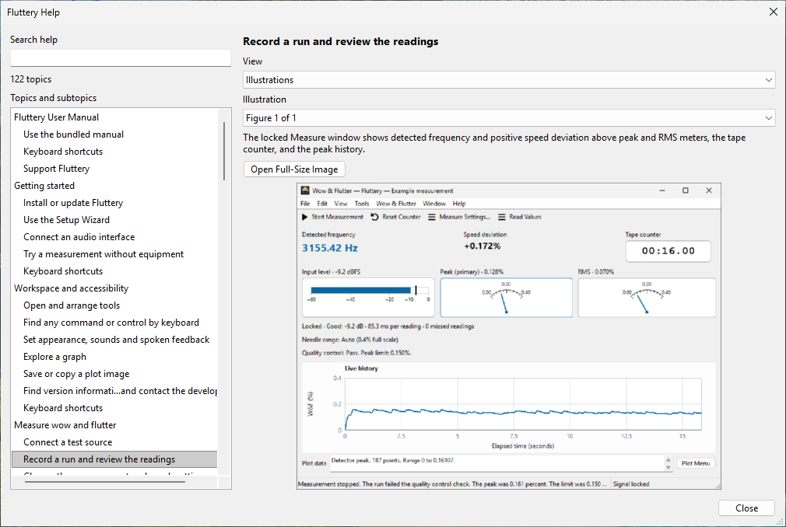
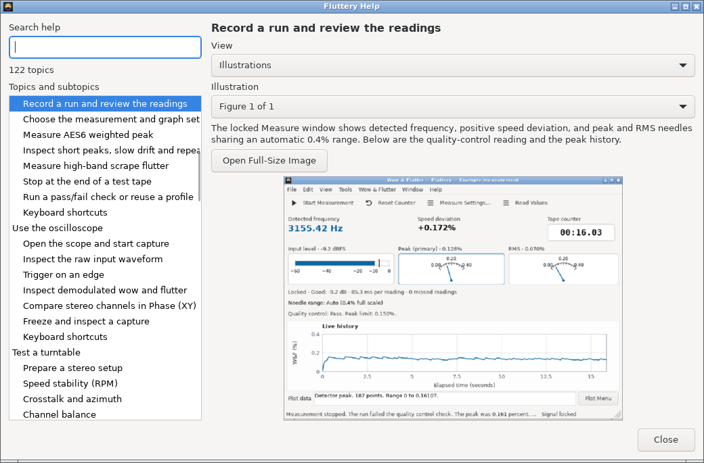

# Fluttery User Manual

Use Fluttery to measure wow and flutter, check turntable speed, align tape machines and cartridges, and analyse audio signals. If you want to try the meter before connecting any equipment, start with the built-in signal generator and loopback.

- [Getting started](01-getting-started.md). Install Fluttery, connect your audio interface and make your first measurement.
- [Workspace and accessibility](02-workspace.md). Arrange tools in windows or tabs, find commands and read graphs with the keyboard.
- [Wow and flutter](03-measure.md). Record measurements and choose the weighting, meter scale and pass/fail limit.
- [Oscilloscope](04-scope.md). View waveforms, set a trigger, compare stereo phase and freeze a capture.
- [Turntable](05-turntable.md). Check speed, crosstalk, channel balance, tracking distortion, noise and resonance.
- [Distortion and signal generation](06-signals.md). Measure distortion and generate test tones, noise or frequency sweeps.
- [Sessions, results and reports](07-results.md). Save measurements, compare runs, and export or print a report.
- [Calibration](08-calibration.md). Check the interface clock and match the gain of the stereo inputs.
- [Troubleshooting](09-troubleshooting.md). Find out why a signal, device or update is causing trouble.
- [Frequency response and interface calibration](10-frequency-response.md). Measure with a sweep or noise, correct for the interface and check tape response.
- [Cartridge and tape alignment](10-alignment.md). Set up a cartridge or phono stage and check tape-head azimuth, bias and record level.
- [Voltage, noise and recordings](11-bench-levels.md). Measure AC voltage and noise, analyse a test-tone WAV or save a recording of speed variation.
- [Keyboard shortcuts](90-keyboard-shortcuts.md). Look up shortcuts for the whole app.
- [Settings reference](91-settings-reference.md). Look up what each setting does.

The illustrations use generated test signals and example sessions. Look at the end of a chapter for its keyboard shortcuts.

## Use the bundled manual

1. Open **Help > Fluttery Help**.
2. Type a term such as `rumble`, `loopback` or `paper size` in **Search help**. Fluttery searches titles and article text.
3. Choose an item in **Topics and subtopics**. The **Article** view includes the instructions, the figure descriptions and the contents of any tables.
4. Use **View** to switch to **Illustrations** or **Reference tables**, where available. **Open Full-Size Image** opens the selected picture in your image viewer. When reading a table, use **Selected row** to read the full text of the current row.
5. To follow a cross-reference, select it under **Related links** and choose **Open Link**. Clear the search box to see the full contents again.

<!-- figures -->
<!-- platform: macos -->

<!-- endplatform -->

<!-- platform: windows -->

Windows illustration

<!-- endplatform -->

<!-- platform: linux -->

Linux illustration

<!-- endplatform -->

<!-- platform: macos -->

<!-- endplatform -->

<!-- platform: windows -->

Windows illustration

<!-- endplatform -->

<!-- platform: linux -->

Linux illustration

<!-- endplatform -->
<!-- endfigures -->

## Keyboard shortcuts

| Command | macOS | Windows and Linux |
| --- | --- | --- |
| Find a topic or select the current search text | `Command+F` | `Control+F` |
| Open the manual from a Fluttery window | `F1` | `F1` |
| Move through Search, Topics and the current pane | `F6` or `Shift+F6` | `F6` or `Shift+F6` |
| Move from Search to the topic results | `Return` | `Return` |
| Choose a topic or subtopic | `Up Arrow` or `Down Arrow` | `Up Arrow` or `Down Arrow` |
| Close the manual | `Escape` | `Escape` |

## Support Fluttery

If you like Fluttery and you’d like to support my work, you can [make a donation](https://www.paypal.com/donate/?hosted_button_id=WMLX4PLED9PRE). There’s no pressure or hard sell. Fluttery is and always will be free.
